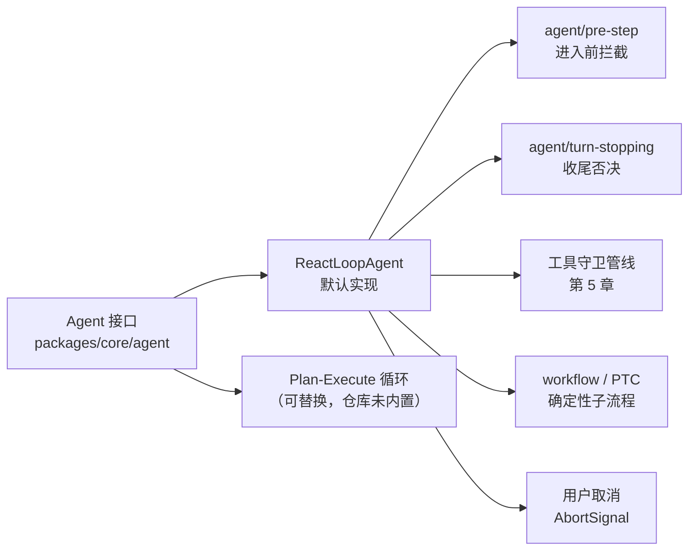
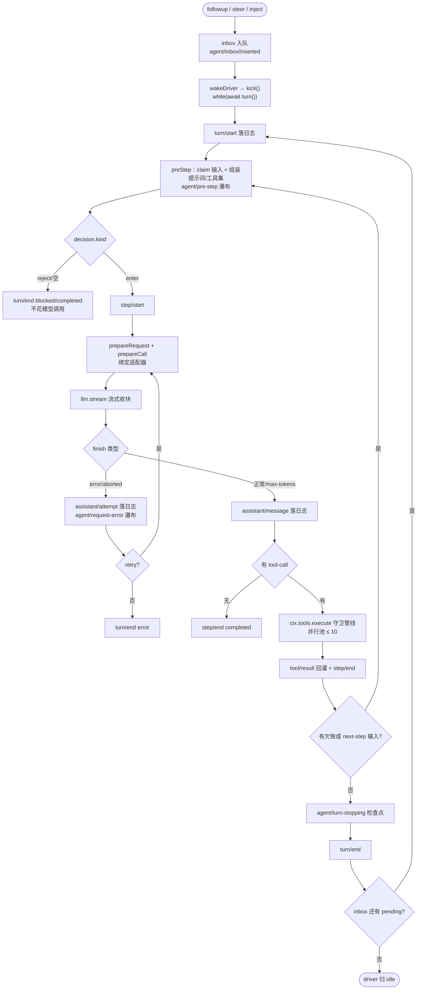
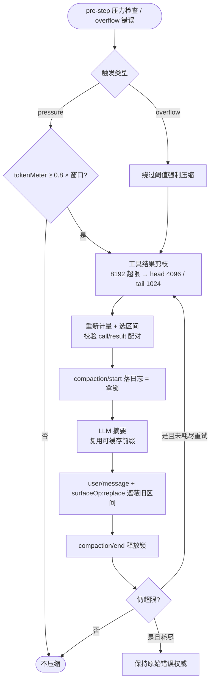
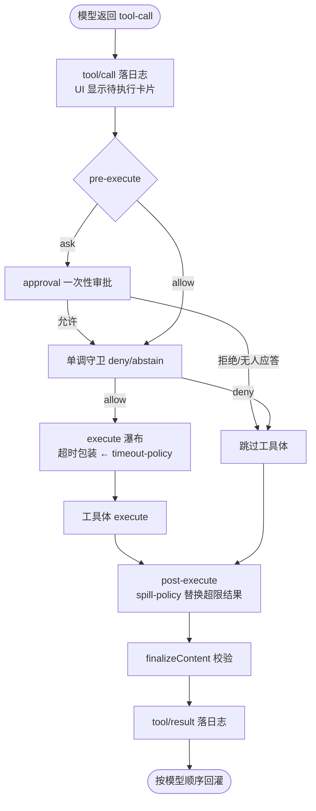
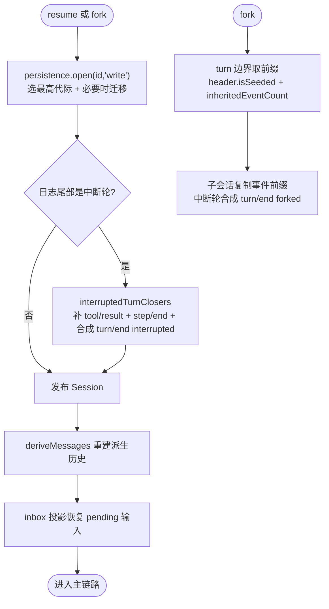
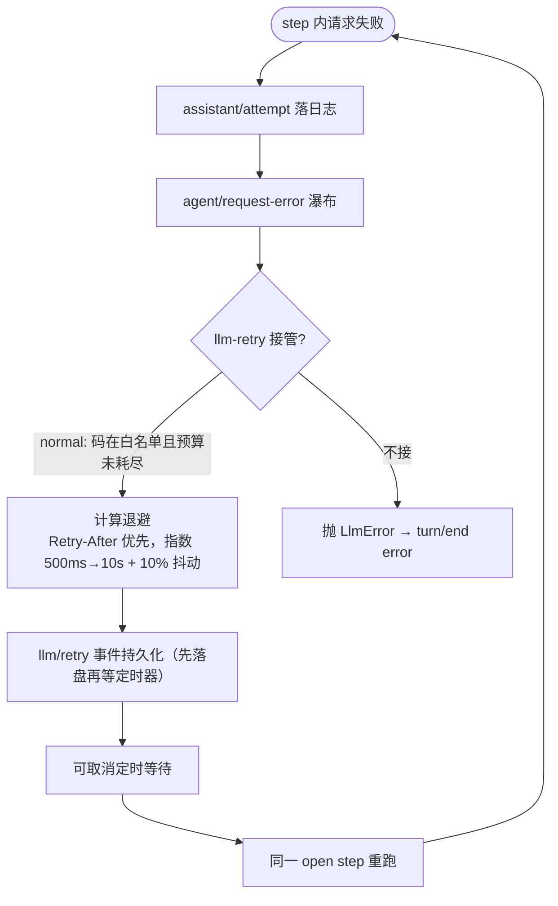
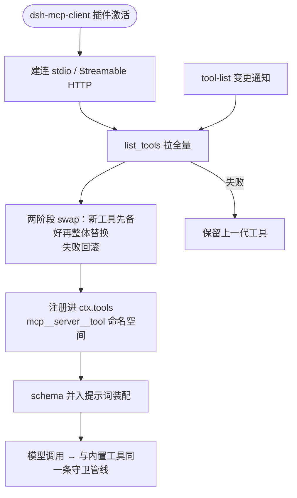
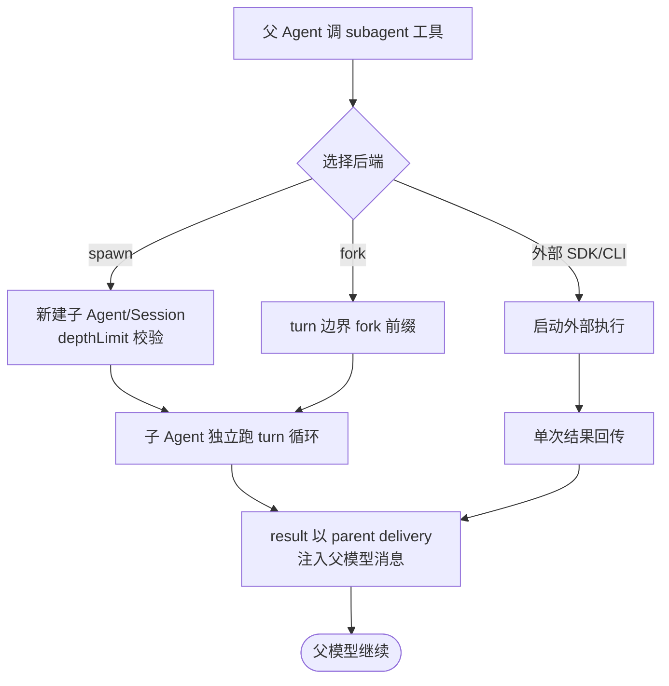
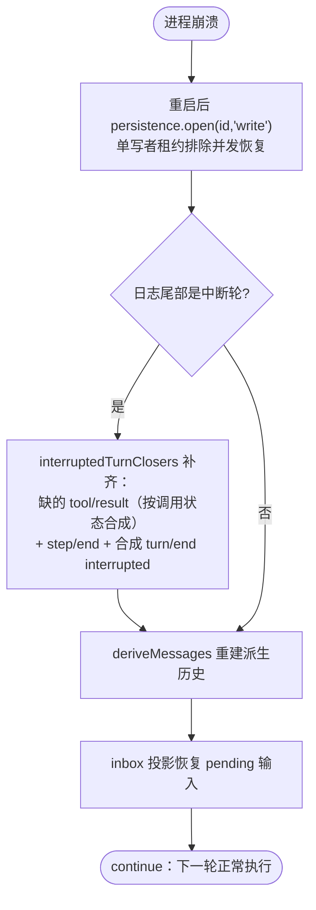

# deepseek-harness

> 以 DeepSeek Harness 为案例的 Agent 架构实现剖析

## 本书说明

**这本书讲什么**：以 DeepSeek 官方开源的 Agent Harness（`dsh`）为贯穿案例，讲透 Agent 运行时的六个技术面——主循环、上下文工程、工具系统、提示词、模型接入、持久化与可靠性。本书的写作线索是：每个技术点上业界有哪几种做法、dsh 选了哪一种、代价是什么。读完你应当既能系统掌握 Agent 架构的知识体系，也能把书中的方案直接当作自己系统的设计参考。

**适合谁读**：
- 只想了解这个项目的人 → 读第 1 章 + 第 14 章
- 想系统学习 Agent 架构的人 → 按顺序读，第 2–6 章是重心
- 只想查某个具体机制的人 → 直接跳章：压缩与上下文见第 4 章，工具守卫管线见第 5 章，KV cache 友好的提示词见第 6 章，崩溃恢复见第 12 章

**案例项目**：
- GitHub：https://github.com/deepseek-ai/deepseek-harness
- 主语言：TypeScript（Node.js ≥ 24.9，全仓 ESM；另附 Python SDK）
- 一句话定位："一切皆插件"的编码 Agent 运行时——模型适配、工具注册表、会话日志甚至 Agent 主循环本身都是 Cordis 框架上可替换的插件，核心卖点是可组合性 + 事件溯源式会话 + 工程级可靠性

## 代码地图

本书引用的核心文件（这是导航，不是目录树）：

| 文件 | 职责 | 相关章节 |
|---|---|---|
| `packages/core/agent-loop/src/agent.ts` | `ReactLoopAgent`：turn/step 主循环、重试、取消 | 第 2、3 章 |
| `packages/core/agent-loop/src/inbox.ts` | durable 收件箱：followup/steer/inject 三种输入 | 第 3 章 |
| `packages/core/session/src/index.ts` | append-only 事件日志、`deriveMessages()` 历史投影 | 第 4、7 章 |
| `packages/core/session/src/types.ts` | `SessionEvent` 事件词汇表 | 第 4、7 章 |
| `packages/core/tools/src/index.ts` | 工具注册表与守卫执行流水线 | 第 5 章 |
| `packages/core/tools/src/schema.ts` | `defineTool` JSON-value schema DSL | 第 5 章 |
| `packages/core/system-prompt/src/index.ts` | 分节注册式提示词装配 | 第 6 章 |
| `packages/llm/llm/src/index.ts` | `ctx.llm` seam、适配器契约、StreamChunk | 第 9 章 |
| `packages/llm/llm-retry/src/index.ts` | 请求失败分类与重试策略 | 第 3、9 章 |
| `packages/compaction/compaction-basic/src/index.ts` | 双触发分层压缩（含 `config.ts` 阈值） | 第 4 章 |
| `packages/session/session-persistence-jsonl/src/storage.ts` | JSONL 落盘、代际管理、写租约 | 第 7、12 章 |
| `packages/mcp/mcp-client/src/index.ts` | MCP server 接入与工具并入 | 第 10 章 |

---

## 第一部分 认识这个系统

## 1. 案例项目全景：一个把"内核"也做成插件的 Agent 运行时

> **本章导读**：dsh 在 Agent 技术版图上处于什么位置？它替代了哪些人工流程与自研工作？本章给出系统形态、一次请求的鸟瞰和全书的设计取向总表，后续每一章都是这张表的展开。

### 1.1 问题域：Agent 框架的四个"写死"

不用 Agent 框架、直接调 LLM API 写一个编码助手，初版只要几十行：拼消息、调模型、解析 tool-call、执行、回灌、循环。真正的成本发生在第二个月之后，问题集中在四处"写死"：

1. **执行环境写死**。工具实现直连本地磁盘和进程。要换成容器、SSH 远程或受限沙箱，每个工具都要改一遍。
2. **上下文管理写死**。历史就是内存里的消息数组。程序崩溃，一切归零；上下文超限，只能粗暴截断。
3. **主循环写死**。模型选择、终止条件、重试逻辑焊死在循环体里。换 provider 或调整终止策略要改核心代码。
4. **过程不可追溯**。模型为什么这么答，事后无法从持久化数据重建当时的完整请求——工具结果、提示词版本、重试尝试都只存在于内存。

这四个写死对应的解法，正是本书第 2–7 章的主线：能力接缝解执行环境（5.5 节）、事件溯源解上下文与状态（第 4、7 章）、插件化解循环（第 2 章）、"模型可见即已记录"解可追溯（第 12 章）。

### 1.2 系统形态

dsh 是一个**运行时（harness）而非框架（framework）**：你把任务交给它，它跑起来；而不是你 import 它的库自己写循环。产品形态按 profile 划分：

| profile | 形态 | 定位 |
|---|---|---|
| `web` | 本地 Web 服务 + 浏览器 GUI | 日常交互主力，默认 `127.0.0.1:3080` |
| `headless` | 单次任务 CLI | `dsh headless "task"`，答案打到 stdout |
| `sdk` / `sdk-minimal` | stdio JSON-RPC 服务 | 被其他程序嵌入 |
| `acp` | Agent Client Protocol 服务 | 自动化客户端专用 |
| `desktop` | Electron 桌面端 | 复用 Web 应用，由桌面宿主拉起 |

单 Agent 为主（ReAct 循环），子代理与工作流为可选能力（第 11 章）。输出全程流式，Web 端通过 WebSocket 复用流订阅会话事件。

### 1.3 一次请求的鸟瞰

```text
用户输入（Web 输入框 / headless 参数 / SDK prompt）
   │  session/prompt → 投递到 Agent 收件箱
   ▼
AgentLoop（ReactLoopAgent）                    ← packages/core/agent-loop/src/agent.ts
   │  turn：claim 输入 → 装配提示词 + 工具 schema → agent/pre-step 瀑布
   │  step：agent/request → llm.stream 流式收块 → assistant/message 落日志
   ▼
工具执行流水线                                  ← packages/core/tools/src/index.ts
   │  tools/pre-execute → 守卫 → approval → execute → post-execute
   ▼
会话日志（append-only JSONL）                   ← packages/core/session/src/index.ts
   │  派生模型历史 deriveMessages()、投影到 UI、落盘
   ▼
客户端渲染（订阅 session/follow 事件流）
```

两个特征值得先记住。第一，**图里没有任何一步是"拼 prompt 字符串"**：模型历史是从事件日志投影出来的（第 4 章）。第二，**工具执行前先落 `tool/call` 日志**——这是"模型可见即已记录"约束的体现（第 12 章展开）。

### 1.4 设计取向总表

这张表是全书的纲领，每行对应后面一章：

| 维度 | 本项目选择 | 被放弃的备选 | 代价 | 详见 |
|---|---|---|---|---|
| 框架底座 | Cordis 插件框架：服务按 `ctx` 键声明、事件瀑布、注册可逆卸载 | 硬编码内核 + 钩子 | 概念负担重（五种派发模式、scope、seam 三角色） | 第 2 章 |
| 编排范式 | ReAct 自由循环，turn/step 二级状态机，**无内置轮数上限** | Plan-Execute / 图编排 | 失控风险交给守卫与用户策略兜底 | 第 2、3 章 |
| 上下文来源 | 会话日志投影派生消息（模型可见即已记录） | 内存消息数组 | 每条消息带 `surfaceOp` 元数据；写放大 | 第 4 章 |
| 压缩策略 | 双触发（压力 0.8 阈值 + 溢出恢复）、先规则剪枝再 LLM 摘要 | 滑动窗口截断 | 摘要不可逆；压缩使 KV cache 从遮蔽点失效 | 第 4 章 |
| 工具加载 | 全量注入当前 scope 可见 schema，scope 分层裁剪 | 检索式按需加载 | 工具多时 schema 逐 step 重复付费 | 第 5 章 |
| 系统提示词 | 走 `system/message` 历史节点（in-history 追加） | 请求字段原地替换 | 旧提示词版本持续付费直到压缩 | 第 6 章 |
| 记忆 | 无独立记忆层，会话日志即全部状态 | 向量库长期记忆 | 无跨会话召回 | 第 7 章 |
| RAG | 无实现；检索以 `web_search`/`web_fetch` 工具形式存在 | 向量库 RAG 管线 | 私有知识检索要自己补 | 第 8 章 |
| 模型接入 | 自有 adapter seam，必实现方法仅 `stream()`；DeepSeek 系适配器 | LiteLLM 全家桶 | 生态窄 | 第 9 章 |
| 多 Agent | 主从星型，`ctx.subagents` 一个 seam 统一五类后端 | 图编排多 Agent | 父只见子结论，过程不可见 | 第 11 章 |
| 可靠性 | 事件溯源 + 中断轮自动补齐 + 写租约 | 定期 checkpoint 快照 | 日志体积；JSONL 非为分析型查询设计 | 第 12 章 |

### 1.5 小结

- dsh 的四个"写死"（执行环境、上下文、主循环、可追溯性）对应四条设计主线，全书按此展开。
- 它是运行时不是框架：以 profile 组织产品形态，`web`/`headless`/`sdk`/`acp` 共享同一棵插件树。
- 设计取向总表是理解全书的索引：每个选择都有被放弃的备选和明确的代价，没有免费午餐。

## 2. Agent 范式与选型逻辑：为什么主循环本身也是插件

> **本章导读**：ReAct 凭什么成为默认范式？它在什么情况下会崩？dsh 的主循环是一个可整体替换的插件，这个设计背后的选型逻辑是什么？本章给出五种范式的选型矩阵。

### 2.1 从 prompt 到 agent 的三要素

一段 prompt 调一次模型，是"问答"；加上**循环**（模型输出能触发下一轮）、**工具**（模型能改变外部世界）、**状态**（多轮之间有连续性），才成为 agent。三者缺一不可：没有循环，模型只能一次想完所有步骤；没有工具，它只能空谈；没有状态，每一步都失忆。

### 2.2 五种范式与失效模式

| 范式 | 核心机制 | 优势 | 失效场景 |
|---|---|---|---|
| ReAct | 推理与行动交替，模型每轮自决下一步 | 错误可归因（每步可观察）、可中断、可人工纠偏 | 长任务中推理链发散、重复试错、局部最优打转【业界】 |
| Plan-and-Execute | 先产出完整计划，再逐步执行 | 全局视野、计划可审查 | 计划僵化，环境变化后需重规划机制；token 双倍 |
| Reflection | 自我批评回路 | 提升单任务质量 | 无限反思；批评本身错误时越改越差 |
| 图编排（Workflow Graph） | 节点 + 边 + 条件分支 | 不确定性收敛到少数节点；可测试、可观测 | 流程事先不可枚举时无法建模 |
| 纯 Workflow | 固定流程，不用模型决策 | 确定性、可复现 | 步骤不可枚举或分支爆炸的任务 |

选型四维对照：**可预测性**（Workflow > 图编排 > Plan-Execute > ReAct）、**灵活性**（ReAct 最高）、**调试成本**（Workflow 最低）、**token 成本**（ReAct 只按需推进最省，Plan-Execute 规划执行双份）。经验法则：步骤可枚举且错误代价高 → Workflow；需要全局计划但环境稳定 → Plan-Execute；其余默认 ReAct【业界】。

### 2.3 dsh 的选择：ReAct 循环，且循环本身是插件

dsh 选 ReAct，但做了一个罕见的设计：**主循环不是内核，而是实现了 `Agent` 接口的一个默认插件**（`dsh-agent-loop`）。接口在 `packages/core/agent`（`ctx.agents` 注册表 + `agent/*` 事件），默认实现在 `packages/core/agent-loop`（`ReactLoopAgent`）。理论上可以用实现同一接口的 Plan-Execute 循环整体替换它，调用方（session API、Web UI）无感。

这个选择的理由链是：

1. **场景匹配**。编码任务的主导形态是"读代码 → 改一处 → 跑测试 → 修下一处"——下一步依赖上一步结果，事先无法枚举，ReAct 是自然选择。
2. **ReAct 的失效模式需要外挂治理，而外挂点必须内建**。ReAct 会打转、会失控，所以 dsh 把治理做成了循环上的四个挂点：`agent/pre-step`（进入前拦截/改写）、`agent/turn-stopping`（收尾前否决）、工具守卫管线（第 5 章）、用户取消。无轮数上限的胆量来自这里——失控治理是策略插件的职责，不是内核写死的数字（第 3 章展开）。
3. **图编排没有消失，而是被降维成能力**。固定流程的需求由 workflow 工具承接（`packages/workflow`，在沙箱内跑确定性流程），PTC 模式则把多步工具链压缩成一次代码执行（5.5 节）。也就是说：dsh 不在"范式"层面二选一，而是让 ReAct 主循环按需调用确定性子流程。



**一个容易混淆的点：插件组合不等于工具选择**。两者都是"挑一批东西"，但机制完全不同：

| 维度 | 插件组合 | 工具选择 |
|---|---|---|
| 谁决定 | 人/运维，改配置文件（patch yml） | 模型，每个 step 自己决定调哪个 |
| 何时定 | 启动时一次定型（整棵插件树） | 运行中逐步动态（每次请求带当前可见 schema） |
| 粒度 | 服务级：换的是"执行世界"（LLM 适配器、沙箱、会话存储、主循环） | 能力级：加的是模型可调用的具体函数 |
| 组合方式 | 分层叠加：profile 的 bundles → 各层 patch 按序覆盖，同 id 后层胜 | scope 分层裁剪 + `{when}` 条件注册，模型只看到最终可见集 |

准确的图景是：**插件树在启动时定型，树上的工具集可以在运行中变化**。MCP 工具就是这条动态缝隙——server 连上后运行时发现并注入注册表（第 10 章）；配置层另有 HMR 支持不重启改配置。类比：插件像机房里装哪些设备（换电源、换机柜），工具像操作员桌面上放哪些工具。

### 2.4 反范式：dsh 明确不用 agent 的地方

两处值得注意的"不用模型决策"：会话标题生成是独立的一次性调用（headless/sdk profile 直接禁用），不进主循环；`fs-observation-policy` 的"先读后改"检查是确定性事件门，不靠模型自觉（5.4 节）。当一个决策可以枚举为规则时，dsh 一律选规则。

### 2.5 权衡与边界

**好处**：换循环不改内核；ReAct 失效模式有内建挂点；确定性需求有 workflow/PTC 出口。
**代价**：`Agent` 接口是强契约，新循环要完整实现 inbox、resume、事件语义——成本不低；仓库未内置第二种循环，"可替换"停留在架构保证层面【推断，未在代码中确认替代实现的成熟度】。
**什么场景别这么用**：任务流程完全固定（如每天定时报表）时，直接写 Workflow，ReAct 循环是纯开销。

### 2.6 小结

- ReAct 的优势是错误可归因、可中断、可纠偏；失效模式（发散、打转）决定了必须有外挂治理点。
- dsh 的独特之处是循环即插件：`Agent` 接口与实现分离，治理挂点（pre-step / turn-stopping / 守卫 / 取消）是接口的一部分。
- 图编排与确定性流程没有消失，而是降维为 ReAct 循环内可调用的工具能力。

---

## 第二部分 运行时内核

## 3. 主循环的工程实现：一个没有轮数上限的循环靠什么不失控

> **本章导读**：一个 while 循环看起来简单，为什么工程上到处是坑？本章拆解 dsh 的 turn/step 二级状态机：输入接入、装配、流式调用、工具批执行、终止与异常，重点讲它"无内置轮数预算"的胆量从哪来。

### 3.1 循环骨架与两级状态机

最小骨架只有五行：取输入 → 调模型 → 有工具则执行并回灌 → 判断是否继续 → 终止。工程复杂度全部藏在细节里。dsh 用两个术语切分粒度：**step = 一次模型请求 + 它触发的工具批**；**turn = 0..n 个 step**，从首次取输入开始到没有欠账结束（`packages/core/agent-loop/src/agent.ts` → `ReactLoopAgent`，内部 `kick()` 驱动 `turn()`）。



### 3.2 单轮状态与输入接入

三种输入共用一个 durable 收件箱（`packages/core/agent-loop/src/inbox.ts`）：`followup()` 排队等下一轮、`steer()` 插入当前轮的下一步、`inject()` 由插件注入运行时上下文（技能目录、文件变更提醒等）。每次增删产生 `agent/inbox/spliced` 事件并折叠进投影——**进程死后 pending 输入依然可读**。注入的上下文要等下一条"唤醒消息"才被 claim，不会单独触发模型调用。

单轮状态构成：消息由日志派生（不存内存数组，见第 4 章）、turn/step 计数、`turnEnds` 终止标记、工具结果欠账、token 计量（`ctx.tokenMeter`）。模型选择在 preStep 时快照，重试期间保持不变。

### 3.3 终止条件：四道闸门

| 闸门 | 实现 | 失效场景与对策 |
|---|---|---|
| 模型自决 | finish 正常且无 tool-call | 模型误判"做完了" → 工具可用 `concluded` 标记宣告收尾；`agent/turn-stopping` 串行检查点可否决收尾 |
| 计数上限 | **无内置轮数上限**（README 明示 no built-in turn budget） | 需要预算时部署策略插件挂 `agent/turn-stopping`，或配置 goals 的 `defaultMaxGoalRounds`（默认 256 轮，`packages/goal/goal`） |
| 重复动作检测 | `dsh-repeat-tool-reminder`：同工具+同参数第 3/5/8 次升级提醒（`packages/bundle/base/cordis.patch.yml` → `thresholds: [3,5,8]`） | advisory 不阻断，防误杀探索性重复；只识别精确重复【业界常见做法】 |
| 用户取消 | `agent.cancel()` → AbortSignal，`turn/end` reason 记 `aborted` | 取消默认清空收件箱（`keepInbox` 可保留） |

`TurnEndReason` 全集：`completed` / `max-tokens`（粘滞：一旦发生，后续 step 不得降级 turn 结果）/ `blocked`（pre-step 拒绝）/ `aborted` / `error` / `forked`（仅 fork 写入）。`interrupted` 是唯一不由循环发出的 reason——留给崩溃恢复写入（第 12 章）。

**闸门语义需要澄清：四道闸门不是并列的"或"关系**。turn 正常收尾的唯一路径是"模型自决停止 → turn-stopping 检查点放行 → `turn/end completed`"；取消与报错是异常路径；重复提醒根本不是终止条件（advisory，提醒完继续跑）。也就是说，"任务做没做完"的实际判定者只有两个：模型自觉，以及可选的策略插件。这带来一个硬币两面的风险——**过早终止**：模型觉得"差不多了"就停，任务实际没做完，这是所有 ReAct agent 的共同弱点。dsh 的缓解手段：turn-stopping 策略可在收尾前检查"todo 有未完成项吗？goal 达成了吗？"并否决收尾（默认部署未内置，需自建）；`create_goal` 声明的目标未达成时会发 continuation 输入把循环拉回来；交互场景里用户一句 `followup` 即可续跑。死循环与提前收工是同一个判断（"这轮该不该停"）在两个方向上的错误——模型越弱，两个方向都错得越多。这正是 dsh 敢砍轮数上限的深层原因：加计数上限只解决"停"，不解决"停得对"。

### 3.4 并行工具调用与异常分类

**并行**：循环把整个原始调用批交给 `ctx.tools.execute()`，执行器按 `ToolDefinition.isConcurrencySafe(args)` 分成并行/独占两组滚动执行，上限 `maxParallelToolCalls` 默认 **10**（`packages/core/agent-loop/src/constants.ts`），屏障按模型顺序排列，**结果严格按模型顺序落 `tool/result`**——保证历史可重放。

**异常四类**：

| 类别 | 处理 |
|---|---|
| 模型错误（finish=error/aborted） | 失败尝试落 `assistant/attempt`（不进模型历史）→ `agent/request-error` 瀑布 → llm-retry 决定重试或抛 `LlmError` |
| 工具错误 | 错误作为结果回灌给模型自行决策，不重试；step 失败时未答调用补合成结果（`TOOL_OUTCOME_UNKNOWN` 等） |
| 解析/参数错误 | `ToolArgsError(INVALID_ARGS)` 走普通错误结果 |
| 上下文超限 | `CONTEXT_WINDOW_EXCEEDED` 类错误由压缩插件优先接管，压缩后返回 retry（第 4 章） |

重试的关键工程决策：**重试发生在同一个 open step 内**，重跑请求但不重跑 pre-step 装配、不重复落 user 消息；每次重试先落 durable `llm/retry` 事件再等定时器——崩溃不会留下隐形挂起重试（`packages/llm/llm-retry/src/index.ts`）。

### 3.5 中断与恢复

用户打断后：已流出的文本定稿为 `interrupted: true` 的 assistant 消息，未派发的调用补合成结果。进程崩溃后：resume 时 `interruptedTurnClosers()` 补齐缺失的 `tool/result`、`step/end` 和合成 `turn/end { reason: 'interrupted' }`（第 12 章详述）。

### 3.6 权衡与边界

**好处**：无预算上限让长任务不被腰斩；重试不污染历史；并行结果保序可重放。
**代价**：失控治理责任转移给部署者——不装策略插件、不管任务的部署可能被无限循环烧钱；advisory 守卫只能提醒不能阻断。
**什么场景别这么用**：无人值守的自动化（ACP profile）务必配置轮数预算或 cost 策略，否则一个打转的循环没有天然止损。

### 3.7 小结

- turn/step 两级状态机把"一次模型请求"与"一轮对话"解耦，重试、压缩、多步工具链都在 step 粒度内消化。
- 终止靠四道闸门而非单一计数：模型自决 + 工具 concluded + turn-stopping 检查点 + 重复提醒 advisory，轮数预算留给部署者。
- 重试在 open step 内进行且先落持久事件，这是"不重复记历史"与"崩溃不留隐形重试"两个目标的交点。

## 4. 上下文工程：模型历史不是攒出来的，是从日志投影出来的

> **本章导读**：为什么"多给点上下文"反而是错的？dsh 把这个问题推到极端——模型可见的一切必须先落日志，历史是日志的纯投影。本章讲 token 经济学、投影式上下文、双触发分层压缩与 spill 溢出机制。

### 4.1 token 经济学：多轮 Agent 的成本平方律

Agent 每轮都要重发全部历史，总 token 成本随轮数近似平方增长；窗口上限（如 128K）不是可用工作预算——工具输出、系统提示词、历史消息挤在同一窗口里，预算必须提前规划【业界】。dsh 的对应物是 `ctx.tokenMeter`：基于日志重放的确定性估算，文本用固定启发式 `CHARS_PER_TOKEN = 4`（`packages/llm/token-meter/src/estimate.ts`），每 block 开销 4、每角色开销 4，provider 上报的 usage 只在请求 envelope 完全一致时才复用为锚点。它是决策用估算，不是计费级精度。

### 4.2 注意力衰减与"模型可见即已记录"

长上下文中间位置的召回显著弱于首尾（lost in the middle）【业界】。这给上下文工程的含义是：重要信息放首尾、工具原始大输出必须离场。dsh 把这条推进成一条架构硬约束——**模型可见即已记录（Model-visible means logged）**：模型历史不是内存里攒的消息数组，而是 `Session.deriveMessages()` 从 append-only 事件日志投影出来的纯函数结果（`packages/core/session/src/index.ts`）。只有带 `surfaceOp` 的消息类事件进入"表面"（surface），turn 边界、流 chunk、失败尝试（`assistant/attempt`）天然被排除。

```text
[单次模型请求的构成]
  ├→ header.config                  ← request/header 事件（provider/model/effort/maxTokens）
  ├→ deriveMessages() 派生历史
  │    ├→ system/message            ← 提示词即历史节点（第 6 章）
  │    ├→ user/message              ← 人工输入 / inject 注入 / 压缩检查点
  │    ├→ assistant/message         ← 内嵌完整压缩流 + usage；空内容不进历史
  │    └→ tool/result（配对 tool/call）
  └→ header.tools + toolHistory()   ← 工具增删以 developer/message 记录
```

投影式设计直接换来四件事免费：崩溃恢复（重放日志即可）、fork（复制事件前缀）、审计（任何请求可重建）、以及压缩的正确性基础——"遮蔽"是可验证的日志操作而非内存改写。

### 4.3 压缩四法与 dsh 的分层选择

压缩的本质是丢信息，丢法只有四类【业界】：

| 压缩法 | 信息保留度 | token 收益 | 失效场景 |
|---|---|---|---|
| 截断 | 低 | 高 | 丢掉仍被引用的前提 |
| LLM 摘要 | 中 | 中 | 多轮摘要后失真 |
| 结构化抽取 | 高（决策）/低（细节） | 高 | 任务需要原文细节 |
| 外部化 + 检索 | 高 | 高 | 检索不回来 |

dsh 的选择是**分层组合**，顺序刻意设计：

1. **先确定性剪枝**（外部化思想的变体）：`dsh-compaction-tool-result-pruner` 对超限工具结果做 head/middle/tail 剪枝，默认 `thresholdChars: 8192`、保留头 4096 / 尾 1024 字符（按 Unicode code point 切），中段替换为 `[... tool result middle pruned ...]` 标记。逐处落 `compaction/prune` 计价事件。这一步**可能无需 LLM 就完成收缩**。
2. **仍超限才 LLM 摘要**：选摘要区间（从第一个非 system 表面节点开始，尾部 verbatim 保留至少 `retainTokens`，不拆 tool-call/result 配对）→ 调模型生成摘要 → 摘要以带 `surfaceOp:{op:'replace'}` 的 `user/message` 落日志，遮蔽旧区间——这是全系统唯一的表面收缩操作。摘要输出要求固定 Markdown 结构（Primary Intent / Key Concepts / Files / Errors / Pending / Current Work / Next Step / Critical Context），偏向结构化抽取而非散文摘要。
3. **第三条腿是 spill**：单个工具结果超限（部署示例 `maxInlineTokens: 12500`）时整篇落盘，模型内联收到头尾预览 + 文件定位符 + 检索提示（`packages/spill/spill-policy`）。保存失败保留原结果，不把成功调用变成 isError。

摘要调用的成本设计值得一提：`summarizeWithLlm` 重放上一请求的可缓存前缀（system 头 + 工具 schema + 区域消息）再把指令作为最后一条 user 消息——**复用 KV cache 降低摘要成本**；且摘要估算 token 必须小于被遮蔽区域的计价，否则拒绝执行。

### 4.4 触发与保留策略

双触发（`packages/compaction/compaction-basic/src/config.ts`）：

| 触发 | 挂点 | 默认参数 |
|---|---|---|
| pressure（压力） | `agent/pre-step` | 阈值 `thresholdRatio` 0.8 × 窗口；`headroomTokens` 65536；verbatim 尾部保留 `retainRatio` 0.16；均按 `modelPolicies`（provider+model）可覆盖 |
| context-overflow（溢出） | `agent/request-error`，仅 `CONTEXT_WINDOW_EXCEEDED` 类错误 | 绕过阈值强制压缩，`maxOverflowRetries` 默认 1 |

保留策略：尾部 16% 原文保留（最近上下文是模型最需要的）；压缩区间边界强制 tool-call/result 配对（拆对会产生模型无法理解的孤儿消息）。压缩以 `compaction/start`/`end` 事件对实现锁——崩溃可检出孤儿锁。恢复重试只在"表面替换代际前进"时返回 retry，`compactionRetries` 默认 1，避免无意义重试循环。



### 4.5 权衡与边界

**好处**：确定性剪枝前置省掉大量不必要的 LLM 摘要；投影保证压缩操作可验证可重放；spill 让超大输出不丢信息。
**代价**：摘要不可逆（旧事件物理保留但模型看不到）；每次压缩使 KV cache 从遮蔽点起失效——项目明确接受此代价换正确性；单条超大消息或 envelope 本身超限无法靠表面压缩修复。
**什么场景别这么用**：上下文管理要"每条消息都精确"的任务（如逐条款合同审阅）不适合摘要压缩，应改用外部化（写入文件按需读回）。

### 4.6 小结

- "模型可见即已记录"是 dsh 上下文工程的根约束，投影式历史让恢复/fork/审计/压缩全部受益。
- 压缩不是单一算法而是分层：规则剪枝（可能免 LLM）→ 结构化摘要（KV cache 复用 + 摘要必须更小）→ spill 外部化。
- 双触发 + 尾部 16% verbatim 保留 + 配对边界校验，构成"防患于未然"与"溢出可恢复"的完整闭环。

## 5. 工具系统：45+ 个工具为什么还敢全量注入

> **本章导读**：工具是给模型用的接口，为什么"写清楚"比"写得多"重要？本章拆解 dsh 的 schema DSL、注册发现、守卫执行流水线与并发调度，并回答一个反直觉问题：它为什么不做检索式工具加载。

### 5.1 工具即接口：模型只能看见 schema

模型理解工具的唯一途径是请求里的 `name/description/parameters` 三元组——执行逻辑、超时、权限全部不可见【业界】。dsh 在类型层面强制了这一点：`ToolDefinition` 的 `execute/output/timeoutMs/isConcurrencySafe` 等字段永不进请求，`schemas()` 白名单只放行三个模型可见字段（`packages/core/tools/src/index.ts`）。调度元数据泄漏给模型在这类设计里是编译期不可能的。

schema 本身是自研 JSON-value DSL（`defineTool`，`packages/core/tools/src/schema.ts`）：参数为隐式开放对象 + 每属性必填；显式 object 必须声明 `additionalProperties`；**输出必须有 `output.schema` 做强校验**——工具返回什么结构，注册时就锁死。

### 5.2 注册与发现：scope 分层而非检索

注册即插件在 `apply()` 里调 `ctx.tools.register()`，scope 分两层：全局层 / agent preset 层，近层同名者胜，重复注册抛错。每个 step 由 `ctx.tools.resolve()` 解析出当前可见集合。三种精细化控制：`restrict({allow/deny})` 收紧可见集、`register(definition, {when})` 按步骤条件动态注册/注销（MCP 与 Skill 用它）、`toolOrder` 配置控制模型可见顺序。**没有检索式工具发现**——45+ 个工具全量注入，这是刻意的（见 5.6 节权衡）。

Skill 是注册体系上的渐进披露特例（`packages/skill/tool-skill`）：会话首个 pre-step 只把技能目录（name + description，默认 ≤500 字符）作为 durable `<system-reminder>` 消息注入，目录变化时整体替换重注入；模型调 `skill({name})` 工具时才读完整正文——目录常驻、正文按需，是"工具多但 token 省"的范式样本。

### 5.3 守卫执行流水线：策略与工具本体分离

所有工具共享同一条流水线，权限、沙箱、审计、超时都在流水线上，工具只写自己的 `execute()`（`packages/core/tools/src/index.ts`）：

```text
ctx.tools.execute(原始批)
  ├→ tool/call 逐个先落日志（执行前）
  ├→ tools/pre-execute 瀑布（可改写/拒绝/要求审批）
  │    └→ ctx.approval 一次性审批（无人应答即拒）
  │    └→ 单调守卫：deny / abstain，只能追加拒绝，不可被后续监听者提权放行
  ├→ tools/execute 瀑布（around：超时包装、指标）
  │    └→ 工具体 execute() → fs 写意图事件 → 工具自有事件
  ├→ tools/post-execute 瀑布（spill、拦截/替换/补上下文）
  ├→ finalizeContent（最后一道内容不变量，失败规范化为 isError）
  └→ tool/result 落日志 → additionalContexts FIFO 回灌下一步
```



两个安全设计值得记住：守卫的**单调性**（只能追加拒绝）堵住了"后续监听者提权放行"的审批绕过；"先读后改"不是工具内的 if，而是 `fs/*` 事件层的守卫——所有文件类工具行为一致。

### 5.4 返回结果设计

错误信息面向模型可理解（`INVALID_ARGS`、`TOOL_OUTCOME_UNKNOWN`），不是堆栈；未答调用的恢复文案明确写"只读/幂等操作才可重试，有副作用先查外部状态或问用户"——把安全语义写进结果文本。超大结果走 spill（第 4 章）。

### 5.5 执行边界与 PTC

沙箱是 `ctx.sandbox` seam：`read-only` / `workspace-write` / `danger-full-access` 三档，后端 Linux bwrap/Landlock、macOS Seatbelt、Windows 受限令牌 ACL（自报 `full|partial` 强制度）；`dsh-sandbox-ssh` 把 fs+subprocess+sandbox 换成 SSH 组合即整体搬进远程沙箱。每工具可配 `timeoutMs`（协作式，靠 signal），永不发给模型。

PTC（Programmatic Tool Calling）是工具数量的另一维答案：模型只见一个 `run_code` 工具，代码内通过生成的 SDK 提交子调用，子调用仍走同一守卫管线（带父令牌）。多步工具链从"N 次模型往返"压成"1 次代码执行"，省 token 但牺牲模型逐步决策。

### 5.6 权衡：为什么敢全量注入

| 注入方式 | 适用工具量 | 优点 | 代价 |
|---|---|---|---|
| 全量注入 | < 50 | 简单、无额外调用、模型全景 | schema 逐 step 重复付费 |
| 检索式加载 | > 100 | 省 token | 多一次检索、可能漏选、debug 困难 |
| 分层加载 | 20–100 | 折中 | 人工分层维护 |

dsh 的答案由四个既有机制共同兜底：scope 分层裁剪（不同 preset 看到不同工具集）、`{when}` 动态注册（MCP/Skill 按需出现）、PTC 压缩高频工具链、spill 消化输出体积。**代价**是工具数继续膨胀后 schema 成本线性上涨，且没有语义检索的兜底；何时需要补检索式加载：工具数破百且多数 step 只用到零头时。

### 5.7 小结

- schema 三元组是模型的全部世界，dsh 用类型系统保证调度元数据物理上进不了请求。
- 策略（审批/沙箱/守卫）与工具本体分离，守卫单调性 + 事件层"先读后改"是两条关键安全设计。
- 全量注入 + scope 裁剪 + PTC + spill 是一套组合拳；检索式工具加载是明确的未做项，工具数破百前不构成瓶颈。

## 6. 提示词设计：系统提示词为什么走历史消息而不是请求字段

> **本章导读**：同样一段提示词，换个位置行为就变了。dsh 的系统提示词以 `system/message` 事件走日志、作为历史发给模型——这个反常识设计是 KV cache 优化的关键。本章解剖分节装配体系与提示词的会话内生命周期。

### 6.1 分层结构：提示词是装配出来的

dsh 的系统提示词不是一段大字符串，而是**分节注册 + 每步组装**的联邦体系（`packages/core/system-prompt/src/index.ts` → `SystemPrompt.assemble()`）。插件向 `ctx.systemPrompt` 注册 `PromptSection {name, order, text, complete?}`，按 order 升序拼接：

```text
[system message 的节序]
  ├→ -1000  固定开场（harness 身份，includeHarnessIdentity 可关）
  ├→ 0      personaPrefix（web-app 覆盖为 coding agent 人设）
  ├→ 100+   各插件贡献的 section（工具使用指导、技能目录、计划约束）
  ├→ 5000   TOOLS_SDK（PTC 模式生成的 SDK 说明）
  └→ 10200  personaSuffix
[chat history] ← deriveMessages() 从日志投影，不属于提示词层
[user message] ← 用户输入
```

关键机制三条：变量 `{{var}}` 未定义时**装配直接失败**（fail loud，不静默替换）；`complete: true` 的 section 独占整个提示词，出现两个即失败（兼容性部署的逃生口）；动态运行时事实（时间、工作目录）走 `PromptContext`，变化时才追加记录，不逐轮重写。

这套设计的本质是把提示词的**所有权分给能力提供方**：每个工具插件自带使用说明，集中常量只锚定顺序。加一个工具不需要改"总提示词文件"——因为根本没有总文件。

### 6.2 本案例的关键决策：提示词走历史消息

业界默认把系统提示词作为请求的顶层 `system` 字段，更新即原地替换。dsh 做了相反的选择：**系统提示词以 `system/message` 事件走日志、作为派生历史的一部分发给模型**。三种路由能力（由适配器在 `prepareCall` 声明）：

| 路由 | 行为 | KV cache 效果 |
|---|---|---|
| 默认（不支持 in-history） | 文本变化时把后续 system 节点逐个置空、改写头节点（全部留痕） | 从被改节点起缓存失效 |
| `systemPromptUpdate: 'in-history'` | 变化**追加**新节点，旧节点保留 | 前缀缓存保住；旧版本持续付费直到压缩遮蔽 |
| `toolUpdate` 支持 | 工具集增删只追加 `developer/message` | 同上 |

原理：KV cache 按前缀命中，改写历史中段的任何字节都会使其后全部缓存失效【业界】。提示词更新走追加，等于把"变化"推到历史末端，前缀不动。对账逻辑保证任意时刻"日志能完整重建上一次请求"——KV 优化与可重放在同一机制上交汇。空文本清空所有系统节点（"没有提示词"是可持久状态），resume 延续 series。

### 6.3 约束的写法：三处解剖

dsh 提示词文本不多，但防跑偏的约束写法值得学：

1. **安全语义写进工具结果而非系统提示词**：未答调用的恢复文案规定"只读/幂等才可重试，有副作用先查外部状态或问用户"——约束出现在模型犯错的现场，比堆在系统提示词里更有效。
2. **升级式提醒**：重复工具调用按 3/5/8 次升级措辞，是建议不是阻断——给模型自我纠正的空间，也避免误杀合法重复。
3. **来源可区分**：Skill 目录注入用 XML 转义的 `<system-reminder>` user 消息，与人工输入在结构上可区分，防止注入内容伪装成用户指令。

### 6.4 输出格式控制

dsh 基本不依赖 prompt 约束或 JSON mode 控制输出格式：**工具调用即结构化输出**，`arguments` 原样保存模型产出的 JSON 字符串，参数不合法走 `ToolArgsError` 回灌让模型自纠；工具输出侧有 `output.schema` 强校验。这符合"schema 强制可靠性最高"的排序【业界】——能用结构化机制的地方就不用提示词恳求。

### 6.5 权衡与边界

**好处**：提示词所有权联邦化，加能力不改总文件；in-history 追加保住 KV cache；fail loud 的装配让畸形提示词不可能发出去。
**代价**：in-history 路由下旧提示词版本持续付费（直到压缩）；"系统提示词是历史的一部分"要求模型能接受历史中的 system 节点，不支持的路由退化为原地改写（缓存照样失效）。
**什么场景别这么用**：提示词极少变化的简单部署，走请求字段更简单，in-history 机制是过度设计。

### 6.6 小结

- 联邦式分节装配 + fail loud 校验，让提示词像代码一样有模块边界和编译期检查。
- 提示词走 `system/message` 历史节点是 KV cache 优化与事件溯源可重放的交汇点，是全书最值得借鉴的单一设计。
- 约束出现在犯错的现场（工具结果文案）优于堆在系统提示词；格式控制优先用结构化机制而非 prompt 恳求。

---

## 第三部分 知识与记忆

## 7. 记忆与状态持久化：会话日志即记忆，还是唯一真相

> **本章导读**："记住"这件事，到底该记什么、记在哪、什么时候忘？dsh 给出的答案是激进的：没有独立记忆层，会话日志就是全部状态。本章讲事件溯源式存储、代际迁移与跨会话恢复，并分析它为什么放弃长期记忆。

### 7.1 三层记忆与 dsh 的激进答案

教科书的分层是：工作记忆（当前轮上下文）/ 会话记忆（本次对话）/ 长期记忆（跨会话）【业界】。dsh 的答案是激进的：**没有独立记忆层**。会话日志就是工作记忆与会话记忆的唯一载体（第 4 章的投影机制）；长期记忆不存在——没有记忆文件、没有向量库、没有召回工具。跨会话复用只有两条窄路：fork/seed（复制事件前缀到新会话）或 session-reference（把另一会话的投影内容以 `recall` 形式注入）。

### 7.2 存储形态：事件溯源

| 载体 | 技术 | 位置 | 说明 |
|---|---|---|---|
| 会话日志 | JSONL + zstd | `$DSH_HOME/sessions/<projectKey>/<sessionId>/session.v4.jsonl[.zstd]` | 约 60 种事件类型；append 即批量 fsync |
| 非会话域数据 | JSON KV 或 SQLite | `$DSH_HOME/storages/` | workspace、插件注册表、投影缓存 |
| 会话检索 | SQLite FTS5 | `sessionQuerySqlite.path`（Web 默认 `:memory:`、按需打开） | 跨会话全文搜索/导出 |

事件词汇（`packages/core/session/src/types.ts`）：`turn/start|end`、`step/start|end`、`user/message`、`system/message`、`assistant/message`（内嵌完整压缩流 + usage）、`assistant/attempt`（不进模型历史）、`tool/call`、`tool/result`。插件可扩展事件（compaction/*、todo/write、job/* 等）。每条消息类事件带 `surfaceOp` 标记表面成员关系。

**格式代际**是本项目对"数据演进不破坏历史"的回答（`packages/session/session-persistence-jsonl`）：当前版本 v4；写打开时逐级组合相邻迁移链（vN→vN+1，每级一个独立包），先编码校验再独占发布后继文件；**已提交代际永不改名、覆盖、删除**；高于当前版本的未来格式拒绝打开（不降级）。这保证任何历史会话永远可读、可审计。

### 7.3 写入、恢复与 fork

写入走"连续前缀"策略：并发追加时只落盘已提交事件的连续子序列，杜绝读到半条事件；跨进程 `open(id,'write')` 单写者租约防双写。



### 7.4 遗忘与冲突

遗忘只有一种：压缩遮蔽（第 4 章）——旧事件物理保留但退出模型视野，这是"忘而不删"的设计，审计与恢复能力不受损。冲突消解问题在这里被消解了：日志是 append-only，没有"同一事实多次写入"的更新语义；状态类工具（todo/goal）用整表替换事件表达最新态。

### 7.5 权衡：为什么不做长期记忆

**好处**：单一事实来源消灭了"内存态与磁盘态不一致"这类 bug 的温床；恢复/fork/审计全部免费；代际迁移让历史数据永不作废。
**代价**：无跨会话召回——用户偏好、项目约定这类长期知识每次会话从零开始；JSONL 为重放设计，分析型查询要靠 FTS5 补（默认关闭）；日志写放大。
**什么条件下需要补**：产品形态是"长期陪伴的助手"（记住用户偏好）或"多会话项目助理"（记住项目约定）时，需要加一层外部化长期记忆——dsh 的架构允许它作为一个注册投影与召回工具的插件加入，但仓库未内置【推断，未在代码中确认官方路线图】。

### 7.6 小结

- 会话日志即记忆：append-only 事件 + 投影派生，把"记住"变成"记录"，把"恢复"变成"重放"。
- 格式代际 + 相邻迁移 + 永不改写已提交代际，是数据演进不破坏历史的完整方案。
- 长期记忆是明确的未做项而非 oversight——对编码 agent 场景，fork 与 recall 已覆盖多数跨会话需求；陪伴型产品才必须补。

## 8. RAG 检索增强：为什么这个 Agent 没有向量库

> **本章导读**：RAG 解决的到底是"不知道"还是"记不准"？dsh 没有任何向量检索实现。本章讲 RAG 的完整知识体系（切分、召回、重排、评测），再分析 dsh 用什么替代了它、什么条件下你需要补上。

### 8.1 RAG 的边界

RAG 解决两类问题：私有知识/时效性知识模型训练时没见过；答案需要可溯源引用。它**不解决**：推理能力不足、知识冲突（检索回来的两段话矛盾）、以及"检索不到"（召回失败是全链路最常见故障）【业界】。

### 8.2 业界完整链路（知识框架）

一条标准 RAG 管线的环节与主流做法：

| 环节 | 主流做法 | 关键取舍 |
|---|---|---|
| 切分 | 固定窗口 / 递归分隔 / 结构感知（按标题、代码块） | 结构感知保语义完整；重叠比例换召回连续性 |
| 召回 | 稠密（embedding）/ 稀疏（BM25）/ 混合 + RRF 融合 | 稀疏对术语精确匹配强；混合是稳妥默认 |
| 重排 | cross-encoder / LLM rerank / MMR 去冗余 | 收益明确，延迟与成本上升 |
| 注入 | 放上下文首尾、避开中间（lost in the middle，见 4.2） | 标注来源支持引用 |
| 评测 | 召回率/精确率、忠实度、答案相关性 | 需要专门评测集 |

检索时机上有根本分野：**固定 RAG**（每轮预检索）简单可预测，但问题不需要检索时浪费、复杂问题一次不够；**Agentic RAG**（检索做成工具，模型决定检索什么、检索几次）灵活可多轮，成本与延迟不可控【业界】。

### 8.3 本案例的实现：没有向量库，检索以工具形式存在

dsh 仓库内没有任何 embedding、向量存储或 rerank 实现。它对"检索"的处理是两个替代品：

1. **模型可见检索 = Agentic RAG 的子集**：`web_search` / `web_fetch` 是普通工具（`packages/web/tool-web`，provider 可换：deepseek/exa/perplexity），模型自决何时检索、检索几次。对公开网络知识，这等价于 Agentic RAG 中"检索即工具"的那一半。
2. **私有知识检索 = 会话全文检索**：session-query 的 SQLite FTS5（`packages/session-query/session-query-sqlite`）提供跨会话关键词搜索——是词汇匹配不是语义检索，服务的是"找回过去会话"，不是知识库问答。

为什么不做向量库：dsh 的目标场景（编码 agent）里，"私有知识"主要是代码库本身，而代码库检索靠结构化工具（`glob`/`grep` 打包的 ripgrep、LSP 符号查询）比向量检索**更准**——代码有精确的符号与路径，模糊相似度反而是噪声源【业界普遍共识，也是 Claude Code 等同类产品的共同选择】。工作区知识以 Skill（Markdown 指令包）形式渐进披露（5.2 节）。

### 8.4 什么条件下你需要补上

当出现以下任一条件，再给这类架构补 RAG：语料是非代码的自然语言文档且规模大（上百份文档，grep 词面匹配失效）；需要语义级"找相似"；需要答案强制溯源。补法上优先选 Agentic RAG（检索做成工具，与 dsh 的工具体系天然契合），固定管线式预检索与其投影式上下文设计冲突较大——每轮注入的检索结果也要走"模型可见即已记录"的日志路径，成本更高。

### 8.5 小结

- RAG 解决私有知识与溯源，不解决推理与召回失败；切分-召回-重排-注入-评测是标准五环节。
- dsh 用结构化代码检索（grep/LSP）+ Skill 渐进披露替代了向量 RAG，对编码场景这是更优解而非缺失。
- 需要补 RAG 时优先做成工具（Agentic 路线），与既有工具体系无缝合并。

---

## 第四部分 模型与协议

## 9. 模型接入层：适配器只有一个必须实现的方法

> **本章导读**：为什么换一个模型，整个系统就可能不工作？dsh 的答案是把 provider 差异压缩成一份能力声明。本章讲 `ctx.llm` seam 的设计、流式词汇、失败归一化与重试策略。

### 9.1 provider 差异是复杂度的根源

各 provider 在 API 形态、tool calling 格式、系统提示词处理、图像支持、限流计费上各不相同【业界】。抽象层的设计难题是：统一接口省了适配工作，但会"吃掉"provider 特有能力。dsh 的解法是把差异压缩成**能力声明**而不是分支代码。

### 9.2 本案例的抽象层设计

`ctx.llm` 是一个 seam（`packages/llm/llm/src/index.ts`）。适配器契约刻意极小：**唯一必须实现的方法是 `stream()`**，产出统一的 `StreamChunk` 序列（`block-start` / `text-delta` / `reasoning-delta` / `tool-call-delta` / `block-end` / `usage` / `finish`）；其余（provider 信息、模型列表、重试策略、能力声明）都有默认实现。已内置 `dsh-llm-deepseek`（api-key / account 两种凭据包）与 `dsh-llm-pi-ai`（OpenAI 兼容多路由）。

差异吸收的关键在 `prepareCall(config)` 阶段：适配器校验配置、解析默认值，并声明能力——图像输入许可、`systemPromptUpdate` 路由（第 6 章）、`toolUpdate` 路由、重试策略。主循环只读这些声明，**循环体里没有任何 provider 分支**。模型不可用的能力（如图片）由 `resolveImageAdmission()` 拦截并触发图像离载，而不是靠调用方判断。

结构化输出不靠 `response_format`：工具调用即结构化输出，`arguments` 保存模型原始 JSON 字符串，校验在工具执行侧（第 5 章）。

### 9.3 流式

流式不只是 UI 体验问题，还是**留痕与恢复的原料**：每个成功响应内嵌完整压缩流（timed stream）随 `assistant/message` 落日志，失败/取消的尝试落 `assistant/attempt`——hard crash 前未结算的流不留痕（有意取舍：结算前的流不可信）。`prepareCall` 返回只能派发一次的 PreparedLlmCall，取消时两侧（适配器与循环）都不提交。Web 端的实时增量走进程内的 `agent/assistant-stream` 帧，仅作 UI 瞬态。

### 9.4 失败归一化与重试

`normalizeLlmFailure()` 把 HTTP 状态归一为统一错误码：401/403→AUTH、402→QUOTA、429→RATE_LIMIT、5xx→SERVER（`packages/llm/llm/src/adapter-failure.ts`）。重试由 `dsh-llm-retry` 插件挂 `agent/request-error` 瀑布实现（`packages/llm/llm-retry/src/index.ts`）：



默认 `maxRetries: 5`（normal 模式，provider 配置），可重试码白名单：`EMPTY_RESPONSE` / `RATE_LIMIT` / `SERVER` / `TIMEOUT` / `TRANSPORT`；AUTH/QUOTA 不重试——凭据与配额问题重试无意义。退避公式 `min(initial × 2^exponent × jitter, max)`，jitter 是 ±10% 对称抖动【业界标准做法】；provider 给的 `Retry-After` 在界内优先。

### 9.5 降级与成本

没有备用模型自动降级——降级是部署者的 patch 责任。成本归因靠 `ctx.tokenMeter` 的确定性估算（第 4 章）：请求 envelope 一致时才复用 provider 上报 usage 作锚点，否则退回启发式。无预算熔断；无多模型路由（模型选择是会话级用户决策，不是系统路由）。

### 9.6 权衡与边界

**好处**：适配器成本极低（一个 `stream()` 方法就能接入）；能力声明机制让主循环零 provider 分支；durable 重试事件让崩溃不留隐形挂起。
**代价**：生态窄（DeepSeek 系优先，接 OpenAI/Anthropic 要自己写适配器）；无自动降级与预算熔断，token 估算是决策级不是计费级。
**什么场景别这么用**：需要多家模型灰度路由、成本熔断的 SaaS 产品，这层需要自建路由器；dsh 的 seam 只解决"接入"，不解决"调度"。

### 9.7 小结

- 极小契约（必实现仅 `stream()`）+ 能力声明（`prepareCall`）= 主循环零 provider 分支。
- 失败先归一化再重试：白名单可重试码、指数退避 + 抖动、Retry-After 优先、AUTH/QUOTA 不重试。
- 每次重试先落 durable 事件是可观测性与崩溃安全的共同来源。

## 10. MCP 与外部能力接入：每个 server 一个插件实例

> **本章导读**：既然已有 function calling，为什么还需要协议？本章讲 M×N 问题与 MCP 协议构成，拆解 dsh 的客户端实现：两阶段 swap 注册、命名空间前缀、与内置工具的完全同权。

### 10.1 M×N 问题与协议的动机

M 个模型客户端要接 N 个工具服务，没有标准协议时需要 M×N 套适配。MCP（Model Context Protocol）把它降为 M+N：服务端实现一次协议，任意客户端可用【业界】。协议构成：传输层（stdio / Streamable HTTP）、初始化握手与能力协商、三类原语（tools 可执行 / resources 可读数据 / prompts 模板）。

### 10.2 本案例的客户端实现

dsh 的 MCP 集成架构有个鲜明特征：**没有共享的 `ctx.mcp` 服务，每个 server 一个 `dsh-mcp-client` 插件实例**（`packages/mcp/mcp-client/src/index.ts`），自行建连并把发现的工具注册进 `ctx.tools`：

```text
建连（stdio 或 Streamable HTTP）→ 拉全量工具 → 两阶段 swap 注册
  ├→ publicToolName()：mcp__<server>__<raw>，超长名追加 12 位 SHA-256
  ├→ createMcpToolDefinition()：参数校验、错误映射、图片落盘
  ├→ tool-list 变化（通知/订阅）→ 再发现；失败保留上一代工具
  └→ server instructions → scope 化 prompt section（受 maxInstructionBytes 限制）
```



### 10.3 与内置工具的差异处理

| 维度 | 内置工具 | MCP 工具 |
|---|---|---|
| 生命周期 | 编译期确定 | 运行时发现，`{when}` 动态注册/注销 |
| 隔离 | 同进程 | 独立进程/远端，失败面更大 |
| 延迟 | 最低 | 多一次 IPC/网络往返 |
| 守卫与审批 | 流水线 | **完全相同**——审批、沙箱、日志一视同仁 |

两个设计细节：命名空间前缀 `mcp__<server>__<tool>` 让不同 server 的同名工具天然不冲突；注册采用"全量备好 → 整体 swap → 失败回滚"，避免热更新期间出现半套工具。限制面也很明确：不支持 prompt template、elicitation、资源订阅；连接失败 = 该 server 静默无工具（不留半残状态）。资源访问另配三个共享工具（`list_mcp_resources` 等，`packages/mcp/mcp-resources`）。

### 10.4 权衡与边界

**好处**：接入外部能力零协议工作；与内置工具同权意味着守卫、审批、spill 全部免费获得；实例化架构让单个 server 崩溃不波及其他。
**代价**：动态工具的 schema 质量取决于第三方 server（description 写得差的工具会拖累选择准确率【业界】）；每 server 一进程有资源开销；连接失败静默无工具，需要部署者主动检查。
**什么场景别这么用**：只有两三个稳定内部工具时，直接写内置插件更简单，MCP 的协议开销不划算。

### 10.5 小结

- MCP 把 M×N 适配降为 M+N；dsh 用"每 server 一插件实例"承载，失败域互相隔离。
- 两阶段 swap + 命名空间前缀解决了热更新半残与同名冲突两个经典问题。
- MCP 工具与内置工具同权过守卫管线是安全边界不因来源而异的关键保证。

---

## 第五部分 规模化与工程化

## 11. 多 Agent 协作：主从星型与它的边界

> **本章导读**：什么时候多 Agent 真的比单 Agent 强？dsh 用一个 `ctx.subagents` seam 统一了"进程内子会话"到"委托外部 CLI"五类后端。本章讲拓扑、通信、上下文隔离的代价与常见失败模式。

### 11.1 动机与拓扑

多 Agent 的四个正当动机：上下文隔离（各自窗口不被污染）、角色专精（提示词聚焦）、并行推进、可独立测试【业界】。dsh 的拓扑是**主从星型**：父 Agent 通过 `subagent` 工具派生/委托子执行体，子完成后结果回传父上下文。

`ctx.subagents` seam 用一个契约统一了五类后端（`packages/subagent/tool-subagent`）：

| 后端 | 形态 | 通信 |
|---|---|---|
| spawn-in-process | 进程内新建子 Agent（独立 Session 日志，保留 parent 血缘与委托深度，`depthLimit` 防递归失控） | 可续聊：`send_message` / `interrupt_agent` / `list_agents` |
| fork-in-process | 父会话 turn 边界 fork，继承前缀事件 | 同上 |
| dsh-sdk / acp | 委托给外部 dsh 实例 / ACP 自动化客户端 | 结果单次回传 |
| claude-code / codex | 委托给外部 CLI Agent（`subagent_oar` 按别名选择） | 结果单次回传 |



### 11.2 上下文隔离的代价与治理

隔离是双刃剑：父 Agent 看不到子 Agent 的过程，只能看结论——结论质量不可控，且父子可能重复劳动。dsh 的治理手段：任务以 prompt ContentBlock 明确下发（减少目标歧义）；本地子 Agent 可续聊纠偏（send_message 而非重派）；模型路由受授权策略约束（未记录策略时子 Agent 只允许父路由，防止子代理越权换模型）；工作流与子代理共享并发上限（`maxConcurrentAgents` / `maxTotalAgents`），防止一次任务打爆进程数。

### 11.3 Agent Teams（实验性）

`packages/experimental/tool-agent-team` 提供更密的协作形态：持久花名册 + 共享任务板 + 直接 inbox 消息，九个工具（`spawn_teammate`、`team_task_*`、`wait_agent` 等）。位于 experimental 包意味着**无产品承诺**，dsh-base 默认禁用，启用时会接管 `send_message` 等工具名（与子代理控制工具互斥）。这个分层本身就是一种诚实：平级协作的失败模式（责任扩散、无限委派、互相等待）尚未被主从模式的治理手段覆盖，所以不进默认能力集。

### 11.4 常见失败模式与本项目对策

| 失败模式 | 表现 | dsh 对策 |
|---|---|---|
| 责任扩散 | 都以为别人做了 | 主从星型：父是唯一责任方 |
| 无限委派 | 子又派孙，层层套娃 | `depthLimit` 委托深度上限 |
| 成本爆炸 | 并行子代理烧钱 | 共享并发上限；子模型路由授权 |
| 死锁 | 互相等待 | wait/wait_agent 有边界；外部后端单次回传无等待环 |
| 结论质量不可控 | 父拿到劣质结论 | 可续聊纠偏；隔离边界由父在派发时写清任务 |

### 11.5 权衡与边界

**好处**：seam 吸收后端差异，"新建子会话"到"委派外部产品"同一接口；独立日志让子任务可审计可回放。
**代价**：父只见结论不见过程，复杂子任务的纠偏依赖续聊质量；未内置任务分解策略（谁拆、拆几份全靠模型判断）。
**什么场景别这么用**：子任务强依赖共享中间状态时，多 Agent 的通信开销超过收益，单 Agent + 多工具更合适。

### 11.6 小结

- 主从星型 + 单一 seam 是多 Agent 的最小可信架构：责任清晰、失败模式可列举、每条都有对策。
- 上下文隔离的代价（只见结论）靠续聊纠偏与授权策略缓解，无法消除。
- Agent Teams 停留在 experimental 是分级治理的示范：未被验证的协作形态不进默认能力集。

## 12. 长任务执行与可靠性：崩溃恢复为什么是免费的

> **本章导读**：一个跑两小时的任务中途崩了怎么办？dsh 的回答是：如果"模型可见即已记录"是真约束，崩溃恢复就从特性变成推论。本章讲中断轮自动补齐、写租约、长任务状态外置与人在回路。

### 12.1 长任务的三个敌人与事件溯源的回答

长任务的敌人：上下文超限（第 4 章的压缩解决）、状态丢失（本章）、时间与世界变化（外部状态要重新验证）。dsh 对状态丢失的回答是把可靠性变成推论：**如果"模型可见即已记录"是真约束，那么进程崩溃后从日志重放即可恢复到崩溃前一刻**——不需要额外 checkpoint 机制。

### 12.2 崩溃恢复：中断轮自动补齐



关键细节（`packages/core/agent-loop/src/agent.ts` resume 路径）：未答工具调用按状态分类补结果——`TOOL_OUTCOME_UNKNOWN`（副作用不明的，文案明确"只读幂等才可重试"）/ `TOOL_NOT_STARTED` / `ABORTED_BEFORE_DISPATCH`。**修复职责放在持有写句柄的 agent 层，持久化层只给物理有效前缀、从不截断修复**——分层保证了"物理完整性"与"语义完整性"各自的正确实现。合成 `turn/end { reason: 'interrupted' }` 让任何消费者看到的都是闭合的事件流。

### 12.3 任务分解与状态外置

长任务计划不能只存在上下文里（压缩会吃掉它），dsh 把会话内状态外置为**落日志的领域事件**：

| 状态 | 工具 | 事件 | 语义 |
|---|---|---|---|
| 任务清单 | `todo_write` | `todo/write` | 整表替换，UI 渲染最新事件 |
| 会话目标 | `create_goal` 等 | `goal/change` | 多轮目标续跑，`defaultMaxGoalRounds` 默认 256 轮 |
| 后台作业 | `job_*` | `job/registered` + `job/settled` | `settled` 缺失即视为未完成，消费方不得臆造结束时间 |
| 定时唤醒 | `schedule_*` | 到点消息注入 | 跨时间长短任务 |

配合 spill（超大工具结果落盘）与 fork（在已验证的 turn 边界分叉出新尝试），构成"状态在日志、细节在盘上、尝试可分叉"的长任务工作面。

### 12.4 幂等、人在回路与重试边界

**幂等**：工具错误不自动重试（错误回灌给模型决策）；重试安全语义写进恢复文案（只读幂等才重试）。**人在回路**：审批是流水线阶段（第 5 章），`ask_user_question` 让模型主动问人，`steer` 输入允许用户在当前轮中途插话纠偏——打断不破坏状态一致性，因为一切已落日志。**重试边界**：模型请求重试白名单 + 次数上限（第 9 章）；压缩恢复只在有进展时重试（第 4 章）；工具调用永不自动重试。三条边界共同防止重试放大。

### 12.5 进度可见性

长任务黑盒问题由事件流天然解决：`session/follow` 订阅者（Web UI、SDK 客户端）实时收到 turn/step/tool 事件，`tool/call` 在执行**前**落日志并推流——UI 显示的是"待执行卡片"而非事后补报。断线后 cursor 续接、`follow/repair` 补洞。

### 12.6 权衡与边界

**好处**：崩溃恢复零额外机制；任何时刻状态可审计；打断与恢复不产生中间态。
**代价**：已提交事件不回滚——取消只终止后续动作，历史留痕（审计友好但对用户可见的"错误历史"无法抹除）；root 关停时最后一条 `turn/end` 可能只在内存（作者自述的已知限制）；恢复不回写已关闭轮次里的未答调用。
**什么场景别这么用**：状态可以随时廉价重建的短任务（如纯计算），事件溯源的写放大不划算。

### 12.7 小结

- "模型可见即已记录"使崩溃恢复成为推论而非特性：重放 + 中断轮合成收尾。
- 长任务状态全部外置为日志事件（todo/goal/job/schedule），上下文压缩吃不掉它们。
- 重试有三条独立边界（请求白名单、压缩需进展、工具不自动重试），共同防重试放大。

## 13. 评测与可观测性：token 计量、快照回放与成本归因

> **本章导读**：Agent 输出每次都不一样，怎么判断它"行不行"？dsh 没有在线评测体系，但把可观测性的地基打得很实：确定性 token 计量、完整流留痕、录制回放测试。本章讲评测知识体系并盘点它有什么、缺什么。

### 13.1 为何 Agent 难评测

非确定性（同输入不同输出）、多步复合误差（单步 95% 正确率的十步任务整体只有约 60%）、缺乏标准答案、成本高——四个因素决定了 Agent 评测不能只看最终答案，必须看过程【业界】。评测维度：任务成功率、步骤效率、成本、延迟、人工评分。

### 13.2 本案例的可观测地基

dsh 没有在线评测体系（无 A/B、无用户反馈闭环、无失败会话回捞工具），但它把**归因所需的地基**打得很完整——这决定了"以后想评测时"是否有数据可用：

1. **完整 trace 即日志**。`assistant/message` 内嵌完整 timed stream，`tool/call` 存模型原始 arguments，`assistant/attempt` 保留失败尝试。任何一次会话可以逐 token、逐工具参数地回放——没有 trace 就无法归因【业界】，而 dsh 的 trace 是免费的（事件溯源副产品）。
2. **确定性 token 计量**。`ctx.tokenMeter` 基于日志重放估算（`CHARS_PER_TOKEN = 4` 启发式 + provider usage 锚点，仅 envelope 一致时复用），使任何历史会话的成本可事后核算——成本归因按轮/按工具可实现。
3. **录制回放测试**。`pnpm run test:snapshot` 走录制的会话快照（`snapshots/`，642 个 JSONL），无 API key 也能回归测试 shipped profiles 的行为；`test:snapshot:record` 重新录制。这是把"非确定性"驯化为"可回归"的标准手法：录制真实模型行为，回放确定性验证【业界同类做法，如 VCR 测试】。
4. **质量门禁**。`test:coverage` 要求 `packages/*/*/src` 每文件 100% 覆盖率；`benchmarks/` 目录挂性能门禁。单元级质量是流程强制的。

### 13.3 失败归因分类

归因分类决定优化方向【业界】。对照 dsh 的机制，五类失败各自的定位数据源：

| 失败类别 | 定位数据源 |
|---|---|
| 选错工具 | `tool/call` 序列 + 模型推理流（reasoning delta） |
| 参数不对 | `ToolArgsError(INVALID_ARGS)` 错误结果回灌记录 |
| 上下文丢信息 | `compaction/*` 事件 + 摘要内容 + 被遮蔽区间 |
| 模型能力不足 | `assistant/message` 最终输出 + 重试记录 |
| 环境问题 | 工具 isError 结果 + `assistant/attempt` 传输错误码 |

这套定位能力的边际成本接近零，因为一切都是已落盘的事件。

### 13.4 缺什么

明确的缺口：**没有任务成功率评测**（没有标准任务集与自动评分器）；没有在线信号（用户是否采纳了建议）；token 估算非计费级。对一个"developer preview"阶段的项目，这个取舍合理——但要把 dsh 用作生产产品，需要自建：从真实会话采样构造评测集、定期跑 `snapshot` 式回归、对失败会话按上表归因。

### 13.5 小结

- 事件溯源让 trace、成本核算、失败归因成为免费副产品——可观测性投资的最佳形式是架构性投资。
- 录制回放（snapshot 测试）是把模型非确定性驯化为可回归验证的务实手段。
- 任务成功率评测是在线缺口，生产化前必须自建。

---

## 第六部分 收束

## 14. 架构决策速查与复盘

> **本章导读**：如果我要自己搭一套，从哪开始、抄什么、避什么？本章汇总全书的关键决策为一张速查表，复盘最成功与最可疑的设计，并给出最小可行架构。

### 14.1 决策速查表

| 维度 | 本案例选择 | 备选 | 什么时候该换 |
|---|---|---|---|
| 框架底座 | Cordis 插件框架（服务注入 + 事件瀑布 + 可逆卸载） | 硬编码内核 + 钩子 | 团队小、能力面稳定时，钩子更省心 |
| 编排范式 | ReAct 循环即插件，治理挂点内建 | Plan-Execute / 图编排 | 步骤可枚举时换图编排 |
| 轮数预算 | 无内置上限，策略插件治理 | 内置 max_iterations | 无人值守部署必须配预算 |
| 上下文来源 | 日志投影派生（模型可见即已记录） | 内存消息数组 | 原型阶段可内存数组，要恢复/审计即换投影 |
| 压缩 | 双触发分层：规则剪枝 → LLM 摘要 → spill | 单一滑动窗口 | 精确性敏感任务改用外部化 |
| 工具注入 | 全量 + scope 裁剪 + PTC | 检索式加载 | 工具破百且多数 step 用不到时 |
| 系统提示词 | in-history 追加（历史节点） | 请求字段原地替换 | 提示词几乎不变时请求字段更简单 |
| 记忆 | 无长期记忆，会话日志即全部 | 向量库长期记忆 | 陪伴型/项目助理产品需补 |
| 模型接入 | 极小 adapter 契约 + 能力声明 | LiteLLM 类统一层 | 需多厂商灰度路由时自建路由器 |
| 多 Agent | 主从星型 + 单一 subagent seam | 图编排多 Agent | 需平级协商时（但先想清楚失败模式） |
| 可靠性 | 事件溯源 + 中断轮合成收尾 | 定期 checkpoint | 状态可廉价重建的短任务不需要 |
| 评测 | trace 免费 + 快照回放 | 在线评测体系 | 生产化必须补任务成功率评测 |

### 14.2 取舍复盘

**最成功的三个决策**：

1. **"模型可见即已记录"**——单条约束推导出恢复、fork、审计、压缩正确性、trace 五项能力，是全书性价比最高的设计。验证方式：全书没有任何一章需要"内存态与磁盘态同步"的补丁逻辑。
2. **提示词 in-history 追加**——KV cache 优化与可重放在同一机制交汇，且为不支持的路由保留了正确的退化路径。
3. **分层压缩**——规则剪枝前置使多数压缩免于 LLM 调用，摘要必须比被遮蔽内容更小的校验堵住了"越压越大"的漏洞。

**最可疑的三个决策**：

1. **无轮数预算**——把失控治理推给部署者。默认配置下一个打转的循环没有止损，headless/ACP 这类无人值守形态尤其危险。
2. **概念负担**——五种事件派发模式、scope、seam 三角色、surfaceOp、代际，读懂源码的前提是先吃透 Cordis。小团队照搬得不偿失，多数项目需要的只是其中两三个机制。
3. **全量工具注入**——工具数持续膨胀后 schema 成本线性上涨且无检索兜底，45+ 个是安全区，但架构上没有为 200 个工具留路径（PTC 缓解但不解决）。

### 14.3 局限与未解决

作者自述（agent-loop README Known Limitations）：并发安全性分类是一元的（无法表达"与兄弟调用相关才危险"）；root 关停时最后一条 `turn/end` 可能只在内存；失败恢复不回写已关闭轮次的未答调用。另有：Windows ACL 沙箱仅 partial 强制；无跨会话长期记忆；无预算熔断；MCP 连接失败静默无工具。

### 14.4 最小可行架构

自建同类系统的最小部件与实现顺序：

1. **第 1 周——会活**：ReAct 循环（step = 请求 + 工具批）+ 5 个内置工具（read/write/edit/bash/grep）+ 重试白名单。此时已可用。
2. **第 2 周——不丢**：事件日志（JSONL 即可，先不做代际迁移）+ 中断轮合成收尾。可靠性从此免费。
3. **第 3 周——不长歪**：压缩（阈值触发 + 工具结果剪枝先行）+ spill。长任务可跑。
4. **后补**：审批/沙箱（有副作用工具时必须）、subagent（上下文爆了再加）、MCP（有第三方工具需求再加）、评测（上生产前必须）。
5. **可以一直不做**：提示词联邦装配（单文件够用很久）、Cordis 级插件框架（钩子足够）、长期记忆。

**延伸阅读方向**：Cordis 的时空可组合性论文（README 引用的 arXiv 文档）、MCP 规范演进、PTC（programmatic tool calling）在业界的后续实践、KV cache 命中率与提示词布局的定量研究。

---

## 附录 A 术语表

| 术语 | 含义 | 首次出现 |
|---|---|---|
| harness | 承载 Agent 运行的运行时（区别于框架：它跑任务，而非被 import） | 1.2 |
| Cordis | dsh 底层插件框架：服务注入、类型化事件、可回收副作用 | 1.4 |
| profile / bundle | 命名插件组合 / 插件行的分发包，启动时层叠成插件树 | 1.2 |
| turn / step | 一轮对话（0..n 步）/ 一次模型请求 + 其工具批 | 3.1 |
| inbox（durable） | 持久化收件箱；followup/steer/inject 三种输入 | 3.2 |
| 瀑布（waterfall） | 事件派发模式之一：监听者依次处理并可改写/拦截 | 1.4 |
| surface / surfaceOp | 模型可见消息集合 / 标记表面成员关系的元数据 | 4.2 |
| 模型可见即已记录 | 硬约束：任何模型可见输入必须先落会话事件 | 4.2 |
| deriveMessages | 从事件日志投影出模型历史的纯函数 | 4.2 |
| in-history 路由 | 系统提示词更新追加新历史节点而非原地改写 | 6.2 |
| 压缩（compaction） | 以 surfaceOp:replace 遮蔽旧历史区间的操作；start/end 事件对即锁 | 4.4 |
| spill | 超大工具结果落盘，模型收头尾预览 + 定位符 | 4.3 |
| 守卫（guard） | 工具流水线上的单调检查：只能追加拒绝 | 5.3 |
| PTC | 程序化工具调用：模型写代码，子调用走同一守卫管线 | 5.5 |
| seam（能力接缝） | 定义/实现/消费三角色构成的可替换能力边界 | 1.4 |
| 代际（generation） | 会话日志格式版本文件（vN），已提交代际永不改写 | 7.2 |
| 写租约 | 单写者锁，防两进程同写一会话 | 7.3 |
| interruptedTurnClosers | resume 时为中断轮补合成收尾事件的机制 | 12.2 |
| Agentic RAG | 检索作为工具、由模型决定检索时机的模式 | 8.2 |
| MCP | Model Context Protocol，模型与工具服务间的标准协议 | 10.1 |

## 附录 B 代码位置索引

| 机制 | 文件 | 函数/类 | 章节 |
|---|---|---|---|
| 主循环 | `packages/core/agent-loop/src/agent.ts` | `ReactLoopAgent`（kick/turn/preStep/step） | 3 |
| durable 收件箱 | `packages/core/agent-loop/src/inbox.ts` | `ReactLoopInbox` | 3.2 |
| 并行上限常量 | `packages/core/agent-loop/src/constants.ts` | `DEFAULT_MAX_PARALLEL_TOOL_CALLS = 10` | 3.4 |
| 事件日志与投影 | `packages/core/session/src/index.ts` | `Session.append` / `deriveMessages` | 4.2、7 |
| 事件词汇 | `packages/core/session/src/types.ts` | `SessionEvent` | 7.2 |
| 工具流水线 | `packages/core/tools/src/index.ts` | `ctx.tools.execute` / `schemas()` | 5.3 |
| 工具 schema DSL | `packages/core/tools/src/schema.ts` | `defineTool` | 5.1 |
| 提示词装配 | `packages/core/system-prompt/src/index.ts` | `SystemPrompt.assemble` | 6.1 |
| LLM seam | `packages/llm/llm/src/index.ts` | `LlmRuntime.prepareCall/stream` | 9.2 |
| 失败归一化 | `packages/llm/llm/src/adapter-failure.ts` | `normalizeLlmFailure` | 9.4 |
| 重试策略 | `packages/llm/llm-retry/src/index.ts` | 退避与 jitter 计算 | 9.4 |
| token 计量 | `packages/llm/token-meter/src/estimate.ts` | `CHARS_PER_TOKEN = 4` | 4.1 |
| 压缩引擎 | `packages/compaction/compaction-basic/src/index.ts` + `config.ts` | `BasicCompactionEngine`（0.8/65536/0.16） | 4.4 |
| JSONL 持久化 | `packages/session/session-persistence-jsonl/src/storage.ts` | `JsonlBackendTracker.install` | 7.2 |
| MCP 客户端 | `packages/mcp/mcp-client/src/index.ts` | `syncTools` / `publicToolName` | 10.2 |
| spill 策略 | `packages/spill/spill-policy` | post-execute 消费方 | 4.3 |
| 子代理 | `packages/subagent/tool-subagent` | `SubagentRuntime.getProvider` | 11.1 |
| 目标续跑 | `packages/goal/goal` | `defaultMaxGoalRounds = 256` | 3.3、12.3 |
| 重复提醒 | `packages/bundle/base/cordis.patch.yml` | `thresholds: [3,5,8]` | 3.3 |
| 会话检索 | `packages/session-query/session-query-sqlite` | `SqliteSessionQueryEngine`（FTS5） | 8.3 |
| 快照回放测试 | `snapshots/` + `pnpm run test:snapshot` | — | 13.2 |
