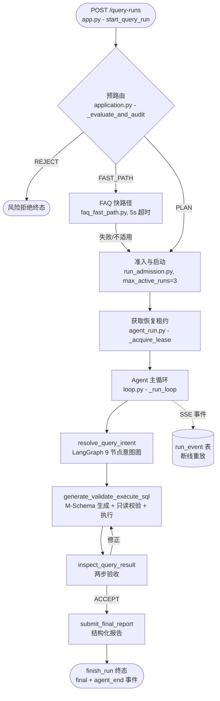
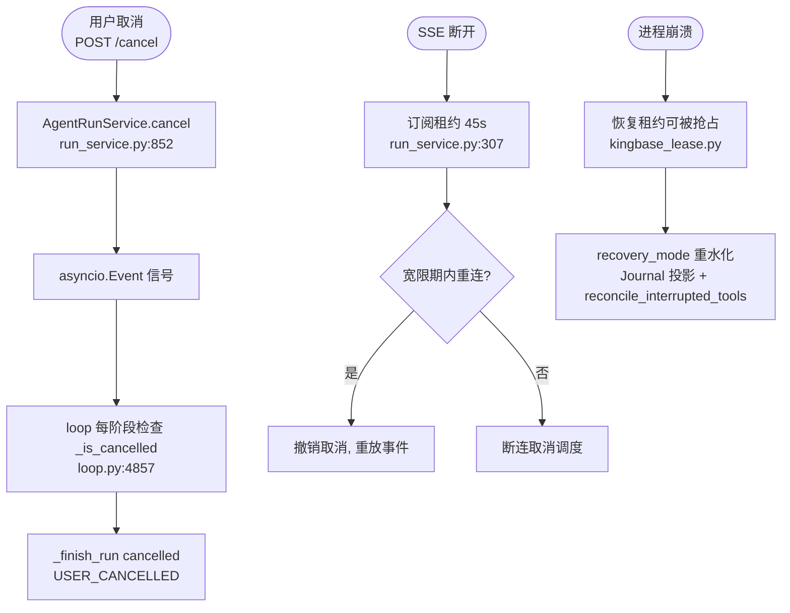
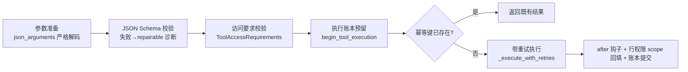
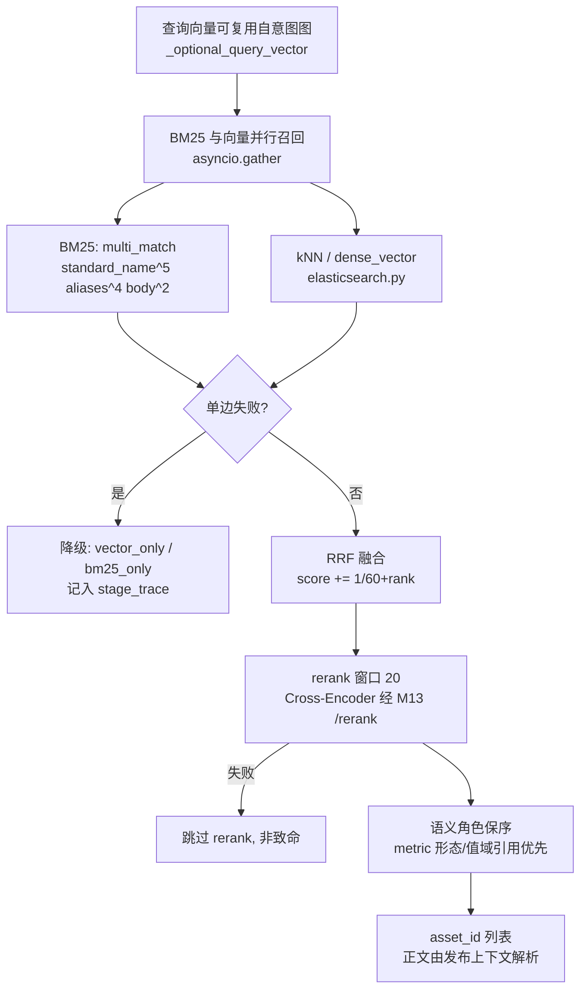
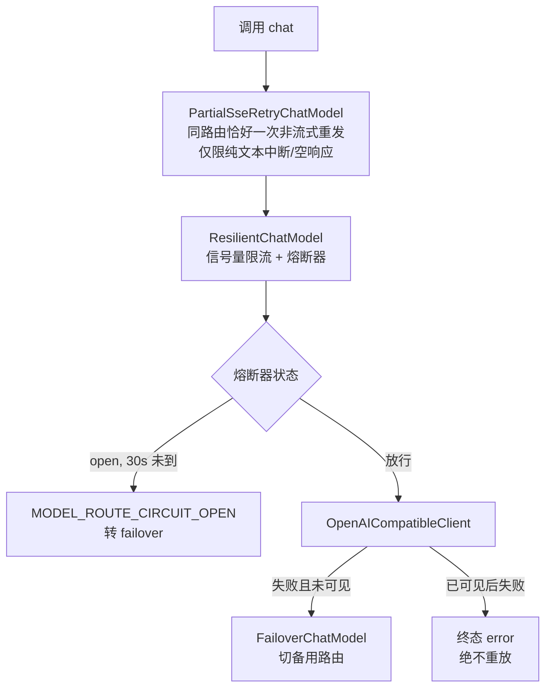
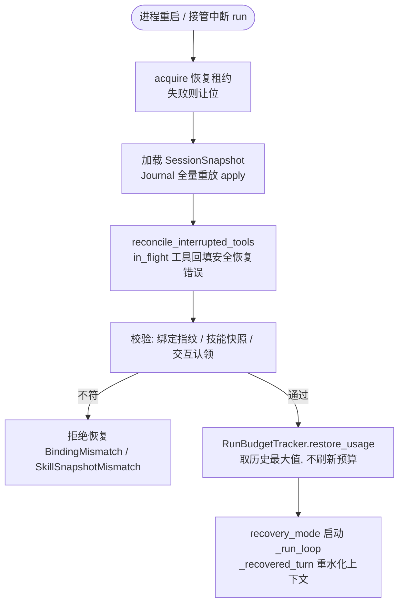

# xkws-agent-algorithm

> 以 xkws-agent-algorithm（小坤问数）为案例的企业级 NL2SQL Agent 架构实现剖析

## 本书说明

**这本书讲什么**：本书以企业 NL2SQL 系统「小坤问数」的在线 Agent 代码库为贯穿案例，系统拆解一个生产级 Agent 的完整技术栈——主循环、上下文工程、工具系统、提示词、记忆与事件溯源持久化、混合检索、模型接入、长任务可靠性、可观测性。与开源 demo 不同，这个案例回答的是另一类问题：当 Agent 的每一次出错都意味着"给业务方看错数据"时，架构要额外付出什么。

**适合谁读**：
- 想了解小坤问数实现的人 → 读第 1 章 + 第 14 章
- 想系统学习 Agent 架构的人 → 按顺序读
- 只想查某个具体机制（压缩切点、幂等账本、failover、M-Schema）的人 → 直接跳对应章节

**案例项目**：
- 仓库：内部仓库（未开源），Python 3.12+，uv workspace 多包结构
> 一句话定位：面向企业问数场景的 NL2SQL Agent——单 Agent 循环编排 13 个工具，意图识别走 LangGraph 子图，SQL 走"语义资产卡检索 → M-Schema 生成 → 服务端校验 → 只读执行"的受控链路，全链路事件溯源 + 预算/时限/循环四道闸门。

## 代码地图

| 文件 | 职责 | 相关章节 |
|---|---|---|
| `packages/xkws-agent-runtime/src/xkws_agent_runtime/loop.py` | 现行 Agent 主循环（`_run_loop`）、工具执行、终止闸门、终态事件（近 4900 行） | 第 1、3 章 |
| `packages/xkws-agent-runtime/src/xkws_agent_runtime/governance.py` | RunBudget/RunDeadline/ToolLoopGuard：预算、时限与循环防护的全部数值 | 第 3 章 |
| `packages/xkws-agent-runtime/src/xkws_agent_runtime/intent_graph/` | 生产在用的意图识别 9 节点 LangGraph 子图 | 第 2、8 章 |
| `packages/xkws-agent-session/src/xkws_agent_session/compaction.py` | token 估算、压缩阈值判断与安全切点算法 | 第 4 章 |
| `packages/xkws-tools/src/xkws_tools/pipeline.py` | 工具执行管线：ToolRegistry/ToolExecutor/ToolResult、账本、恢复预算 | 第 5 章 |
| `packages/xkws-tools/src/xkws_tools/sql_execution.py` | 唯一 SQL 出口工具 `generate_validate_execute_sql` | 第 5 章 |
| `config/prompts/agent.yaml` + `packages/xkws-agent-runtime/.../system_prompt.py` | 受版本控制的系统提示词与缓存友好装配器 | 第 6 章 |
| `packages/xkws-session-persistence/src/xkws_session_persistence/journal.py` | 事件溯源仓储：Journal/Checkpoint/Outbox 原子提交 + CAS | 第 7、12 章 |
| `packages/xkws-session-persistence/.../kingbase_lease.py` | 金仓条件 UPSERT 恢复租约：同会话只允许一个 worker 恢复 | 第 12 章 |
| `packages/xkws-semantic-runtime/src/xkws_semantic_runtime/hybrid_retrieval.py` | BM25+向量并行召回、RRF 融合、rerank 与角色保序 | 第 8 章 |
| `packages/xkws-agentic-sql/src/xkws_agentic_sql/{m_schema,generator,validator}.py` | M-Schema 文本合同、SQL 生成子调用、只读校验总闸 | 第 8 章 |
| `packages/xkws-model/src/xkws_model/{gateway,failover,resilience}.py` | 模型路由、主备切换、熔断与重试 | 第 9 章 |
| `packages/xkws-observability/src/xkws_observability/trace.py` | Trace 事件模型：Policy/Payload/Envelope/Context | 第 13 章 |

---

# 第一部分 认识这个系统

## 1. 案例项目全景：当答错数据的代价足够高，Agent 架构会变成什么样

> **本章导读**：这个系统替代的是"业务方提需求 → 分析师写 SQL → 出报告"的人工流程。本章给出问题域、一次提问的完整鸟瞰图，以及全书纲领性的设计取向总表——后续每一章都是这张表中某一格的展开。

### 1.1 问题域：NL2SQL 里"错"的代价

这个系统替代的是"业务方提问题 → 分析师理解口径 → 写 SQL → 出数 → 做报告"的人工流程。把 LLM 直接接到数据库上也能跑通一部分问题，但在企业数据场景下会撞上四堵墙：

1. **口径幻觉**：模型不知道"报销金额"是按含税还是不含税统计、哪个字段是权威口径——这些口径知识只存在于已发布的指标定义里。
2. **权限越界**：同一张表，不同租户、不同用户能看的行和列不同。模型生成的 SQL 天然不带行权限过滤。
3. **不可追责**：直接生成 SQL 失败后，你无法区分是"理解错了意图"还是"写错了字段"，也没有审计证据链。
4. **执行不可控**：一条没有预算上限的 Agent 可以在循环里反复试错，烧掉任意多的 token，甚至拖垮数据库。

由此推出这个系统的根本设计立场：**模型可以理解、可以建议，但口径、权限、执行三类决定权全部收归服务端**。全书后续的每一个机制——语义资产卡、M-Schema、执行账本、冻结过滤器——都是这一立场的展开。

### 1.2 系统形态

- **形态**：服务端 API（FastAPI），前端通过 `POST /api/v1/query-runs` 发起提问，以 SSE 流接收增量事件；无 CLI，无桌面端。
- **结构**：uv workspace 管理的 23 个包（M00 公共 → M24 协同办公提醒），每个包独立 `pyproject.toml`。离线语义发布控制面（M10）是独立仓库，在线侧只通过 HTTP 只读客户端消费其不可变 release，不共享代码。
- **编排**：单 Agent 主循环（手写）+ 意图识别 LangGraph 子图（生产在用）+ 一个平行未接线的 LangGraph agent 图。
- **数据面**：数据库为金仓（Kingbase），SQL 执行经由 Metadata 服务的 HTTP 端点 `/api/v1/database/execute`，Agent 进程不直连数据库驱动。

### 1.3 一次提问的鸟瞰



关键点：意图识别不是主循环里的模型轮，而是一个工具调用（`resolve_query_intent`）内部的独立子调用流水线；SQL 同理。主 Agent 本身只做编排与判断，重活全部下沉到工具内的受控子流程。

### 1.4 设计取向总表

| 维度 | 本案例的选择 | 被放弃的备选 | 代价 |
|---|---|---|---|
| 编排范式 | 手写 while 主循环 + LangGraph 意图子图 | 全量 LangGraph 图编排 | 主循环代码复杂度高（近 4900 行） |
| SQL 权责 | 模型提交意图引用与决策字段，服务端生成/校验/执行 | 模型直接写 SQL | 灵活性下降，需维护 M-Schema 合同 |
| 口径知识 | 离线发布不可变语义资产卡，在线只读消费 | 在线 RAG 知识库自由问答 | 发布流程重，口径更新有延迟 |
| 上下文 | 每轮按投影重建，事件日志为唯一真相 | 消息列表原地追加 | 每轮重建有计算成本 |
| 工具注入 | 全量注入 + 技能白名单过滤 + 探索态切面 | 检索式工具加载 | 工具多时会回落到选择准确率问题 |
| 记忆 | 事件溯源 Journal + CAS + 投影 | 普通消息表 | 存储与实现复杂度高 |
| 模型接入 | 自研 httpx 薄客户端 + 兼容 profile | LiteLLM / 官方 SDK | 自担协议演进成本 |
| 可靠性 | 租约 + 执行账本 + Outbox + 幂等预留 | 进程内重试 | 大量持久化写入 |
| 外部协议 | 不用 MCP，全部内部 HTTP Port | MCP 接入 | 生态工具无法即插即用 |

### 1.5 小结

- 这是一个"高确定性优先"的 Agent：模型的话语权被系统性压缩，换取口径、权限、审计三重可控。
- 离线/在线分离是前提：没有不可变的语义发布，在线的一切受控都无从谈起。
- 全书后续章节分别展开总表中的一格；遇到具体实现时，回到这张表看它在全局中的位置。

## 2. Agent 范式与选型逻辑：为什么主循环是手写的，意图识别却是 LangGraph

> **本章导读**：这个仓库同时存在两套编排——手写 while 循环（生产）和 LangGraph agent 图（平行未接线），而意图识别却已在生产用 LangGraph。本章用范式对比讲清这三者的选型逻辑，以及"何时不该用 agent"。

### 2.1 从 prompt 到 agent：三要素

一段系统提示词 + 一次模型调用，无论写得多精细，都只是"问答"。成为 Agent 需要三件事同时成立：**循环**（模型输出能触发下一轮动作）、**工具**（能改变外部状态或获取新信息）、**状态**（跨轮次记忆与终止条件）。这个项目的主循环在 `packages/xkws-agent-runtime/src/xkws_agent_runtime/loop.py → _run_loop()`（loop.py:907），三要素齐备。

### 2.2 四种范式的失效模式

| 范式 | 核心结构 | 优势 | 典型失效场景 |
|---|---|---|---|
| ReAct | 推理与行动交替，观察回灌 | 错误可归因、可中断、可纠偏【业界】 | 长任务推理链发散、重复试错 |
| Plan-and-Execute | 先产出计划再逐步执行 | 全局视野、计划可审查 | 计划僵化，需要重规划机制，token 双倍 |
| Reflection | 自我批评回路 | 提升单轮质量 | 无限反思、批评漂移【业界】 |
| 图编排 Workflow Graph | 节点+条件边，状态显式 | 可观测、可测试、不确定性收敛 | 流程固化，动态性差 |
| 纯 Workflow | 固定管线，无 agent 循环 | 确定性最强 | 步骤无法枚举时不可用 |

### 2.3 本案例：一个混合体，三条战线

**主线是 ReAct 的变体**。`_run_loop` 的内层 while 让"模型轮 ↔ 工具轮"交替；但模型同时持有 `manage_plan` 工具可以落盘一份带乐观锁版本号的执行计划（`packages/xkws-tools/src/xkws_tools/planning.py → ManagePlanTool`，写操作需 `expected_revision`）——这是把 Plan-and-Execute 的"计划"做成了**可修订的账面状态**而非一次性产物。计划不是先行的，而是随执行演进；每次替换都产生事件并做 CAS 校验。

**意图识别是图编排**。`packages/xkws-agent-runtime/src/xkws_agent_runtime/intent_graph/builder.py → build_intent_graph()`（`intent-graph/v1`）定义了 9 个节点：normalize_request → extract_intent_signal → embed_query → retrieve_semantic_candidates → rerank → assemble_evidence_bundle → correct_preselection_input → resolve_canonical_intent → finalize_intent，全部由 `state["next_node"]` 条件边路由。选图的理由很典型：意图解析的步骤**可枚举**、每步失败模式不同（检索空、rerank 漂移、歧义待澄清）、需要逐步留痕——这正是图编排的适用区。

**平行未接线的是第三个实验**。`langgraph_engine.py → LangGraphRuntimeEngine`（langgraph_engine.py:29）文件头自述"intentionally parallel to the legacy runtime. Application wiring is deferred until the contract and differential gates pass"——全仓只有 `__init__.py` 导出它，无任何应用层调用。5 节点的 agent-graph/v1（hydrate_or_recover / model_turn / execute_tool_batch / route_error / finalize）已经建成并通过契约测试，但迁移被刻意冻结，等差分验证通过才切换。

### 2.4 选型矩阵与反思

| 维度 | 手写循环 | 图编排（现状） |
|---|---|---|
| 可预测性 | 中（靠闸门与守卫） | 高（状态显式） |
| 灵活性 | 高（任意分支逻辑） | 低（改图需改代码） |
| 调试成本 | 高（状态隐式在闭包里） | 低（state 可序列化） |
| 迁移风险 | — | 高：loop.py 里的兼容恢复、预算调度、steering 等行为要在图中一一复刻 |

这个案例给出了一个务实的中间态：**新机制（意图识别）直接用图建，存量主循环不动，用差分验证决定是否迁移**。它承认了图编排的可测试性优势，也承认了重写 4900 行主循环的风险。

### 2.5 何时不该用 Agent

这个系统里最"反 agent"的设计恰好是最值得学的：SQL 不是 Agent 现场发挥写出来的自由文本，而是走 `generate_validate_execute_sql` 工具背后的**固定管线**（生成 → 校验 → 执行 → 诊断回灌，见第 8 章）。步骤可枚举、错误代价高（错数据）、需要确定性——三条"该用纯 workflow"的判据全中【业界】。Agent 的价值被压缩到它真正不可替代的部分：理解歧义、选择口径、判断结果是否回答了问题。

### 2.6 小结

- ReAct 是骨架，Plan-and-Execute 的"计划"被改造成带乐观锁的持久状态，两者混合。
- 意图识别用 9 节点 LangGraph 子图，生产在用；agent 主图的 LangGraph 化是已建成但刻意冻结的平行实现。
- 最重的业务环节（SQL）走受控管线而非 agent 自由发挥——"何时不该用 agent"是本案例最核心的选型结论。

---

# 第二部分 运行时内核

## 3. 主循环的工程实现：一个 while 循环里的四道闸门

> **本章导读**：`_run_loop` 是全书最核心的一个函数（近 4900 行文件的心脏）。本章拆解双嵌套循环骨架、模型/工具/时间/循环四类终止闸门的具体数值、顺序工具执行与部分失败表达、异常分类学，以及取消信号如何贯穿全链。

### 3.1 循环骨架：双嵌套 while

`loop.py → _run_loop()`（loop.py:907）的结构是外层"一次 Agent run"、内层"连续模型↔工具轮"：

```text
_run_loop()  ← packages/xkws-agent-runtime/src/xkws_agent_runtime/loop.py
├→ 初始化：预算/时限 tracker、循环守卫；recovery_mode 下重建上下文（_recovered_turn, loop.py:948）
└→ while not cancelled:                        # 外层：一次 run
   └→ while 有更多工具调用 or 有 pending 消息:   # 内层：模型↔工具轮
      ├→ 提交 steering 消息（用户插话 → commit_message）
      ├→ 预算闸门 budget_tracker.reserve_model_call() / 时限闸门 deadline_tracker.ensure_available()
      │    └→ 失败 → 可调度一次"收尾模型轮"，否则 agent_error 终态
      ├→ message = await _stream_assistant_response(...)     # 一次流式模型调用
      ├→ stop_reason ∈ {error, aborted} → 兼容性恢复（预算内重放）或终态
      ├→ 有 tool_calls → _execute_tool_calls()（顺序执行）
      ├→ 终止协议检测：报告已交付 / 安全拒绝 / 交互暂停 / 终态公共错误 → _finish_run 后 return
      └→ 无 tool_calls → 阻断性失败→FAILED；交付不完整→注入内部恢复消息继续
```

外层 while 的尾部还有第三条出口：follow-up 队列非空时把追问转为新的 pending 消息继续跑（loop.py:1737-1742）。

### 3.2 终止条件：四道闸门的全部数值

| 闸门 | 机制 | 默认值 | 出处 |
|---|---|---|---|
| 模型自决 | 无 tool_calls 且报告已交付/安全拒绝 → completed | — | `_has_completed_report_delivery` loop.py:2185 |
| 调用预算 | `max_model_calls`/`max_tool_calls`/`max_total_tokens` | None，但 API 层强制提供前两者 | governance.py:206；environment_runtime.py:44-47 |
| 协议恢复预算 | `max_model_recovery_calls`（独立于业务预算） | governance 0，API 默认 2 | main.py:1123 |
| 时间闸门 | `max_active_milliseconds` | API 默认 1_440_000ms（24 分钟）；自由探索 420s+收尾 30s | main.py:1116-1118 |
| 循环守卫 | `ToolLoopGuard.max_identical_calls`：同（签名,诊断指纹）第 3 次同参调用拒绝 | 3 | governance.py:377 |
| 无进展检测 | 探索模式 3 轮提示 → 5 轮强制收尾 → 6 轮终态 | 3/5/6 | loop.py:1315-1377 |
| 交付恢复 | 不完整交付最多重试 | `_MAX_INCOMPLETE_DELIVERY_RECOVERIES=3` | loop.py:127 |

设计要点：**协议恢复预算独立于业务预算**——流中断后的重放不挤占正常业务的模型调用额度，但自身有上限；`restore_usage()`（governance.py:318）保证同 run 重启时取历史最大值而非清零，重启不能"重新获得预算"。

### 3.3 工具执行：顺序、保序、批内级联

`_execute_tool_calls()`（loop.py:2620）对同一轮的多个 tool_call **顺序 for 循环执行，不并发**。结果按调用顺序写回消息列表；进度更新事件用 `asyncio.create_task` 排队并在结果前统一 settle，保证 update 先于 tool_execution_end。批内级联规则：

- `manage_plan` 失败 → 后续非独立读调用直接返回 `PLAN_BATCH_DEPENDENCY_FAILED`；
- 循环守卫拒绝 → `TOOL_LOOP_DETECTED`（terminate=True）；
- 出现 `runtime_control`（服务端终态）、交互暂停或取消信号 → 本批后续全部跳过；
- `stop_reason=="length"` 的截断调用整体作废（`_fail_truncated_tool_calls`，loop.py:2591）——参数可能被截断，执行有风险。

放弃并发是有意的：工具里有副作用与交互暂停，串行让"部分失败"的表达退化为简单的顺序前缀问题。

### 3.4 异常分类：20 类 category

`errors.py → ERROR_CATEGORIES`（errors.py:13-36）定义 20 类，覆盖模型瞬时/输出无效、检索瞬时/空/降级、工具业务拒绝/瞬时/结果未知、持久化瞬时/不确定、状态可重建/不兼容、取消、预算耗尽、超时、内部不变量破坏等。`normalize_error()`（errors.py:75）按 code 关键词归类，`progress_fingerprint()`（errors.py:113）对错误做 sha256 指纹——同一指纹的重试会被循环守卫拦截。

工具错误与模型错误的处理哲学不同：**工具错误是"模型可见的观察"**，带着恢复契约回灌，让模型决定修正参数还是换路径；模型流错误才走服务端的兼容性恢复（预算内重放，必要时降级非流式，loop.py:1096-1097）。终态统一由 `_finish_run()`（loop.py:3937）产出，最终呈现失败时降级为 `build_terminal_final_event`。

### 3.5 中断与恢复



三个支撑件：**取消信号**贯穿全链；**订阅租约**（45 秒，心跳为租约 1/3）区分"用户离开"与"网络抖动"；**恢复租约 + Journal** 保证另一进程重水化时状态一致（细节见第 12 章）。

### 3.6 小结

- 双嵌套 while + 四道闸门：模型自决是主出口，预算/时间/循环守卫是确定性兜底，谁都不能单独缺席。
- 工具顺序执行换来了部分失败表达的简单性；批内级联规则把"计划失败则后续无意义"显式化。
- 异常的核心区分是"模型可见的观察"与"服务端恢复"两条通道——不是所有错误都该让模型看到。

## 4. 上下文工程：Agent 最贵的资源

> **本章导读**：这个系统的上下文哲学是"按投影重建，而非按消息追加"——每轮模型调用前，从事件日志重新投影出该轮该看的上下文。本章讲投影的三个层次（多投影函数、筛选规则、形态变形）、token 阈值触发的摘要式压缩与安全切点算法，以及压缩为什么默认没接线。

### 4.1 上下文不是越大越好

Agent 多轮对话的成本随轮数平方增长——每轮都要重发全部历史【业界】；且模型对长上下文中间位置的召回弱于首尾（lost in the middle）【业界】。这决定了上下文管理的目标不是"塞更多"，而是**在有限预算内最大化与当前决策相关的信息密度**。本案例还多一条企业约束：工具结果可能携带受保护内容（如未公开 SQL），上下文还要区分"模型可见"与"仅前端可见"两个平面。

### 4.2 本案例的非常规选择：按投影重建，而非按消息追加

常见实现是维护一个消息列表，每轮 append。本案例反过来：**消息列表是派生物，事件日志才是真相**。每轮模型调用前，由投影函数从 Journal 事件流重建上下文。

先纠正一个容易的误解：投影不等于"把日志读出来拼接"。投影 = **读取 + 按规则筛选 + 变形**——骨架确实是读日志，但哪些事件进上下文、跨不跨 run、以什么形态给模型，全都是显式规则，而不是历史遗留。这套规则分三层看。

**第一层：多个投影函数，各服务一个消费者。** "投影"不是一个函数，是一组：

| 投影 | 位置 | 消费者 |
|---|---|---|
| `project_session_memory()`（full_session/v1） | `xkws-agent-session/memory.py:58` | 全会话视图（含历史 run） |
| `project_current_run_safe_memory()`（current_run_safe/v1） | 同文件 `:83` | **每轮模型调用的默认投影** |
| `project_messages_to_llm()` | `xkws-agent-session/projection.py:12` | 最后一道变形：内部形态 → Provider API 形态 |
| SessionMemoryCoordinator（persistence 包 memory.py） | 会话协调器 | 恢复/回灌与压缩落盘 |

每轮用哪个是显式决策而非约定：`packages/xkws-query/src/xkws_query/agent_run.py:82` 写死 `_MODEL_MEMORY_PROJECTION = CURRENT_RUN_SAFE`——主循环的模型上下文默认**只看当前 run**。

**第二层：筛选规则——哪些要、哪些不要。** 以现行默认投影为例（`memory.py:379-385` 可核对）：

| 规则 | 处理 | 为什么 |
|---|---|---|
| 非当前 run 的记录 | 不进上下文 | 一个 session 可含多个 run（追问/恢复/澄清后续），防跨问题串话 |
| `stop_reason ∈ {error, aborted}` 的助手消息 | 剔除 | 流中断的残次输出不可安全重放，喂回去会带偏模型 |
| `admission_only=True` 的准入消息 | 剔除 | 纯内部记账，对模型无信息量 |
| 已认领澄清卡 | 只注入"源问题 + 已持久化响应"一条，且不继承上一 run 的用户文本 | 上一 run 的文本可能只是过期的澄清答案（配合第 7 章 query-restation 协议） |
| 工具结果中的私有值 / opaque 执行凭据 | 剥离，绝不回灌（loop.py:954-958） | 模型可见面与前端可见面分离（见 4.1） |
| 压缩摘要 | 仅当摘要覆盖范围全部属于当前 run 才带入（`_summary_covers_only_current_run()`） | 跨 run 摘要会带入本轮不该看的旧问题语境 |
| 计划状态 | 每轮追加一条含当前 `plan_revision` 的状态消息 | 防止模型续跑时用过期的计划版本号 |

**第三层：变形——事件形态 ≠ API 形态。** `projection.py → project_messages_to_llm()` 把内部 `custom` 消息转成标准 `user` 消息、把压缩摘要转成带固定前缀（"The conversation history before this point was compacted into the following summary:"）的 user 消息、剔除内部展示字段。内部事件形态与 Provider API 形态就此解耦——改 Provider 不用改 Journal，反过来也一样。

**为什么不用原地 append**：append 的问题是消息列表自己变成第二个真相源——恢复时要回答"断在哪条消息中间"，压缩后"删了哪条"没有记录，权限变化后"哪些消息不该再给模型看"没有开关。投影式做法下这些都是投影规则的函数：恢复 = 重放，压缩 = 加游标事件，筛选 = 改规则重投影。

系统提示词侧则按"缓存友好固定顺序"装配（`system_prompt.py → assemble_agent_system_prompt()`）：稳定片段在前，动态的 run_sections 在后，让 provider 的提示词缓存尽量命中（详见第 6 章）。

### 4.3 压缩：token 阈值触发 + 安全切点

压缩契约在 `packages/xkws-agent-session/src/xkws_agent_session/compaction.py`，方法选型先看对比：

| 压缩法 | 信息保留度 | token 收益 | 本案例是否采用 |
|---|---|---|---|
| 截断 | 低 | 高 | 否（丢上下文不可接受） |
| LLM 摘要 | 中 | 中 | **是**（外部化摘要构建器） |
| 结构化抽取 | 高（决策）/低（细节） | 高 | 部分（计划状态每轮重投影即为此类） |
| 外部化 + 检索 | 高 | 高 | 是（长期记忆作业，见第 7 章） |

实现要点：

1. **触发**：`should_compact(context_tokens, context_window, settings)`——`context_tokens > context_window - reserve_tokens` 才触发，按 token 不按轮次。token 估算优先用最近一条可重放 assistant 消息的 provider usage，尾部消息按"字符数 ÷ 4"保守估算。
2. **安全切点**：`find_cut_point()` 从尾部按 `keep_recent_tokens` 反向累积，且切点必须落在合法消息类型集合上——**绝不能切在 ToolResult 开头**（否则模型看到孤立工具结果）；若切在助手消息中间，回退到本回合 user 消息起点。
3. **原文永不删除**：压缩产物是 `compaction_saved` 游标事件（含 `covered_through_sequence`），落库由 `packages/xkws-session-persistence/.../memory.py → _save_compaction_locked()` 完成。摘要只是视图，Journal 完整保留——这使压缩可以重做、可以回滚。
4. **预算参数**：语义阶段 `provider_context_window_tokens=131_072`、`output_reserve_tokens=16_384`、窗口下限 65_536（`xkws-api/langgraph_intent.py:863-864`）；`main.py:1282-1290` 校验窗口必须覆盖语义输入 + 输出预留 + 安全余量。

### 4.4 权衡与现状

**好处**：投影式上下文使恢复、审计、"哪个该进上下文"的策略演进都只改投影函数一处；事件溯源让压缩可逆。
**代价**：每轮重建有成本；投影规则本身成为新的正确性负担（如"摘要只覆盖当前 run 才可带入"，`_summary_covers_only_current_run()`）。
**诚实的现状**：压缩机制已完整建成（阈值、切点、落盘、失败回退一应俱全），但 `xkws-api/main.py` 的装配方**未传入 `compaction_policy` 与 `summary_builder`**——当前长会话实际靠调用预算截断兜底，压缩处于"已建成未接线"状态【推断，未在代码中确认接线，依据是装配方缺省】。这个差距本身有教材价值：可靠性机制的最后一公里（接线 + 验证）往往比机制本身更难。

### 4.5 小结

- "投影重建"替代"消息追加"，是事件溯源架构在上下文层的必然推论；投影 = 读取 + 筛选 + 变形，筛选规则（当前 run、残次消息、私有值、澄清卡）是显式代码而非约定。
- 压缩按 token 阈值触发、摘要式、切点有合法性约束（不得以 ToolResult 开头）、原文永不删除。
- 上下文安全不只是 token 问题：CURRENT_RUN_SAFE 投影用"只带当前 run"的规则防止跨问题串话。

## 5. 工具系统：13 个工具、一份执行账本和一条唯一 SQL 出口

> **本章导读**：工具不是函数库，是被四层防线（schema 校验 → 访问要求 → 执行账本 → 可靠性策略）包裹的受控接口。本章拆解注册机制、工具清单、执行管线六步、ToolResult 双通道投影，以及"模型不写 SQL，只提交意图引用"这一根本约束。

### 5.1 工具即接口：模型眼里的世界只有 schema

模型无法看到函数体，它对工具的全部理解来自 name/description/parameters【业界】。本案例把这一点推到极致：每个工具的 `parameters` 是**手写的 JSON Schema（Draft 2020-12）**——不是 pydantic 自动生成，而是逐字段用 `oneOf`、`pattern`、`minLength` 表达约束，如 `sql_execution.py → GenerateValidateExecuteSqlTool.parameters`（sql_execution.py:281-368）。校验用 `jsonschema.Draft202012Validator`（`pipeline.py → _prepare_and_validate()`，L1223）。

### 5.2 注册机制：无装饰器，组合根显式装配

工具是 `BaseTool` 子类（`xkws_tools/base.py`），带 `name/version/description/parameters/access/reliability` 类属性与异步 `execute()`。注册不走装饰器，而在**组合根**完成：`xkws-api/main.py`（约 L4270-4437）按能力开关条件构造工具列表，`registration.py → register_agent_tools()` 批量注册进 `ToolRegistry`（按 `(name, version)` 键，同名多版本拒绝解析）。`to_openai_function_tool()`（registration.py:97）把定义投影为 OpenAI function-calling 声明。选择显式装配而非装饰器扫描，是因为**哪些工具可用本身就是运行时配置**（能力开关、技能白名单、探索态切面）。

### 5.3 工具清单（13 个，按类分组）

| 类别 | 工具 | 一句话职责 |
|---|---|---|
| 意图 | `resolve_query_intent` | 把问题整理为结构化意图；READY 返回不可变意图引用，不足返回澄清草稿 |
| 意图 | `manage_intent_exploration` | 未发布指标的自由探索生命周期控制 |
| 意图 | `decide_follow_up_execution` | 追问执行前声明建议模式与数据覆盖范围 |
| SQL | `generate_validate_execute_sql` | 唯一 SQL 出口：服务端生成→校验→EXPLAIN 预检→执行；模型不传 SQL |
| SQL | `query_schema_subgraph` | 查询已认证 Schema 子图，发布执行子图证书（10s 超时） |
| 知识 | `query_knowledge_base` | 查询当前主题域已发布已授权语义知识（HTTP/Ossie 双实现二选一） |
| 结果 | `inspect_query_result` | 两步验收：首读列结构/预览，第二次回传 `inspection_context_ref`+决策 |
| 结果 | `analyze_query_result` | 对完整结果做本地过滤/分组/聚合/TopN 派生 |
| 结果 | `request_result_export` | 已持久化结果导出 CSV/XLSX，只传句柄 |
| 结果 | `submit_final_report` | 仅在 inspect=ACCEPT 且证据齐全后提交结构化报告 |
| 交互 | `request_user_interaction` | 无法安全继续时暂停运行、向用户请求澄清/风险决策 |
| 交互 | `manage_plan` | 计划状态机管理，写操作需 `expected_revision` 乐观锁 |
| 交互 | `submit_security_denial` | 记录结构化安全拒绝终态 |

注意两个共性：**句柄化**（结果通过 `session_result_handle`/`inspection_context_ref` 引用，不把大数据塞进对话）与**决策字段极简**（SQL 工具的参数里没有 SQL、没有表名字段名，只有意图引用或探索决策——`execution_handoff.py` 把模型词汇限制在五个决策字段，L65）。

### 5.4 执行管线：六步防线

`pipeline.py → ToolExecutor._execute_registered()`（L736）按固定顺序执行：



可靠性策略（`ToolReliabilityPolicy`，L137）按工具声明副作用级别、超时、可重试错误码；`__post_init__`（L151）强制两条铁律：**NON_IDEMPOTENT_WRITE 不得自动重试、不得标记 timeout_replay_safe**——超时且非只读时结果标记 `TOOL_EXECUTION_TIMEOUT_IN_DOUBT` 终止（L1043-1060），因为"到底执行没执行"服务端无法知道。参数校验失败的修复上下文是精心设计的：`path/expected/observed` + 从 schema 投影的**最小合法示例**（`_invalid_arguments_example()`，L2649），有界 1KB。

### 5.5 返回结果：双通道投影

`ToolResult`（pipeline.py:260）的 status 分 `success/error/blocked` 三层。关键是**双通道**：`to_message()` 是可持久化版本（有 `public_error` 时脱敏为统一文案）；`to_model_message()` 仅进程内模型可见，附带 `model_only_tool_diagnostic` JSON 与恢复 envelope（L334-403）。诊断做有界化：字符串/集合/深度限幅、显式 `truncated` 标注、Bearer/URL 凭证脱敏（`_bounded_diagnostic_value()`，L2485）。错误文本把 schema 错误压缩为"message + 参数路径 + 允许属性 + 归位建议"（`_validation_error_text()`，L2590）——让模型能改，而不是堆栈轰炸。

### 5.6 注入策略与执行边界

工具量级 13 个，采用**全量注入 + 两层按需过滤**：技能 `allowed_tools` 白名单（`main.py` L4462-4471 按 `activate_snapshot` 的快照重建 ToolRegistry）与探索态切面（原子探索工具注册但平时不可见）。对照业界三分法：

| 注入方式 | 适用工具量 | 本案例 |
|---|---|---|
| 全量注入 | < 20 | ✔（13 个，经白名单过滤后更少） |
| 分层加载 | 20–50 | 技能白名单近似此模式 |
| 检索式加载 | > 50 | 未采用 |

执行边界收口在数据面：SQL 只读（sqlglot 语法树禁 DML/DDL，含 CTE 包裹）、语句超时 90s、HTTP 超时 95s、响应上限 32MB、SQL 模型诊断 4000 字符（`data-access/metadata_execute.py`）；行权限由服务端 `DataPermissionRewriter.rewrite()` 重写进 SQL（见第 8 章）。

### 5.7 小结

- 工具 schema 是产品：手写 JSON Schema + 决策字段极简 + 句柄化，三件事共同压低模型的犯错空间。
- 六步管线里最有分量的是执行账本：幂等预留、副作用策略、超时不确定性处理都在这一层。
- 双通道投影（持久化版 / 模型版）是企业场景的通用需求——不是所有信息都该让模型看到。

## 6. 提示词设计：8 万字 YAML 与缓存友好装配

> **本章导读**：这个项目的提示词工程有两个反直觉选择：提示词正文放在受版本控制的 YAML 里（fail-closed 加载），意图识别用 wire 级 schema 强制而 SQL 生成用纯 prompt 协议。本章解剖系统提示词的装配顺序、七条工具策略的条件注入，以及三种解析失败处理的真实实现。

### 6.1 提示词是版本化资产，不是字符串常量

主系统提示词正文在 `config/prompts/agent.yaml`（约 82KB），由 `packages/xkws-api/src/xkws_api/instruction_catalog.py → load_backend_instructions()` 加载，强校验 `version==1` 与节点结构完整，**缺失即抛错**（fail-closed），不允许静默降级。SQL 生成指令同理：`xkws-agentic-sql/instructions.py → SqlGenerationInstructions.render()` 从 YAML 模板树渲染，注释明确"不从模型输出读取模板"——模板内容与用户输入隔离，防提示注入。把提示词当代码管理（版本、评审、diff）是这个规模系统的必选项【业界】。

### 6.2 系统提示词的分层解剖

`agent.yaml → agent.system` 的层次与"防跑偏"强度：

1. **角色与能力边界**（1 行）："只能基于已授权的工具和已观察到的结果回答，不得编造查询数据。"
2. **硬门槛层**（真正防跑偏的三条）：报告提交门槛（`inspect_query_result` 必须返回 `decision=ACCEPT` 且 `report_submission_allowed=true`）；结果检查门槛（"有界预览不代表完整结果"，预览截断不构成拒绝 ACCEPT 的理由）；筛选检查门槛（`NOT_REQUIRED` 不等于证据不足）。
3. **偏差定位与流程**：语义冲突时先定位"首次偏差"再决定修意图/SQL/报告；先 `manage_plan` 再 `resolve_query_intent`。
4. **语言硬约束**：无论模型默认语言，交付文本必须简体中文。
5. **重试纪律**："不得原样复用相同参数进行随机重试"——与第 3 章循环守卫的服务端拦截形成双保险。
6. **终态定义**：`terminate` 只是观察不是终态；只有自然语言答复、报告成功、安全拒绝三种正常完成。
7. **报告深度分级**：三档判据 + 深度分析四段固定标签 + 零值/NULL 表述纪律。

代码内嵌的四段稳定片段（`system_prompt.py:13-31`）同样值得看：TopN 硬边界（"Top 0 必须逐字保留进参数，由服务端拒绝"——禁止模型"好心改写"）、观测时间上限、证据适用范围（"不能把上一题的失败直接套到新题"）。

### 6.3 装配顺序：缓存友好 + 条件注入

`assemble_agent_system_prompt()` 按固定顺序拼装：base → 代码片段 → 全局工具策略块 → 技能 XML（`format_skills_for_system_prompt()`）→ `<environment_context>`（日期/时区）→ run_sections（历史意图承接/主题域/追问策略）。工具策略块（`instructions.py → GlobalAgentInstructions`）的注入条件值得单独讲：每条策略声明 `marker + required_tools`，**仅当当前工具集合满足全部 required_tools 且 marker 未出现过时才注入**（`_global_agent_instruction_blocks()`，L120-132）——提示词随工具面自动伸缩，被过滤掉的工具其使用规则也不会出现。检索上下文与工具结果**不进 system prompt**，以消息流进入对话。

### 6.4 输出格式控制：三档并用

| 调用点 | 机制 | 证据 |
|---|---|---|
| 意图选择/补丁/裁决 | wire 级 `json_schema` strict（Pydantic 生成） | `_intent_resolution/model_gateway.py:539-554` |
| 意图歧义审计 | 降级 `json_object` + 服务端严格校验 | model_gateway.py:555-572 |
| 主题域识别 | wire 级 `json_schema` strict | `theme_domain_resolution.py:376-390` |
| SQL 生成 | **纯 prompt 协议** + Pydantic 校验 | `agent.yaml` sql_generation.protocol；`generator.py:427-431` |
| FAQ 结果核对 | prompt 内嵌 JSON 契约 | `faq_fast_path.py:287-291` |

SQL 走 prompt 协议的原因是它由自研客户端直连多 provider，wire schema 的兼容面不可控——这是"三档可靠性依次上升、灵活性依次下降"【业界】的活例子：本案例在兼容性与可靠性之间按调用点分别取了不同档位。

### 6.5 解析与修复：三条通道都真实存在

1. **带错重试**：意图侧 `StreamingIntentModel.complete_structured()`（`intent_resolution.py:2439`）把上次"已解析但校验失败的对象"连同 `validation_phase` 回灌，并按阶段给**针对性修复指令**——如 `SEMANTIC_METRIC_SELECTION` 阶段明确"治理原因码只能写入 governance_gaps，绝不能写入 mode"（L2479-2487）。
2. **协议订正重试**：SQL 生成 `generator.py:462` `for attempt in (1, 2)`，第一次失败把原始输出+完整校验错误作为"【模型输出协议订正】"回灌，第二次失败即 `SQL_OUTPUT_FORMAT_INVALID`。
3. **服务端修复裁决**：物理可执行性问题走专用修复阶段（`_repair_physical_projection_executability()`，intent_resolution.py:5700），重复失败受 `max_repair_attempts` 约束。

few-shot 的处理也反直觉：全系统没有真实 few-shot，只有**结构 one-shot**（占位值示例），重试时显式声明"以下仅重申结构，不决定任何业务值"（model_gateway.py:505）——示例的风险不是教格式，而是把示例值泄漏进业务输出【业界】。

### 6.6 小结

- 提示词分层（角色→硬门槛→流程→语言→终态→输出规范）使"防跑偏"约束可定位、可评审。
- 条件注入（marker + required_tools）让提示词与工具面保持一致，避免教模型用不存在的工具。
- 格式控制按调用点分档：意图用 schema 强制，SQL 用 prompt 协议 + 一次订正重试——统一到一种反而错。

---

# 第三部分 知识与记忆

## 7. 记忆与状态持久化：事件溯源打底的记忆体系

> **本章导读**：这个系统没有"把消息存进表里"这么简单——会话是一个约 30 种事件的纯函数折叠状态机，消息表只是事件日志的投影。本章讲三层记忆的真实落地、压缩的事件溯源实现（原文永不删除）、长期记忆的后台作业链路，以及双 memory.py 的职责划分。

### 7.1 "记住"的前提是"可重放"

普通实现把消息存进表，忘了就没了。本案例的会话是**事件溯源**状态机：`packages/xkws-agent-session/src/xkws_agent_session/state.py → SessionSnapshot`（frozen dataclass）由约 30 种事件（`message_recorded`、`tool_result_recorded`、`intent_resolved`、`plan_replaced`、`interaction_requested`、`compaction_saved`……）经纯函数 `apply()` 折叠得出。快照字段包括 `journal`、`queryable_intent`、`plan`、`pending_interaction`、`active_run_id`、`compacted_through_sequence` 等。折叠是纯函数意味着：任何时刻任何进程加载同一事件流，得到的会话状态逐字段一致——这是第 12 章一切恢复机制的基石。

三层记忆的真实落位：

| 层 | 实现 | 存储 |
|---|---|---|
| 工作记忆 | SessionSnapshot 字段 + 每轮投影（第 4 章） | Journal 事件流 |
| 会话记忆 | 会话列表/消息的浏览器可见投影 | `ods_agent_conversation(_message)` 表 |
| 长期记忆 | run 结束后的后台摘要/画像作业 | `ods_agent_long_term_memory(_source/_job)` |

### 7.2 会话记忆：同事务投影，不是旁路

`conversation_history.py → KingbaseConversationHistoryRepository` 在 Session Journal 的**同一事务**内写入会话消息表（`append_records_in_transaction()`），按 `(session_id, journal_sequence)` 唯一 + `ON CONFLICT DO NOTHING` 幂等。这不是性能优化而是正确性设计：投影表永远不可能出现"Journal 有、消息表没有"的中间态。报告投递消息单条上限 200,000 字符、展示字节上限 1MB（`_MAX_REPORT_HISTORY_*`）。另有 `backfill_from_session_journal()` 支持从 Journal 全量重建投影表——投影坏了可以重放，真相只有一份。

### 7.3 长期记忆：后台作业，而非即时写入

写入链路（`packages/xkws-query/src/xkws_query/long_term_memory.py`）：run 结束且非 waiting 且用户开启 → `enqueue_run()` 入作业表 → 后台 `_worker_loop()`（轮询 10s、批量 8）→ 从会话历史取"当前 run 消息 + 之前最多 3 条引导消息、截尾 8 条" → 调模型生成摘要（上限 100 字符）→ 落库；另有 persona 画像抽取。幂等靠操作票据表（`_operation_replay()` + 回执）。

**写入时机选择"run 结束后异步"**而非即时：写入的是"这轮对话值得记住什么"的判断，本身需要看完整轮次；且不让记忆作业的延迟/失败影响主流程。检索侧 `LongTermMemoryService.recall()`：词法 + 最近各取 20 候选 → 模型从中选 5 → 失败回退仓库顺序前 5。这是"候选粗召回 + 模型精排"的轻量混合检索（对照第 8 章的重型版本）。

### 7.4 存储形态对比与冲突消解

| 存储形态 | 本案例用法 | 检索能力 | 代价 |
|---|---|---|---|
| 事件日志（Journal） | 唯一真相，约 30 种事件 | 按序列游标 | 不能语义检索 |
| 关系投影表 | 会话消息、报告 | 按会话/时间 | 同事务写入的复杂度 |
| 作业表 + 票据 | 长期记忆 | 词法 + 模型精排 | 异步延迟 |

一致性冲突统一靠 **CAS**：Journal 追加校验 `expected_revision`，不符抛 `ConcurrentWriteError`（`journal.py`）；计划替换带 `expected_revision`，冲突抛 `PlanRevisionConflictError`；交互卡被另一个 run 认领（`RESUME_CLAIMED` 必须带 `resume_worker_id`）后，旧 run 的恢复请求直接拒绝。再加**绑定指纹**校验（`_load_checked()`：`snapshot.binding_fingerprint` 与调用方不符抛错）——记忆不仅怕并发，还怕"换了运行环境后错配"。遗忘机制缺席：长期记忆没有 TTL/衰减，只有 trace 有 30/7 天两级保留（第 13 章）——记忆当资产无限累积是否合理，是值得质疑的点（第 14 章复盘）。

### 7.5 两个 memory.py 的职责划分

`xkws-agent-session/memory.py` 是**纯函数**投影与压缩边界构造（无 IO，可独立单测）；`xkws-session-persistence/memory.py` 是 `SessionMemoryCoordinator`——以会话 CAS 为边界，把主循环的提交钩子（`commit_message/commit_tool_result/...`）转成同事务的事件写入，并做运行绑定校验。同一个名字出现两次不是事故：状态计算与状态持久化被刻意分在不同包，前者无 IO 可测试，后者管事务可审计。

### 7.6 小结

- 事件溯源 + 纯函数折叠，让"恢复"从难题退化为"重放事件流"。
- 投影表与 Journal 同事务写入，消除了"真相与视图不一致"这一整类 bug。
- 长期记忆是异步作业 + 票据幂等 + 轻量两段检索；遗忘机制缺席是明确的待改进点。

## 8. RAG 检索增强：从语义卡到一条可信 SQL

> **本章导读**：检索的原子单位不是文档切片，而是离线发布时固化的"语义资产卡"；在线只召回 asset_id，正文必须从不可变 release 解析。本章讲 BM25+向量 RRF 融合、rerank 失败降级、M-Schema 受控注入，以及 SQL 生成-校验-修复循环如何消费检索结果。

### 8.1 RAG 的边界先说清

RAG 解决"私有知识与时效性"、提供可溯源引用；不解决推理不足，也不解决"检索不到就该换个问法"【业界】。本案例对 RAG 的定位更收窄：检索只负责**找到口径证据**，口径本身由离线发布固化。因此在线侧没有切分、没有索引构建——检索的原子单位是离线生成的"语义资产卡"（metric/field/dimension/value_set/physical_table 等卡型，下文简称"语义卡"），在线只召回 `asset_id`，正文从已发布的 knowledge context 解析（`hybrid_retrieval.py` 模块头注释："Backends … return only index identities"）。

### 8.2 混合检索链路



过滤器在查询层冻结：`tenant_id/theme_domain_id/semantic_release_id/snapshot_id/status=published/agent_eligibility/permission_acl_refs`（`elasticsearch.py → _search_request()`）——**权限和版本不靠后过滤，而是检索条件本身**。策略参数集中在 `HybridRetrievalPolicy`（L83-91）：候选 50、rerank 窗口 20、向量超时 3s、各角色召回限额（结构化词法 4、物理清单 4、值域 2 等）。进程内 `RecallCache` 按（租户、权限范围哈希、release、主题域、scope、归一化输入、排序配置版本）七元组键缓存，TTL 24h，权限变化即失效。

### 8.3 M10 不可变 release：缓存与信任的边界

`m10_client.py → M10ReleaseClient` 只读两个端点（current-binding / exact publication），`content_sha256` 加载时不符即抛完整性错误。不可变性的工程体现：`current` 指针本身**永不缓存**，只缓存 `M10ActiveReleaseBinding`（manifest_hash + binding_version）用于校验本地缓存是否还有效；唯一的精确发布缓存是容量为 2 的 LRU，key 含全部 release/snapshot 身份——续跑复用的是**初跑冻结的那一个 release**，不是"最新的"。另有一条 Ossie 原生发布通道（`ossie_client.py`），rerank 文本经 sha256 校验与权限绑定，同样绝不读 current 指针。

### 8.4 从证据到 SQL：M-Schema 与受控生成

检索产出的卡片最终汇入 SQL 生成子调用的上下文——**M-Schema**（`m_schema.py`，版本 2.3）：从授权物理快照确定性投影的文本合同，含 `【AUTHORIZED_SCHEMA_SHA256】` 等三重哈希证据，模型可见上限 200,000 字符。few-shot 不做在线检索，而是离线固化为卡片上的 `selected_metric_sql_examples`。

生成-校验-修复循环（`legacy/agentic_sql_service.py → AgenticSqlService.execute()`，L633）最多 3 次：每轮加载上次诊断 → `generator.generate(repair_diagnostic=...)` → `SqlSafetyValidator`（7970 行）校验 → 失败且错误码可修复（约 38 个 `_REPAIRABLE_CODES`）→ 带诊断回灌下一轮。校验内容分层：只读（sqlglot 禁 DML/DDL，含 CTE 包裹）、表/列授权、**L1 冻结条件证明**（`frozen_filters.py → analyze_frozen_filters()` 对 AST 逐作用域比对，产出 SATISFIED/VIOLATED/UNKNOWN 证据）、值锚（等值字面量必须来自冻结条件或发布卡，`profile.py → validate_value_anchors()`）。最关键的一步在模型之外：`permission_preparation.py → prepare_permission_execution()` 由服务端把行权限**重写进 SQL** 并复检——权限是确定性变换，模型永远看不到也改不了权限谓词。

### 8.5 固定 RAG 还是 Agentic RAG

| 方案 | 检索时机 | 本案例评价 |
|---|---|---|
| 固定 RAG（预检索） | 每轮固定 | 意图图内的 retrieve→rerank 节点即此类：确定性高、可测试 |
| Agentic RAG（检索即工具） | 模型决定 | `query_knowledge_base` 工具是兜底通道，但主链路不依赖模型自发的多轮检索 |

选择偏固定的理由：问数场景的检索意图可以由意图图结构化地推导（指标/维度/粒度），让模型自由决定"检索几次"反而引入不可控延迟与漏检。代价是意图图需要为每种证据类型预置召回通道（`HybridRetrievalPolicy` 里那组限额就是通道清单）。

### 8.6 小结

- 检索单位是发布固化的语义卡，权限与版本是检索条件而非后过滤——这是企业 RAG 与通用 RAG 的分水岭。
- RRF 融合 + rerank 非致命降级 + 角色保序，形成"精度优先、可用性兜底"的召回结构。
- SQL 修复循环的上限是 3 次、错误码白名单约 38 个：重试必须枚举可修复的失败面，而非盲目再来一次。

---

# 第四部分 模型与协议

## 9. 模型接入层：自研薄客户端与"未可见才切换"的 failover

> **本章导读**：不用 LiteLLM，不用 OpenAI SDK，纯 httpx 手写四个端点；provider 差异交给可探测的兼容 profile。本章讲路由目录、failover 的"零可见字节才切换"铁律、partial-SSE 恰好一次重试、熔断器，以及成本归因的结构化输出分布已在第 6 章详述，本章聚焦传输与韧性层。

### 9.1 抽象层选型：自研薄封装，不用 LiteLLM

`packages/xkws-model/src/xkws_model/openai_compatible.py → OpenAICompatibleClient` 是纯 httpx 手写实现：`/chat/completions`、`/responses`、`/embeddings`、`/rerank` 四个端点的 payload 组装与 SSE/JSON 消费全部自研，全仓无 litellm、无 openai SDK。统一对话契约是 `event_stream.py → EventStream[dict, AssistantMessage]`：所有 provider 归一化为 `start/text_delta/thinking_delta/toolcall_*/done/error` 事件 + 一份含 usage/stop_reason 的终态消息。

放弃通用抽象层的理由：LiteLLM 这类统一层"会吃掉 provider 特有能力"【业界】，而本案例需要精确控制 SSE 中断语义、工具增量聚合、兼容性降级这些边缘行为。代价是协议演进自己扛——缓解手段是 `compatibility.py` 的兼容 profile：`ModelCompatibilityRegistry.resolve()` 按 `profile_id` 或 `matches(provider, model, base_url)` 自动探测（内置 OpenAI 标准、DeepSeek、Qwen、GLM、Kimi 等 profile），通过 `adapt_chat_payload()` 对 payload 做微调（如关闭不支持的思考开关）。

### 9.2 配置与路由：数据库是路由目录

运行时路由配置来自金仓 `model_config` 表（`kingbase_configuration.py → KingbaseGatewayConfigurationLoader.load()`），凭据加密存储、按 `api_key_ref` 解密装配。每条 `GatewayRoute` 含 `purpose("chat"|"embedding"|"rerank")`、协议（chat_completions/responses）与韧性参数（默认超时 30s、熔断阈值 3 次、恢复 30s）。路由是**静态按任务类型**划分：主对话、意图解析、SQL 生成、embedding、rerank、长记忆各自独立 route_id，未显式配置的回落主路由（`main.py` L2466-2496）；fallback 链要求同 purpose、embedding 必须同维度、禁止成环（`GatewayConfiguration.__post_init__`，L222-238）。不做成本动态路由——问数场景下单次路由错误的代价（口径答错）远大于成本优化收益。

### 9.3 failover：只在"零可见字节"时切换

`failover.py → FailoverChatModel._produce()` 的核心铁律：**主路由一旦产生可见事件（text/thinking/toolcall）就永不切换重放**——否则工具副作用会重复执行。`start` 事件不算可见输出。可切换条件：未可见且错误可重试（`resilience.py → is_retryable_route_failure()`：超时/传输错误/路由不可用/熔断开/配额耗尽），或"语义空成功"（完成但零输出，转 `MODEL_EMPTY_RESPONSE` 可重试）。切换前发 `partial_sse_retry` 事件、写 `model_route_recovery` trace；备用也失败则记录 `backup_failed` 并发唯一终态事件。



重试策略没有指数退避循环——延迟重试只出现在个别基础设施调用（如 ES 对 408/429/5xx 的一次重试）。模型层的哲学是"层级化一次性恢复"：partial-SSE 恰好一次重试（且只对"纯文本/思考、无工具片段"的中断，由适配器标记 `partial_sse_retry_eligible`），真正的弹性靠主备切换与熔断（closed/open/half-open，同 `failure_domain_id` 共享熔断器）。配额（`quota.py`）按路由做累计次数 + 并发信号量，等待时超时/取消**不消耗**累计额度。

### 9.4 流式与增量聚合的脏细节

SSE 消费有三个看门狗（首事件超时/空闲超时/总时长）；空闲到期时 `complete_tool_use_if_ready()`（openai_compatible.py:1917）只接受"已完整收到 id+name"的工具调用，**绝不推断缺失字段**。增量聚合按 provider `index` 维护 `{id,name,arguments_json}`，参数齐备后解析为对象发 `toolcall_end`。还有一段针对真实世界的补丁：`_merge_tool_argument_fragment()`（L1950）识别某些网关"重复发完整参数前缀"的行为——两段都是对象前缀且完整扩展已有时才替换，否则追加。这些代码是"为什么不能只读协议文档"的最好注脚。

### 9.5 成本与 token 归因

provider 的 `prompt_tokens/completion_tokens` 归一为 `input/output/cache_read/cache_write/total_tokens`（openai_compatible.py:3217-3250），usage 随模型响应与工具管道透传。`governance.py → RunBudgetTracker.record_model_usage()` 累计并按调用类别归因：业务调用 / 协议恢复调用 / 收尾保留调用 / 工具调用，`to_mapping()` 随 run 状态持久化；自由探索模式接续时继承累计值（`exploration_recovery.py:226`）。归因粒度到"调用类别"而非只到 run——这是定位"成本黑洞在业务轮还是恢复轮"的最低要求。

### 9.6 小结

- 自研薄客户端 + 兼容 profile，换取对 SSE/工具聚合/降级的精确控制；通用抽象层省下的工作量会以"调不了底层行为"的方式还回来。
- failover 的不变量是"零可见字节才切换"，它保护的不是模型调用而是工具副作用的不重复。
- 重试不靠退避循环靠层级恢复：单路由恰好一次重试 → 熔断 → 主备切换 → 唯一终态，每层都有明确资格条件。

## 10. MCP 与外部能力接入：为什么这个系统不用 MCP

> **本章导读**：全仓没有一行 MCP 集成。本章先讲清 MCP 解决的 M×N 问题与协议构成（业界通用知识），再解释这个项目为什么用"HTTP 只读 Port + 服务端授权"替代了 MCP——以及什么条件下才值得补上。

### 10.1 MCP 解决什么问题（业界通用）

M 个模型客户端 × N 个工具服务，没有标准协议时需要 M×N 套适配；MCP 把它降为 M+N【业界】。协议由三部分构成：传输层（stdio / SSE / streamable-http）、初始化握手时的能力协商、三类原语（tools 可执行、resources 可读数据、prompts 模板）。客户端生命周期：建连 → 协商 → `list_tools` → schema 转换并入本地注册表 → `call_tool` → 重连管理【业界】。

### 10.2 业界对比：内置工具 vs 协议接入

| 方案 | 接入成本 | 动态性 | 延迟 | 隔离性 |
|---|---|---|---|---|
| 进程内工具 | 低 | 无（重新部署） | 最低 | 无 |
| MCP | 中（一次协议实现） | 高（运行时发现） | 中（IPC/网络） | 进程/网络隔离 |
| 内部 HTTP Port | 低-中 | 中（按版本发布） | 低-中 | 网络隔离 |

### 10.3 本案例：为什么不用 MCP

全仓没有一行 MCP 集成（检索 `mcp|ModelContextProtocol` 仅命中无关的 SSO/日志文件）。它选择的是第三条路——**内部 HTTP Port + Protocol 模式**：

1. **跨服务能力全部收敛为只读 HTTP 客户端**：M10 release 读取（`m10_client.py`，超时 10s、单飞去重、`trust_env=False`）、SQL 执行（`metadata_execute.py` 的 `/api/v1/database/execute`，先校验授权票据）、Ossie 原生发布（`ossie_client.py`）。接口契约以 Pydantic/TypedDict 定义在各自包内，客户端与服务端同仓演进。
2. **动态发现被刻意放弃**：本案例的工具面由组合根 + 技能快照静态决定（第 5 章），因为"模型能用什么工具"是权限问题，必须可审计、可快照、可恢复重放——运行时动态发现恰好破坏这三个性质。
3. **隔离靠进程边界与授权票据**，不靠协议：执行面（Metadata 服务）与 Agent 进程物理分离，凭据加密存储。

本质上，MCP 的价值来自"能力提供方不可控、异构、第三方"。当所有能力都在同一组织内、同一发布节奏下，协议税（协商、命名空间、版本兼容）换不来对等收益。

### 10.4 什么条件下值得补上

出现以下任一条件，MCP 的账才开始算得过来：需要接入组织外第三方数据工具且无法改造其接口；多个异构 Agent 平台共享同一批工具服务；工具提供方的发布节奏与 Agent 平台解耦到需要独立部署。届时接入点是现成的——`ToolRegistry` 只认 `ToolDefinition`，MCP 客户端只需把 `list_tools` 的 schema 转换后注册进去，管线与账本无须改动。

### 10.5 小结

- 不用 MCP 不是落后，而是"能力提供方完全可控"前提下的理性选择；协议的价值随提供方异构性上升。
- 用"HTTP Port + 静态工具面 + 授权票据"替代了 MCP 的隔离与动态性，换取审计与可重放。
- 迁移成本已被架构预留：注册表抽象使协议接入成为增量工作而非重构。

---

# 第五部分 规模化与工程化

## 11. 多 Agent 协作：为什么这个系统坚持单 Agent

> **本章导读**：意图识别拆成 9 个图节点、SQL 拆成独立子调用，但都不是"多 Agent"。本章讲多 Agent 的四种动机与拓扑（业界），再复盘这个系统为什么选择"单 Agent + 工具内子调用流水线"——以及代价。

### 11.1 多 Agent 的四种动机与代价（业界通用）

多 Agent 的正当动机有四：上下文隔离（子 Agent 窗口不被主任务污染）、角色专精（提示词更聚焦）、并行推进、可独立测试【业界】。拓扑常见主从（supervisor）、层级、平级协商、流水线、辩论五类；通信从共享上下文到结构化 handoff，信息损失逐级递增。失败模式同样著名：责任扩散、无限委派、成本爆炸、互相等待的死锁【业界】。

| 方案 | 上下文隔离 | 并行度 | 复杂度 | 适用场景 |
|---|---|---|---|---|
| 单 Agent + 多工具 | 无 | 工具级 | 低 | 任务链路短、上下文可控 |
| 多 Agent | 强 | 高 | 高 | 子任务独立、需要不同专长 |

### 11.2 本案例：单 Agent，但到处是"模型作为库函数"

全系统只有一个对话级 Agent（`_run_loop`）。但它内部散布着**十多处独立的模型子调用**，每一个都不 回灌主对话、不持有对话历史，只接收构造好的输入、返回结构化结果：

| 子调用 | 位置 | 输入 |
|---|---|---|
| 意图多阶段流水线（选择/补丁/裁决/歧义审计/修复裁决 5 阶段） | `_intent_resolution/model_gateway.py` | 问题 + 语义卡证据 |
| SQL 生成（含修复轮） | `agentic_sql/generator.py` | M-Schema + 意图上下文 |
| FAQ 快路径匹配与结果核对 | `faq_fast_path.py` | FAQ 目录 + 结果摘要（3.5s/500 token 预算） |
| 主题域识别 | `theme_domain_resolution.py` | 问题 + 发布目录 |
| 长期记忆摘要/画像/recall 精排 | `long_term_memory.py` | 截尾 8 条消息 / 20 候选 |

这就是本案例对多 Agent 问题的答案：**把"专精"做成工具内的受控子调用，而不是自治的子 Agent**。隔离通过参数构造实现（只传该子任务需要的信息），而非通过独立上下文窗口；结果以 `ToolResult`/结构化合同返回，失败被管线捕获转为模型可见观察（第 5 章）。

### 11.3 为什么不做真正的多 Agent

1. **责任边界不可接受**：问数的失败是"给错数"，需要每一步可归因。多 Agent 的结论级交接会切断证据链——而本案例连 SQL 的每个字面值都要求值锚证明（第 8 章），无法接受"子 Agent 说它检查过了"。
2. **上下文隔离的收益已被投影替代**：需要隔离的其实是"证据构造"环节，意图图用 9 个节点的显式状态传递做到了这一点，且每个中间产物可测试、可 trace。
3. **成本可控性**：多 Agent 的委派深度不可静态预估；本案例所有模型调用都在预算账本（`RunBudgetTracker`）的类别之下。

代价也如实说：意图多阶段流水线本质是**把图编排的复杂度藏进了工具内部**（`intent_resolution.py` 近 7000 行），主 Agent 无法审查阶段间的中间状态，只能看到最终意图引用——如果流水线在中间阶段犯错且未触发服务端校验，主循环的纠正机会有限。

### 11.4 小结

- "多 Agent"的真实需求常常是"多个专精的模型调用"，后者可以用工具内子调用实现，保留单 Agent 的可归因性。
- 隔离的手段从"独立窗口"换成"构造参数"，信息边界反而更清晰、可审计。
- 代价是工具内部复杂度膨胀：`intent_resolution.py` 的规模本身就是这个选择的账单。

## 12. 长任务执行与可靠性：租约、账本与 Outbox

> **本章导读**：这是全书工程密度最高的章节。SSE 断了怎么办？进程崩了怎么办？同一会话两个 worker 同时恢复怎么办？非幂等工具超时后到底执行了没有？本章逐一拆解恢复租约、工具执行账本三态机、事务 Outbox、幂等预留与 steering 消息队列。

### 12.1 长任务的三个敌人，在这里都有实体方案

上下文超限（第 4 章）、状态丢失、外部世界变化。本章聚焦后两者。这个系统的 run 最长 24 分钟、跨越 SSE 连接、可能因进程崩溃中断，且同一会话可能被多个 worker 触碰——可靠性设计的目标是：**任何时刻任何组件崩溃，系统都能收敛到一致状态，且不会重复执行有副作用的动作**。

### 12.2 恢复租约：同会话只允许一个 worker

`kingbase_lease.py → KingbaseRecoveryLeaseRepository` 用条件 UPSERT 实现租约：`ON CONFLICT (session_id) DO UPDATE ... WHERE lease.expires_at <= now OR lease.worker_id = EXCLUDED.worker_id`——过期可抢占、未过期他人不可夺；续租与释放都带 worker_id 条件。`AgentRunFacade` 持有租约贯穿整个 run，流运行期间按 TTL/3 周期续租（`_renew_lease_until_stream_settles`，agent_run.py:1255），续租失败立即触发取消信号。获取失败抛 `RecoveryLeaseUnavailableError`——另一个进程正在恢复，本次让位（run_service.py:1232-1236）。

### 12.3 恢复流程：从事件流重建一切



两个细节见功力：其一，恢复描述符 `RunRecoveryDescriptor`（`run_control.py`，schema `run-recovery/v1`）**故意不含对话内容与 SQL/凭据**——恢复所需的运行绑定、checkpoint 引用、技能快照之外，一切从 Journal 重建，避免描述符本身成为第二个真相源；其二，`durable` 与 model-only 消息分离，opaque 执行凭据绝不回灌模型（loop.py:954-958）。中断工具的对账不猜结果：`in_flight` 未回填的工具写成"安全恢复错误观察"，由模型或人决定下一步。

### 12.4 工具执行账本：回答"到底执行了没有"

`tool_execution.py → ToolExecutionLedger`（生产为 `kingbase_tool_execution.py`，表 `ods_agent_tool_execution`）是幂等的核心：

1. `begin_tool_execution(record, allow_recovery_retry)` 按 `idempotency_key` 索引；已 SUCCEEDED/FAILED 的键直接返回既有结果（`should_execute=False`）。
2. 同键若被不同 session/tool/arguments_hash/side_effect 复用 → `ToolExecutionConflictError`。
3. 三态机：`IN_FLIGHT → IN_DOUBT`（中断后未知）。**NON_IDEMPOTENT_WRITE 副作用的工具中断后不允许自动重试**，转 `MANUAL_REVIEW_REQUIRED`；幂等工具标 `RETRY_SAFE` 自动续跑。

与第 5 章的可靠性策略呼应：无账本时非幂等写直接 blocked（`TOOL_EXECUTION_EXECUTION_LEDGER_REQUIRED`）——账本不是可选项，是副作用工具的准入条件。会话级对账 `reconcile_tool_executions(session_id)` 扫描账本给出逐工具恢复决定。

### 12.5 事件投递：Outbox 与断线重放

**事务 Outbox**（`journal.py → OutboxRecord`）：跨进程通知（如 run 终态）与状态变更**同事务**写入 outbox 表，投递器 `outbox.py → OutboxDispatcher.dispatch()` 按仓库顺序投递、**首个失败即停**（保持事件顺序），成功才 `mark_outbox_delivered()`——经典 outbox 模式【业界】，消灭"状态已变、通知丢了"的窗口。

**断线重放**：run 事件先 `append_run_event` 入库再广播（`_persist_event` → 观察者），SSE 端点支持 `after_sequence`/`Last-Event-ID` 按 `mode=replay/tail/history` 重放（app.py:968）。订阅本身有租约（45s，心跳 15s）；断开后宽限期（`disconnect_grace`）内重连撤销取消，逾期才调度取消——"用户离开"与"网络抖动"被区分对待。run 级幂等同样齐备：`Idempotency-Key` 头 + 请求去重表（`reserve_request()`），终态幂等只认首个终态事件（`_assert_idempotent_finalization()`）。

### 12.6 steering 与人在回路

运行中的用户插话经 `enqueue_run_message()` 落库，主循环在**下一模型轮前**从 `PendingMessageQueue`（FIFO，`all`/`one-at-a-time` 两种模式）取出提交（loop.py:1031-1036）；交互卡（澄清/风险决策/权限告警）通过 `request_user_interaction` 把 run 置为 waiting，SSE 流提前结束、控制权交给交互 API，恢复时 `RESUME_CLAIMED` 防止两个 worker 续跑同一张卡。纠偏的入口被设计在消息层而非提示词层——插话是持久化事件，不怕进程中断。

### 12.7 小结

- 可靠性不是重试策略，是**状态机的完备性**：事件溯源（第 7 章）+ 租约 + 账本 + Outbox 四件套，让"崩溃"退化为"换个人重放事件"。
- 幂等的关键区分是副作用级别：只读随意重试，非幂等写中断后必须人工裁决——宁可慢，不可错。
- 恢复描述符刻意最小化（不含对话内容），单一真相源原则在恢复路径上的体现。

## 13. 评测与可观测性：trace 是审计旁路，不是日志

> **本章导读**：三层消费面（前端 SSE / 内部 EventObserver / Kingbase trace）各取不同投影；trace 走加密收件箱 + 独立 worker 落库，发布失败绝不阻断主流程。本章同时如实交代评测现状：HTTP 基准框架在 git 历史中，现存的是配置套件与判分设计。

### 13.1 三个消费面，三份投影

同一个 run 产生的事件被三个互不干扰的消费面使用：**前端 SSE**（message_update 节流 1 秒持久化、内部字段在 emit 前剥除）、**内部 EventObserver**（失败隔离总线：单个 sink 异常收集为 `ObservationFailure`，绝不反噬主运行，`events.py:41-51`）、**Kingbase trace**（审计旁路）。trace 与 SSE 分道是刻意的：trace 记录包含脱敏前的完整诊断，SSE 只推公开投影——审计看到的世界可以比用户看到的世界更完整，反之不行。

### 13.2 trace 管道：发布失败绝不阻断主流程

事件模型（`xkws-observability/trace.py`）：`TracePolicy`（服务端下发版本化策略：capture_mode 分 METADATA/FULL、保留 30 天/原始 7 天）→ `TraceEnvelope`（span 树 + 序列号 + payloads，payload 强制 sha256）→ `TraceContext.record()` 在 METADATA 模式剥除正文只留元数据。三个工程决策值得抄：

1. **Agent 侧 O(1)**：`AsyncTracePublisher.record()` 只是 `put_nowait`（队列满则丢弃计数），后台批量（64 条/批）HTTP 投递——追踪的代价从主流程转移到旁路。
2. **本地加密 spool**：投递失败落 Fernet 加密的 `trace-spool.jsonl`，每 0.5s 重放——采集链路自身可降级可恢复。
3. **独立 worker 落库**：worker 以租约认领收件箱（`FOR UPDATE SKIP LOCKED`）、解密校验 sha256、物化到 8 张 trace 表，失败指数退避（1s 起步封顶 5min）。`TraceContext.finish()` 自动闭合所有未结束 span——"失败或取消路径不得留下 running 状态"。

脱敏边界（`redaction.py`）：只脱传输凭据（authorization/token/secret 等键名），**prompt 与模型数据不脱敏**——审计需要看到模型到底说了什么；原始 payload 的读取须提权并记录访问审计（`record_trace_access_audit`）。

### 13.3 面向用户的进度投影

`activity.py → PublicActivityLifecycle` 把内部阶段投影为稳定的活动事件：根工具映射为用户可理解的阶段（`resolve_query_intent→intent_understanding`、`generate_validate_execute_sql→sql_generation`），配中文摘要（"正在理解问题和统计口径"），SQL 内部阶段归并为 HYDRATE/PLAN_GATE/EXECUTE_SINGLE 等组。**内部状态机的重构不影响前端文案**——这层映射是长任务进度可见性的关键：用户看到的不是技术事件流，而是稳定语义的阶段。

### 13.4 评测：设计仍在，代码在 git 历史

如实交代现状：HTTP 基准框架（`run_http_benchmark.py`、`comparator.py`、私有 gold 生成器、`fixture-regression-v1` 套件）在提交 fdcc95d6 中被删除，可从 git 历史取证；现存的是 `benchmark.sh` 入口与 `config/benchmark/*.json` 的 50+ 聚焦回归套件清单。被删代码揭示的判分设计仍值得记录：

- **五重哈希绑定**：套件 manifest ↔ 数据快照 ↔ gold.sqlite ↔ 语义发布 manifest sha256，不一致即拒绝运行——防止"数据变了还说测试通过"。
- **判分隔离**：评测进程可访问私有 gold，被评的 Agent 进程不得读取 `benchmark/private/`。
- **比较器**：数值按 Decimal 舍入 6 位，默认多重集相等（无序），可切换有序逐行比较。
- **指标**：total/accuracy 之外单列 usable 维度（仅 `decision=usable` 的题）——把"系统自知不可用"的题与"答错"的题分开计。

测试分层由 `pytest.ini` 划定：默认只跑 `tests/unit`；两个 marker 定义语义测试的证据等级——`real_semantic_retrieval`（读真实 M10 发布、走生产检索适配器）与 `synthetic_semantic_contract`（协议级合成测试，**永不算语义回归证据**）。这个区分直接写进了仓库 AGENTS.md 的强制规范。

### 13.5 小结

- trace 是旁路不是日志：O(1) 采集 + 加密 spool + 独立 worker，追踪系统的每一环都不能反过来威胁主流程。
- 三个消费面三份投影，"用户看到的"与"审计看到的"是两种受控不同的视图。
- 评测最大的教训是流程性的：判分与被评系统的进程隔离、数据哈希绑定、"合成测试不算语义证据"的证据分级，比任何单一指标更重要。

---

# 第六部分 收束

## 14. 架构决策速查与复盘

> **本章导读**：如果要自建一套同级的 NL2SQL Agent，从哪开始、抄什么、避什么。本章汇总全书决策速查表、三个最成功与三个最可疑的决策、局限清单与最小可行架构。

### 14.1 决策速查表

| 维度 | 本案例选择 | 备选 | 什么时候该换 |
|---|---|---|---|
| 编排范式 | 手写 ReAct 循环 + 意图 LangGraph 子图 | 全量图编排 | 主循环行为稳定、差分验证通过后迁图 |
| 计划 | `manage_plan` 乐观锁持久状态 | 一次性 Plan-and-Execute | 步骤高度可预测时 |
| 终止闸门 | 模型自决 + 预算/时间/循环守卫四道 | 只靠 max_iterations | 永远不要只靠一道 |
| 上下文 | 事件投影重建 + token 阈值摘要压缩 | 消息列表追加 + 截断 | 短期 demo 可追加；长会话必须投影/压缩 |
| 工具注入 | 全量 + 技能白名单过滤 | 检索式加载 | 工具 > 50 个时 |
| 工具安全 | 六步管线 + 执行账本 | 单层 try/except | 有副作用工具时账本不可省 |
| 记忆 | 事件溯源 + CAS + 投影表 | 消息表 | 需要恢复/审计/重放时必须溯源 |
| 检索 | BM25+向量 RRF + rerank 非致命降级 | 纯向量 | 领域词表强（口径名、别名）时必须加词法 |
| SQL 权责 | 服务端生成校验执行，模型只交意图引用 | 模型写 SQL | 错数据代价高于灵活性损失时 |
| 模型接入 | 自研 httpx + 兼容 profile + 零可见才切换 | LiteLLM | 需要精确控制流式/降级语义时自研 |
| 外部协议 | 内部 HTTP Port，不用 MCP | MCP | 工具提供方异构/第三方时上 MCP |
| 多 Agent | 单 Agent + 工具内子调用 | 子 Agent 委派 | 需要结论级隔离且可容忍证据链断点时 |
| trace | 异步旁路 + 加密 spool + 独立 worker | 同步落库 | 永远不要同步 trace |

### 14.2 复盘：三个最成功与三个最可疑

**最成功**：
1. **事件溯源 + 投影**（第 4、7、12 章）——一个决定同时解决了恢复、审计、压缩可逆、跨进程一致四个问题，是全系统的杠杆点。
2. **权限服务端重写 + SQL 校验总闸**（第 8 章）——模型永远看不到权限谓词，把"权限"从提示词问题变成确定性代码问题。
3. **failover 零可见字节铁律 + 预算闸门体系**（第 3、9 章）——用少数清晰不变量替代大量特判。

**最可疑**：
1. **压缩已建成未接线**（第 4 章）——机制完整但装配方缺省，长会话靠预算截断兜底；可靠性机制的"最后一公里"缺口最危险，因为它造成"已有保护"的错觉。
2. **意图工具的复杂度藏进工具内部**（第 11 章）——`intent_resolution.py` 近 7000 行，主 Agent 无法审查中间状态；工具内子调用的代价在这里最明显。
3. **双轨 LangGraph 的冻结期**——agent-graph 已建成却长期不接线，平行实现的维护与漂移成本持续发生；差分验证的门槛若不设期限，冻结会变成永久。

### 14.3 局限与未解决

- 长期记忆无遗忘/TTL（第 7 章），资产会无限累积。
- 评测框架本体在 git 历史中，当前默认测试路径不含集成测试，`pytest.ini` 引用的 `benchmark/tests` 已悬空（第 13 章）。
- 工具全量注入策略在工具数增长到数十个后需要演进（第 5 章）。
- 压缩接线、LangGraph 迁移、自由探索模式的治理边界均处于过渡态。

### 14.4 最小可行架构

若自建同类系统，按此顺序实现，前三步即可跑通受控 demo：

1. **受控 SQL 链路**：授权 schema 投影（M-Schema 简化版）→ 生成子调用 → 只读校验（sqlglot 禁 DDL/DML）→ 服务端执行。权限可先做列白名单。
2. **意图引用工具面**：模型不写 SQL 只交意图引用；工具管线做 schema 校验 + 错误修复上下文。
3. **四道闸门 + 预算账本**：模型自决/调用数/时间/同参循环守卫。
4. 后补：事件溯源 Journal（升级为可恢复）、恢复租约与执行账本（升级为多 worker）、混合检索（升级为语义卡发布）、trace 旁路（升级为全链审计）。

### 14.5 延伸阅读方向

ReAct 与 Reflexion 原始论文；Anthropic 的 context engineering 与 effective agents 工程指南；LangGraph 的 checkpoint/interrupt 语义（对照本案例的平行实现）；MCP 规范（理解何时值得上协议）；text-to-SQL 评测基准（BIRD、Spider）与 execution-based 判分思路。

---

## 附录 A 术语表

| 术语 | 含义 | 首次出现 |
|---|---|---|
| 语义资产卡 | 离线发布固化的口径知识单元（metric/field/dimension 等卡型） | 8.1 |
| M-Schema | 从授权物理快照确定性投影、带哈希证据的文本 schema 合同（v2.3） | 8.4 |
| 语义卡发布（M10 release） | 不可变的语义层发布单元，在线只读消费 | 8.3 |
| 意图引用（intent ref） | 意图解析产出的不可变引用，SQL 工具的准入凭证 | 5.3 |
| 执行账本 | 按 idempotency_key 记录工具执行状态的持久化簿记 | 12.4 |
| 恢复租约 | 金仓条件 UPSERT 实现的会话级互斥恢复权 | 12.2 |
| Journal / 事件溯源 | 会话事件的唯一真相源，状态由纯函数折叠 | 7.1 |
| 投影 | 从事件流重建特定视图（模型上下文/会话列表）的纯函数 | 4.2 |
| 压缩切点 | 摘要压缩的消息边界，受合法性约束 | 4.3 |
| 零可见字节 | failover 切换的前提：主路由尚未产生任何可见模型输出 | 9.3 |
| partial-SSE 重试 | 对纯文本中断的同路由恰好一次非流式重发 | 9.3 |
| RRF | 倒数排名融合：score += 1/(k+rank)，本案例 k=60 | 8.2 |
| 值锚 | SQL 等值字面量必须来自冻结条件或发布卡的证明要求 | 8.4 |
| steering | 运行中用户插话经持久化队列注入下一模型轮 | 12.6 |
| 兼容 profile | 按 provider/model 自动探测的 payload 微调器 | 9.1 |
| Outbox | 状态变更与跨进程通知同事务写入、顺序投递的模式 | 12.5 |
| IN_DOUBT | 工具超时/中断后"结果未知"的账本状态 | 12.4 |
| 证据分级 marker | pytest 标记：真实语义检索证据 vs 合成协议证据 | 13.4 |

## 附录 B 代码位置索引

| 机制 | 文件 | 函数/类 | 章节 |
|---|---|---|---|
| 主循环 | `xkws-agent-runtime/loop.py` | `_run_loop()` | 3.1 |
| 预算/时限/循环守卫 | `xkws-agent-runtime/governance.py` | `RunBudget` / `RunDeadline` / `ToolLoopGuard` | 3.2 |
| 工具顺序执行 | `xkws-agent-runtime/loop.py` | `_execute_tool_calls()` | 3.3 |
| 错误分类 | `xkws-agent-runtime/errors.py` | `ERROR_CATEGORIES` / `normalize_error()` | 3.4 |
| 上下文投影 | `xkws-agent-session/memory.py` | `project_session_memory()` / `project_current_run_safe_memory()` | 4.2 |
| 压缩阈值与切点 | `xkws-agent-session/compaction.py` | `should_compact()` / `find_cut_point()` | 4.3 |
| 消息边界投影 | `xkws-agent-session/projection.py` | `project_messages_to_llm()` | 4.2 |
| 工具注册 | `xkws-tools/registration.py` | `register_agent_tools()` / `to_openai_function_tool()` | 5.2 |
| 执行管线 | `xkws-tools/pipeline.py` | `ToolExecutor._execute_registered()` / `ToolResult` | 5.4 |
| SQL 工具 schema | `xkws-tools/sql_execution.py` | `GenerateValidateExecuteSqlTool.parameters` | 5.1 |
| 技能加载 | `xkws-skills/loader.py` | `SkillLoader.load()` / `SkillRegistry.activate_snapshot()` | 5.6 |
| 系统提示词装配 | `xkws-agent-runtime/system_prompt.py` | `assemble_agent_system_prompt()` | 6.3 |
| 意图多阶段 prompt | `xkws-tools/_intent_resolution/model_gateway.py` | `_intent_stage_prompt()` / `complete_structured()` | 6.4 |
| 会话状态机 | `xkws-agent-session/state.py` | `SessionSnapshot` / `apply()` | 7.1 |
| 事件溯源仓储 | `xkws-session-persistence/journal.py` | `SessionJournalRepository` / `append_memory()` | 7.4 |
| 长期记忆作业 | `xkws-query/long_term_memory.py` | `enqueue_run()` / `recall()` | 7.3 |
| 混合检索 | `xkws-semantic-runtime/hybrid_retrieval.py` | `retrieve_candidates()` / `_rrf()` | 8.2 |
| M10 只读客户端 | `xkws-semantic-runtime/m10_client.py` | `M10ReleaseClient` | 8.3 |
| M-Schema | `xkws-agentic-sql/m_schema.py` | `MSchemaDocument` | 8.4 |
| SQL 生成 | `xkws-agentic-sql/generator.py` | `ModelSqlGenerator.generate()` | 8.4 |
| SQL 校验总闸 | `xkws-agentic-sql/validator.py` | `SqlSafetyValidator.validate()` | 8.4 |
| 冻结条件证明 | `xkws-agentic-sql/frozen_filters.py` | `analyze_frozen_filters()` | 8.4 |
| 行权限重写 | `xkws-data-access/data_permission_rewriter.py` | `DataPermissionRewriter.rewrite()` | 8.4 |
| 模型网关 | `xkws-model/gateway.py` | `GatewayClientFactory.chat_model()` | 9.2 |
| failover | `xkws-model/failover.py` | `FailoverChatModel._produce()` | 9.3 |
| 熔断/限流 | `xkws-model/resilience.py` | `RouteCircuitBreaker` / `ResilientChatModel` | 9.3 |
| 结构化解析修复 | `xkws-model/structured_result.py` | `structured_result_object()` / `_extract_json_object()` | 6.5 |
| 恢复租约 | `xkws-session-persistence/kingbase_lease.py` | `KingbaseRecoveryLeaseRepository` | 12.2 |
| 工具账本 | `xkws-session-persistence/tool_execution.py` | `begin_tool_execution()` / `reconcile_tool_executions()` | 12.4 |
| Outbox | `xkws-session-persistence/outbox.py` | `OutboxDispatcher.dispatch()` | 12.5 |
| Trace 契约 | `xkws-observability/trace.py` | `TraceContext` / `TracePolicy` | 13.2 |
| Trace 投递 | `xkws-observability/publisher.py` | `AsyncTracePublisher` / `EncryptedTraceSpool` | 13.2 |
| 活动投影 | `xkws-agent-runtime/activity.py` | `PublicActivityLifecycle` | 13.3 |
| 追问覆盖判定 | `xkws-query/follow_up.py` | `ResultCoverageEvaluator.evaluate()` | 7.1 |
