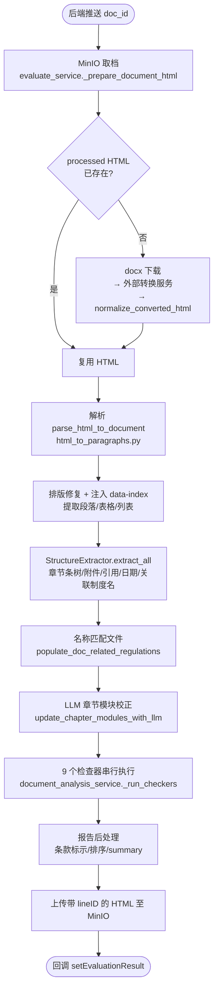

# auditwise

> 以 auditwise（制度审核算法端）为案例的「文档评审流水线」实现剖析 —— 从 docx→HTML 之后开始，逐流程拆解解析、结构化、规则/LLM 检查与 RAG 比对

## 本书说明

**这本书讲什么**：auditwise 是一个制度文件（规章制度）AI 审核系统。本书从算法端拿到 docx→HTML 转换结果的那一刻讲起，沿数据流逐个流程拆解：HTML 规范化与 lineID 注入 → 正则结构化 → 章节模块分类 → 9 个检查器（正则/词性/LLM）→ RAG 制度比对 → 结果回调。每个流程回答三件事：**做了什么、为什么这么做、具体怎么做**（含伪代码、提示词拼接、输入输出、对比与检索细节、正则规则）。

**适合谁读**：
- 想了解 auditwise 算法端实现的人 → 读第 1 章全文链路 + 第 13 章决策速查
- 要接手开发/调参的人 → 按第 2–12 章顺序读，每章独立成篇
- 想查某个具体提示词或正则 → 直接翻附录 A（Prompt 总表）、附录 B（正则总表）

**案例项目**：
- 主语言：Python（FastAPI + Redis Stream + MinIO + Milvus + spaCy + bge-m3 本地模型）
- 一句话定位：接收制度 docx，转 HTML 注入行号后做「六维度」评审（结构格式/关联制度完备性/业务规则清晰度/合法合规性/职责清晰度/考核激励有效性），产出可按行号高亮定位的评审报告

## 代码地图

| 文件 | 职责 | 相关章节 |
|---|---|---|
| `app/application/services/evaluate_service.py` | 评估编排：取档/转换/上传/回调 | 第 1、2 章 |
| `app/infrastructure/utils/convert_api.py` | docx↔HTML 外部转换客户端 + HTML 排版规范化 | 第 2 章 |
| `app/infrastructure/utils/html_to_paragraphs.py` | HTML→段落提取 + data-index 注入 + 修订处理 | 第 2 章 |
| `app/infrastructure/utils/structure_extractor.py` | 章/节/条树、附件、引用、生效日期、关联制度名提取 | 第 3 章 |
| `app/infrastructure/utils/llm_tools.py` | 章节模块分类 + 激励条款分类的 Prompt 与解析 | 第 4、9 章 |
| `app/application/services/document_analysis_service.py` | 检查器编排、报告后处理 | 第 5 章 |
| `app/infrastructure/algorithms/regex_structure_checker.py` | 结构格式 9 项检查 | 第 6 章 |
| `app/infrastructure/algorithms/llm_context_aware_checker.py` | 责任表/主体明确性两路 LLM 分析 | 第 7 章 |
| `app/infrastructure/algorithms/regex_position_checker.py` 等 | 岗位/部门/适用范围正则检查 | 第 8 章 |
| `app/infrastructure/algorithms/rag_legal_compliance.py` | 上位/横向制度冲突比对 | 第 11 章 |
| `app/infrastructure/rag_pipeline/pipeline.py` 等 | 制度库入库管线 | 第 12 章 |
| `app/api/deps.py` | 检查器注册顺序（9 个） | 第 5 章 |

---

## 第 1 章 全景：一次评审的完整链路

> **本章导读**：先建立全书地图——一次评审从哪进来、经过哪些站、每站产什么。后续每章都是这张图上的一站放大。

### 1.1 系统形态与两个入口

auditwise 算法端是一个常驻的 FastAPI 服务（`main.py`），启动时做三件事：连 Redis/MinIO 自检、启动**评审消费者**（`evaluate_queue_consumer.start_consumers`，消费后端推来的 Redis Stream）、启动**入库消费者**（`rag_pipeline.redis_consumer.consume_stream`，消费制度文件解析任务）。同一进程内两条互不相干的队列，对应两条业务线：评审已上传的制度、把制度库文件变成向量。

评审任务有两个入口，最终走同一个 `evaluate_document()`：

| 入口 | 触发方式 | 超时/并发控制 |
|---|---|---|
| 同步接口 `POST /api/v1/evaluate` | 后端直接 HTTP 调用（`app/api/v1/evaluate.py`） | 依赖调用方 |
| Redis Stream 消息 | 后端 XADD 一条含 docId/MinIO key 的消息（`evaluate_queue_consumer._do_evaluate`） | 单任务 900s 超时 + 全局 Semaphore 4（`EVALUATE_CONCURRENCY_LIMIT`） |

另有 `extract_related_regulations_document()`：只做「结构化 + 提取关联制度列表」不跑检查器，按 MQ 消息给的 callbackUrl 回传——供后端在评审前先拿制度清单。

### 1.2 评审主链路鸟瞰



**text 流程**（函数级）：

```
├→ evaluate_document()                      evaluate_service.py
│   ├→ _prepare_document_html()             缓存命中检查 → 转换
│   ├→ analysis_service.analyze_html()      document_analysis_service.py
│   │   ├→ parser.parse_html()              → parse_html_to_document（第 2、3 章）
│   │   ├→ _populate_doc_related_regulations()（第 11.1 节）
│   │   ├→ update_chapter_modules_with_llm()（第 4 章）
│   │   └→ _run_checkers()                  9 个检查器（第 6–11 章）
│   ├→ upload_file_to_minio(html_with_line_id)
│   └→ _callback_report()                   POST setEvaluationResult
```

### 1.3 设计取向总表

| 维度 | 本项目选择 | 被放弃的备选 | 代价 |
|---|---|---|---|
| 结构识别 | 文本正则即时扫描（不依赖 HTML 标签） | 解析时打结构标签存库 | 每次评审重复扫描；好处是前端改标题后无需重新解析 |
| 检查器编排 | 固定顺序串行 | 并发线程池 | 慢；根因是共享 spaCy/jieba 实例并发 `nlp()` 会卡死（代码注释明示） |
| LLM 角色 | 做窄任务（分类/对齐/关系判断），输出 index 或短 JSON | 让 LLM 直接通读全文写报告 | prompt 次数多（按条/按批循环），但每步可验证、可归因 |
| LLM 输出控制 | prompt 约束 JSON + Python 剥 ``` 围栏 + 3 次重试 | OpenAI JSON mode / schema 强制 | 偶发解析失败靠重试兜底 |
| 检索 | 每次评审实时调 Milvus（COSINE 向量 + BM25 稀疏字段） | 本地缓存向量 | 每次评审都要嵌入 25 个 chunk |
| 定位 | lineID（data-index）唯一物理坐标 | 章节编号定位 | 报告 issue 与 HTML 强耦合，但前端高亮零歧义 |
| severity | 一律 Python 端给 WARNING/INFO，不让 LLM 评 | LLM 分级 | 分级粗，但杜绝了 LLM 随意升降级 |

### 1.4 小结

- 两条 Redis Stream、一个进程：评审消费者与入库消费者互不影响，靠不同 Redis 实例隔离。
- 评审主链路是**固定流水线**，不是 Agent 循环——步骤可枚举、错误代价高，固定流程优于自主决策【业界：步骤可枚举且需确定性时选 workflow 而非 agent】。
- 全书后续章节按数据流顺序展开：第 2 章从「拿到 HTML」开始。


## 第 2 章 HTML 规范化与 lineID 注入

> **本章导读**：拿到转换服务吐回的 HTML 后，先做排版修复，再在一次遍历里同时完成「段落提取」与「行号注入」。这是后面所有检查器能精确高亮的地基。

### 2.1 为什么不是直接解析 docx

docx 是 OOXML 二进制格式，直接解析样式/表格/嵌套结构成本高且要自己处理公式、图片、修订痕迹。本项目把 docx→HTML 交给外部转换服务（`CONVERT2HTML_API_URL`，Aspose.Words 内核，`convert_api.convert_docx_to_html()`），算法端只消费 HTML。转换是同步 HTTP POST（multipart 上传 docx 字节，`target=html`，超时 60s）。**为什么缓存 HTML**：同一 doc_id 只转换一次——`evaluate_service._prepare_document_html()` 先查 MinIO 是否已有 `processed_{doc_id}.html`，命中则跳过转换；转换+注入行号后的 HTML 会回写同一个 key，下次评审（或用户在前端改了几处再评）直接复用。

**为什么转换后还要再修一道**：Aspose 的 HTML 有三类已知问题会让前端排版「看起来像文档被截断/图片乱飞」，`normalize_converted_html()`（`convert_api.py`）逐一修复：

1. **段距哨兵**：Word 的 `w:beforeLines/w:afterLines` 是 int32，未设置时哨兵值 `-2147483648`，Aspose 会把它换算成约 `-1.07e8 pt` 的 margin。genoffice-web 前端只认 ≥0 的段距，这种超大负 margin 会把该段之后的正文整体拉出页面。修复：解析内联 style，凡 margin 各分量换算成 pt 后绝对值 > 720（`_MAX_LAYOUT_PT`，即超过一页的段距视为哨兵）直接删除。单位换算用 `_LENGTH_RE` 支持 pt/px/cm/mm/in。
2. **浮动表格**：Aspose 把浮动表写成 `float`，后文会绕排到表旁并上移。修复：table 的 style 一律 pop 掉 `float`。
3. **相对定位图片**：`position:absolute` 的 `` 若最近的定位祖先不是段落，会相对页面定位、图往页首跑。修复：img 的父 `<p>` 若无定位则补 `position:relative`。

### 2.2 排版规范化 normalize_converted_html

伪代码：

```
normalize(html):
    soup = BeautifulSoup(html)
    for el in soup 所有标签:
        style = 解析内联 style 为 dict
        if style 为空 且 el 不是 table/img: continue
        丢弃 |margin 分量| > 720pt 的 margin       # beforeLines 哨兵
        if el is table: 移除 float
        if el is img and position==absolute: 给父 <p> 补 position:relative
        回写 style（空则删除 style 属性）
```

导出方向（HTML→docx，`convert_html_to_docx`）另有一个 `ensure_export_html_document()`：保证输出是完整 HTML5 文档——无 `<html>` 就包一层，孤立 `<body>` 只迁子节点防嵌套，`<head>` 合并时跳过重复 charset。这是给导出链路的稳定性补丁，评审链路不经过。

### 2.3 单次遍历：段落提取 + data-index 注入

核心函数 `_read_html_to_paragraphs_and_inject_line_ids()`（`html_to_paragraphs.py`）。**为什么单次遍历**：段落提取和行号注入需要保证同一个元素「提取到的 text」与「注入的 data-index」严格对应，分开两遍会有顺序漂移风险，且 HTML 解析开销不小，一遍做完最稳。

纳入正文的块级标签：`p, h1~h6, table, ol, ul`。行号从 1 起按文档顺序递增：

```
next_ln = 1
for el in body 中所有块级标签（按文档顺序）:
    if el is p/h1..h6:
        text = 取纯文本(含修订处理); if 空: 跳过（空段不占行号）
        el['data-index'] = next_ln; 记录 {type:paragraph, text, line_number}
    if el is table:
        逐 tr/td 提取单元格文本（表格无内容则跳过）
        el['data-index'] = next_ln; 记录 {type:table, table_index, rows[{row_index, cells[{cell_index,text}]}]}
    if el is ol/ul（且不在表格内，表格内已在 cell 提取时处理）:
        每个 li 单独占一个行号，文本前缀 "1. " "2. " ...   # 替换 HTML 编号为文本编号
```

三个细节：

- **单元格内列表**：`_cell_text_with_numbered_list()` 先收集 `ol/ul` 之前的兄弟节点文本（如「上位制度（法规）名称：」这类前缀不丢），再给每个 li 加 `1. 2. 3.` 编号，前缀与编号列表用换行拼接。
- **响应式字号**：注入行号的同时 `_apply_responsive_typography_deep()` 给块级元素和声明了 font-size 的子孙 span 改写 `font-size`——已有字号用 `min(原字号, clamp(...))`，否则直接用分档 clamp 表达式（h1 24–40px、h2 20–32px、h3 18–26px、h4~h6 16–22px、正文 14–20px）。**为什么写在 span 层**：Word 转 HTML 常把字号写在内联 span 上，只改 p/table 不生效。
- **表格是「一行」**：整个 table 占一个 lineID，rows/cells 结构单独保留——检查器要引用表格内容时按 cell 粒度取（如禁用词检查把所有 cell 文本拼起来扫）。

### 2.4 修订模式（accept/reject）

Word 修订转 HTML 后是 `<ins>`/`<del>` 标签。`_plain_text(node, revision_mode)` 提供两种读法（`html_to_paragraphs.py`）：

| 模式 | `<ins>` | `<del>` | 用途 |
|---|---|---|---|
| `accept`（默认） | 并入正文 | 整棵子树丢弃 | 评审与操作记录——按「接受全部修订后」的文本评 |
| `reject` | 整棵子树丢弃（含其中嵌套的 del——那是插入后又被删的字） | 展开回正文 | 得到修订前正文 |

相邻节点直接拼接、不在标签边界补空格，文档原有空格与 `&nbsp;` 保留；`<br>` 转换行。**为什么要 reject 模式**：file-diff 功能需要比较「修订前 vs 修订后」，两种读法共用同一套遍历，保证逐段对得上。

### 2.5 小结

- 转换交给外部服务，算法端用 `normalize_converted_html()` 修 Aspose 的三类排版 bug（margin 哨兵/浮动表/图片定位），阈值 720pt。
- 段落提取 + lineID 注入一次遍历完成；空段不占行号；列表逐 li 编号；表格整表一行号。
- 修订两种读法（accept/reject）服务评审与 diff 两条链路。


## 第 3 章 即时结构化：StructureExtractor 的正则识别

> **本章导读**：结构（章/节/条/附件/引用/生效日期）完全靠文本正则识别，不依赖 HTML 标签。这一「即时扫描」设计是产品需求（前端改标题后结构自动重组）的直接结果。

### 3.1 为什么不用 HTML 标签识别结构

产品需求（`docs/algorithm_workflow.md` 3.6 节）明确：用户在前端可以直接修改章节标题，修改后结构必须**自动重组**。如果结构在解析期写死（比如给 `<p>` 打上 `chapter` 标签存库），改标题后标签就失效。所以结构识别放到**每次评审时在内存中即时扫描**，只依赖文本内容。代价：每次评审都要重扫一遍；好处：结构与文本永远一致，且同一套正则被检查器复用（第 6 章编号检查、第 7 章按条分组、第 11 章按条切块全部吃同一棵树）。

### 3.2 主循环：单遍扫描的九件事

`StructureExtractor.extract_all()`（`structure_extractor.py`）输入是第 2 章产出的 `paragraphs_info`，一次遍历同时产出 9 类信息。**为什么合并成一次遍历**：附件边界、正文范围、引用位置互相依赖（比如「引用只在第一章之后、第一个附件之前提取」），拆开多遍会重复处理边界判断。

```
主循环 for para in 段落列表:
    ① 附件章节（附件X 格式，4 种模式，见 3.4）
    ② 附件目录（附件：1.xxx 格式，编号行连续收集）
    ③ 正文结构树（HEADER_PATTERN 匹配章/节/条/数字列表标题）
    每个段落若不是标题 → 进 content_buffer，挂到当前栈顶节点
    循环后：
    ④ 填充附件章节内容（含表格单元格展平，重复的三个标签行去重）
    ⑤ 章节条扁平化 → extract_chapter_items（level/index/line_number/title）
    ⑥ 构建章级 toc_items（仅「章」，此处打 module 标签）
    ⑦ 正文段落范围（第一章→第一个附件前）
    ⑧ 引用文件（《...》书名号）
    ⑨ 生效日期行 + 关联制度名称
```

编号体系核心正则（全库统一，防各处手写字符集漂移）：

```python
CN_NUM_CHARS   = r"一二三四五六七八九十百千万零〇○两\d"
CHAPTER_PATTERN = rf"^第?([{CN_NUM_CHARS}]+)(章|节|条)"   # 「第」可省略
HEADER_PATTERN  = rf"^\s*((?:\d+\.)+\d+|\d+\.|第[{CN_NUM_CHARS}]+[章节条]|第\d+[章节条])\s*(.*)$"
```

中文数字转整数 `cn_num_to_int()` 处理三类：阿拉伯数字直接转；「二〇二四」这类**全数字字符无单位**的按位拼接（注释特别说明：「〇」「○」都要收录，否则「第一百○一条」匹配得到却转不成 101）；「二十一」这类带单位的按 十进制规则累加（十=10、百=100、千=1000，temp 缓存乘数）。

### 3.3 章节条树：栈式嵌套与「挤行拆条」

**层级判定** `_get_header_level()`：章=1、节=2、条=3；纯数字列表（`2.` `2.1`）给 level 4+，使其永远隶属于当前章/节/条而不与之平级。树构建用经典栈：新标题弹出所有 `level >= 新标题 level` 的栈顶，栈空则挂根，否则挂栈顶的 children。

**「挤行拆条」**（`_split_embedded_tiao_from_remainder`）：现实文档常见「第一章 总则 第一条 为了… 第一条 …」多个标题挤在同一段。对章/节标题行的剩余文本，用 `ARTICLE_TOKEN_RE`（`第[数字字符]+条`）找所有「第X条」，把每一对（条标、条内文）拆成独立的 level=3 子节点挂到该章下。**为什么只对 level 1/2 做**：条标题与正文同行是正常情况（「第五十二条 本办法…」），条自身走「标题=第X条、同行剩余文本进 content」的规则，不再拆。

**end_index 语义**：每遇到新行，栈内所有祖先的 `end_index` 都被更新为该行号（父章范围延伸到子节点末行）。若有附件，正文所有节点的 `end_index` 被 clamp 到 `第一个附件起始行 - 1`（`_clamp_end_indices`）——保证「最后一条」的范围不会吃进附件。

### 3.4 附件区识别：四种模式与正文边界

附件是制度文档最容易排版混乱的区域，四种模式覆盖：

| 模式 | 正则 | 标题来源 |
|---|---|---|
| 内联 | `附件\s*(\d+)\s*[：:\s]\s*(.*)` | 冒号后；若只有冒号/数字/空格，向下一两行找 |
| 换行 | `附件\s*(\d+)\s*$` | 下一行（最多看 2 行） |
| 无编号裸行 | `^附件\s*[：:]?\s*$` | 下一行，编号按已有附件数 +1 |
| 无编号内联 | `^附件\s*[：:]\s*(.+)$` | 冒号后（排除「附件：1.xxx」目录格式——冒号后以数字编号开头的不算） |

**附件目录**（模式 `附件[：:]` 后接 `1.xxx 2.yyy`）单独识别，条目正则 `(\d+)\s*[.、．]\s*([^0-9]+?)(?=\d+\s*[.、．]|$)` 支持一行多目录项。**关键守门规则**：只有「确实解析出附件章节标题或目录条目」才认定进入附件区（`confirmed_attachment_start_lines`），此后所有行不再计入正文结构树。**为什么这么保守**：正文里偶尔出现「附件」两个字（如「详见附件」），误判会把后半篇正文全部划出结构树。

### 3.5 关联制度名称提取（上位/横向/下位）

`extract_related_regulation_names()` 在附件章节里找「与本制度相关联的制度」内容段（标题正则 `与本制度相关联的制度|关联.*制度|相关.*制度`），提取三个小节（`structure_extractor.py`）：

```
上位制度（法规）名称： → superior_regulation_names
横向相关联制度名称：  → lateral_regulation_names
下位制度名称：        → subordinate_regulation_names
```

提取逻辑（`_parse_regulation_names_under_heading`）要处理一堆脏格式：编号列表项 `1./1、1．/-/•`；**同一行多个编号粘连**（「办法2.中国质量奖3.中国铝业」按 `(?=\d+[.．、]\s*)` 预拆）；断行续接（无标点且 ≤5 字的行拼到上一条）；终止条件（遇到「无」独占一行、或「XXX名称：」小节头即停）。过滤规则：去空白、去重、跳过「无」与「无—18—」类页码组合、长度 ≤2 的丢弃。

这三份名称列表是第 11 章 RAG 比对的检索起点——**谁拿去检索**：上位/横向名称用来匹配制度库文件做冲突比对，三份名称 + 书名号引用一起作为「已声明」集合参与完备性过滤。

### 3.6 引用、生效日期与正文范围

- **引用文件**：书名号 `《([^》]+)》`。**范围限定**：只在「第一个章节标题之后 → 第一个附件之前」提取（引用目录本身在附件里，排除在外）。为定位行号，先把范围内段落拼接成大字符串并记录每段起始偏移，匹配到书名号后用偏移反查行号（`_extract_references`）。
- **生效日期行**：三路来源合并——① 第一条之前所有含 `\d{4}年\d{1,2}月\d{1,2}日` 的行；② 最后一个段落（仅当含「印发/生效」）；③ 显式句式 `自[^。；;\n]{0,50}?起施行`（`_extract_effective_date_line`）。供第 6.5 节日期有效性检查用。
- **正文范围**（`_extract_main_body_paragraphs`）：起点找「第一章」行号，找不到依次退化「第一节」「第一条」，再不行取全文最小行号；终点是第一个附件前一行。这个范围内的段落（含表格）就是 `main_body_paragraphs`——多数检查器的「只查正文不查附件」都靠它。

### 3.7 小结

- 结构识别纯文本正则、每次评审即时扫描，是为了前端改标题后结构自动重组；`CN_NUM_CHARS` 统一数字字符集防各处漂移。
- 章节条树用栈构建，纯数字列表强制 level 4+ 隶属章条；「挤行拆条」处理多标题挤一段的脏文档。
- 附件识别保守守门（确认见到章节标题/目录条目才算进入），正文/引用/生效日期的范围全部围绕「第一个附件」这条边界。
- 关联制度三分类名称（上位/横向/下位）在这里提取，是第 11 章 RAG 比对的输入。


## 第 4 章 章节模块分类：正则先行 + LLM 校正

> **本章导读**：「这一章属于总则还是职责分工」决定了后面激励/职责检查器往哪打。本项目用「关键词先标注 → LLM 校正」两级方案，而不是全交给 LLM。

### 4.1 两级方案的动机

六个标准模块（总则/适用范围/职责分工/管理内容与流程/激励与考核/附则，配置于 `rules.json` 的 `section_modules`）决定了后续检查器的靶区：激励检查器只扫「激励与考核」章节，必备章节检查按模块判断存在性与顺序。**全交给 LLM 的问题**：总则/附则这类章节标题关键词极准（正则零误报），送 LLM 反而引入不稳定 + token 成本；**全交给正则的问题**：「管理内容与职责」这种章标题横跨两个模块、语义判断正则做不了。所以拆两级：`source=regex` 的模块（总则/适用范围/附则）关键词命中即定；`source=llm` 的模块（职责分工/管理内容与流程/激励与考核）先正则给「初步标注」，再由 LLM 统一校正。

### 4.2 第一级：关键词正则标注

解析阶段（`parse_html_to_document` → `_build_toc_items`）就为每个「章」打 module 标签：`_match_modules_for_title()` 把该章**标题 + 内容**去空格拼接，对每个 module 的 keywords/title 列表做包含匹配，**命中任意一个关键词即归入该模块，一章可同时属于多个模块**（全部命中都收）。标题未命中的模块再用内容兜底匹配。这一步的结果直接写入 `doc.toc_items`。

### 4.3 第二级：LLM 校正 Prompt 与回写

`update_chapter_modules_with_llm()`（`llm_tools.py`）在检查器执行前调用，失败静默（保持正则标注不变，主流程不中断——`document_analysis_service.py` 里 try/except 包裹并打日志）。

**Prompt 拼接结构**（`build_chapter_module_classification_prompt`）：

```
角色：你是一个制度类文件的审查专家，为每一章打模块分类标签
任务说明：基于章节列表判断 module；「初步标注（关键词匹配，供参考）」
【必备模块】：职责分工、管理内容与流程、激励与考核        ← 只列 source=llm 的
重要说明：一章可属于多个模块；各模块的判定细则（如「责任追究不视为激励与考核」）
章节标题列表（纯标题，供先判断顺序，不受内容预览干扰）
文档章节列表：
    第三章 职责与分工
        初步标注（关键词匹配，供参考）: 职责分工
        location=105-142
        内容预览: （前 200 字）
    ...
输出要求：严格 JSON {"chapters":[{"index","title","module":[...]}]}，
        仅可使用【必备模块】中的名称，无效名称将被忽略
```

**细节**：① 只送「module 不全为 regex 模块」的章节——纯总则/附则章不进 prompt（省 token）；② 每章带 `location=起始-结束行号` 和 200 字内容预览，让 LLM 有语义依据；③ 同时给纯标题列表，提示 LLM「先基于此判断顺序」。

**输入输出**：输入 = 上述 prompt（一次调用）；输出 = JSON，经 `parse_chapter_module_classification_response()` 解析——剥 ``` 围栏、`module` 数组做**白名单过滤**（只保留 `source=llm` 的模块名，LLM 幻觉出的「行政人事」直接丢弃）。回写规则：**仅覆盖 LLM 有返回的章**，未返回的章保持正则标注；整次调用失败则完全不写。

### 4.4 小结

- 两级分类：regex 模块正则直判（稳定零成本），llm 模块正则给初标 + LLM 校正（覆盖语义横跨）。
- LLM prompt 里把「正则初标」作为参考信息注入，相当于给模型先验；输出做白名单过滤 + 部分覆盖，失败静默降级到正则结果。
- 这一章的分类结果是第 6 章（必备章节/顺序）、第 9 章（激励靶区）检查器的直接输入。

## 第 5 章 检查器框架与执行模型

> **本章导读**：9 个检查器怎么注册、怎么串行执行、失败怎么兜底、报告怎么统一后处理。这是所有算法的公共底座。

### 5.1 检查器清单与注册顺序

`app/api/deps.py` 的 `get_active_checkers()` 硬编码注册 9 个检查器，`DocumentAnalysisService._run_checkers()` 按此顺序串行执行：

| # | 检查器 | 类型 | 评审维度（issue.type） |
|---|---|---|---|
| 1 | RegexStructureChecker | 正则+spaCy | structure_and_format |
| 2 | RegexProcessFlowChecker | 正则+spaCy | business_rule_clarity |
| 3 | LlmContextAwareChecker | LLM（按条循环） | responsibility_clarity / business_rule_clarity |
| 4 | RegexScopeChecker | 正则 | responsibility_clarity / business_rule_clarity |
| 5 | LlmIncentiveTierChecker | LLM（整章一调） | incentive_effectiveness |
| 6 | RegexPositionChecker | spaCy+词库 | structure_and_format |
| 7 | LlmResponsibilityChecker | LLM（10 段/批并发） | responsibility_clarity |
| 8 | RegexDepartmentChecker | spaCy+词库 | responsibility_clarity |
| 9 | RagComplianceChecker | RAG+LLM | legal_compliance / related_regulations_completeness |

### 5.2 两类基类与统一重试

- **BaseRuleChecker**（`domain/services/base_checkers.py`）：确定性检查器基类，`check()` 直接转发 `validate_rule()`。
- **BaseLLMChecker** → **BaseJsonLlmChecker**（`infrastructure/algorithms/base_json_llm_checker.py`）：LLM 检查器基类。核心统一逻辑：
  - **重试**：`check()` 里调用失败与解析失败共用同一预算 `MAX_LLM_RETRIES=3`，指数退避（1s 起步 ×2）。用尽后返回空结果（该检查器本轮静默放弃）。gateway 层（`OpenAILLMGateway`）不做重试——注释明确「重试预算由 Checker 统一」，避免两层重试叠乘。
  - **JSON 解析**：`parse_response()` 剥 ```json 围栏 → `json.loads` → 遍历 `issues[]` 组装 `AnalysisIssue`；单条解析失败跳过不拖累整批。**severity 不由 LLM 回传**，Python 统一设 WARNING（注释：后续可按 description 再分级）——为什么：让 LLM 评严重级别既不稳定也不可控。
  - **通用 system prompt**（`get_system_prompt()`）：规定「You are an automated compliance auditor」+ JSON 格式 + 无问题时返回 `{"issues": []}` + 除 JSON 外不输出任何文字。子类把这个 prompt 拼进自己的 f-string 大 prompt 开头。

### 5.3 串行执行与静默失败

`_run_checkers()` 逐个调用，每个用 `_safe_check` 包 try/except：**单个检查器异常只记 `checker_errors` 打日志，不中断其他检查器**（评审报告是多个维度的合集，一个维度挂掉不应清空整份报告）。两条注释级理由值得记住：

- 为什么不并发：多个检查器共用同一 spaCy/jieba 实例，并发 `nlp()` 会卡死（`_run_checkers` docstring 明示）。
- 失败上报：检查器可通过 `get_checker_errors()` 上报内部错误（如禁用词 API 挂了），服务层汇总进 `report.checker_errors`，让前端知道「这个维度没查成」而非「查过没问题」——这两者业务含义完全不同。

### 5.4 报告后处理：条款标示、排序、summary

检查器全部跑完后（`document_analysis_service.py`）：

1. **`map_issue_title_markers()`**（`issue_report_mapper.py`）：按 issue 的行号区间反查结构树，把 `issue.title` 改写为「第X章/第X节/第X条/附件/无定位」标签（原语义标题挪到 `issueTitle`）；命中「条」时回填 `clauseIndex = section.index`。定位算法：先找「完全包含该区间」的节点（按范围最小→层级最深优先）；章/节节点还会下钻找其**第一条**（用户实际按条看问题）。找不到包含的就退化为「重叠」节点，再不行标「附件」或「无定位」。
2. **排序**：`issue_report_sort_key` 按 (start, end, code, issueTitle) 稳定排序——注释明示是为了消除「并发检查器导致返回顺序随机」。
3. **summary**：`_build_summary_from_issues()` 按 issue.type 统计六维度数量，用固定模板拼装中文总结（好的维度列举、差的维度带数量与专用话术，合法合规性问题提示「需优先关注」）。纯模板，不调 LLM。
4. **附加产物**：`related_regulations`（解析阶段匹配结果直接复用）、`clause_department_map`（第 8.4 节部门计分产出）、`responsibility_table_minio_key`（第 7.3 节 Excel）。

### 5.5 LLM 接入层与全局调用参数

所有 LLM 调用走同一扇门：`OpenAILLMGateway.complete(prompt, options)` → OpenAI SDK（兼容 DeepSeek 等端点），`messages=[{role:user, content:prompt}]`——**本项目没有独立 system message，system prompt 一律拼进 user content**。全局参数（`llm_gateway.get_default_llm_options()`）：`temperature=0.3`、`extra_body={"chat_template_kwargs":{"enable_thinking":False}}`（关掉 qwen3 的思考模式，压延迟）、超时 120s。模型默认 `qwen3`，端点为中铝 API 网关（`app/core/config.py`，均可环境变量覆盖）。

### 5.6 小结

- 9 个检查器固定顺序串行，单点失败静默兜底并上报 checker_errors，报告永远能出。
- LLM 检查器统一吃 BaseJsonLlmChecker 的重试/解析/severity 管线；调用层温度 0.3、关思考模式、无独立 system message。
- 报告后处理三件套（条款标签映射/稳定排序/模板 summary）是所有检查器共用的「最后一公里」。

## 第 6 章 结构与格式检查（RegexStructureChecker）

> **本章导读**：9 项子检查全部确定性算法，零 LLM。重点拆解编号状态机、禁用词「单独成词」判定和引用双向比对。

### 6.1 九项子检查总览

`RegexStructureChecker.validate_rule()` 按固定顺序跑九项，全部确定性算法、零 LLM（`regex_structure_checker.py`）：

| 子检查 | code | 逻辑要点 |
|---|---|---|
| 1 必备章节+顺序 | STRUCT-001 | 6 模块存在性；首章含总则、末章含附则；职责分工/管理内容与流程不得只出现在第一章 |
| 2 禁用词 | STRUCT-002 | 后端双词库合并，长词优先，部分词须「单独成词」 |
| 3 章节编号 | STRUCT-003/004/006 | 章/节/条状态机（见 6.3） |
| 4 列表编号 | STRUCT-005/007/008 | 按父前缀跟踪期望编号 |
| 5 附件必备项 | STRUCT-009/010 | 「与本制度相关联的制度」须同时在附件章节和附件目录 |
| 6 必备要素 | CONTENT-001 | 7 要素（适用范围/目的/依据/原则/定义/生效日期/解释权归属）按 source 分总则/附则检查 |
| 7 生效日期 | DATE-001 | 早于系统日期报错 |
| 8 空章节 | STRUCT-011/012 | 只有标题没有内容 |
| 9 引用匹配 | REF-001/002 | 书名号引用 ↔ 关联制度目录 双向比对 |

### 6.2 禁用词：词库拉取 + spaCy 单独成词

**词库从哪来**：不是本地配置——`get_tab_data_from_backend()`（`backend_callback.py`）同步 GET 后端 `getTabDataList?tabType=abandoned`（禁用词库）和 `tabType=customise`（自定义禁用词库），合并成 `{word: 提示词}` 表（customise 同 key 覆盖）。**为什么放后端**：禁用词是运营可维护数据，改词不用发版。API 失败不报 issue 而是写入 `checker_errors`。

**匹配**：所有词按长度降序拼成 `|` 交替正则（长词优先，防「应当」被「应」截胡），逐段 `re.finditer`。段落级定位，命中词写入 `keyword=[词]`、`keywordIndex=[字符偏移]`——前端可精确高亮到词。

**「单独成词」判定**（`_is_standalone_token`）：`rules.json` 的 `forbidden_words_require_standalone` 列了 8 个字（为/应/或/须/要/如/若/凡）——这些字出现在「应当」「或者」「如果」里不该报。判定方式：对所在句子跑 spaCy，**只认 `token.idx == match.start()` 的 token**（注释解释：不能用「包含该位置」的 token，否则会错拿前一个 token），token 文本等于匹配词才算单独成词。再叠加一层兜底表 `_STANDALONE_COMPOUND_OVERRIDE`：分词器偶尔把「或者」拆成「或」「者」两个单字 token，此时直接看原文该位置是否以复合词开头，是则不算单独成词。**为什么需要兜底**：spaCy 中文模型的分词粒度不稳定，纯正则位置对齐扛不住。

### 6.3 章节编号状态机（跳号/重号/回退）

`_analyze_numbering()` 是一个三层状态机，输入是第 3.3 节产出的章/节/条列表（**附件内的条先被过滤掉**——附件里的「第X条」是附件自己的体例）：

```
章：expected = 已见章数 + 1
    idx == expected           → 正常，seen_zhang.add(idx)
    idx ∈ seen_zhang          → 重号（如第七章后又写第六章附则）
    idx < expected 且未见过   → mismatch（编号错误，应为 expected）
    idx > expected            → 跳号；同时接受该章号（防「跳号后全错」雪崩）
    每遇新章：节计数与 seen_jie 重置
节：同章逻辑，但 expected = 本章内已见节数 + 1
条：先探测模式——新章第一条若是 1 → reset 模式（每章重置）；
    若新章第一条 > 1 且此前无模式 → continuous 模式（全文连续编号）
    跳号后出现「比期望小」的条号：静默重新同步（count=idx），不报
```

**为什么条要做双模式探测**：公司制度两种体例都合法——全文 1~N 连续编号、或每章从第一条重新开始。不探测就会把合法体例误报成跳号/重号。**为什么「回退不报」**：跳号（如缺了第五条）之后，第六条按 reset 模式算 expected=5 而实际 idx=6，若逐个报会把错误放大成 N 条 issue；同步计数只报真正跳号那一条。

issue 文案用 `int_to_cn_num()` 把期望值转成中文数字（「请改为『第五条』」），超出常用范围（≥1000）回退阿拉伯数字。

列表编号（`_analyze_list_numbering`）用 `expected_map: {父前缀元组: 期望值}`：`1.2.3` 的父前缀是 `(1,2)`；遇到新父级时期望从 1 起；同时清除该层级之下的过期计数（从 `1.2.3` 切到 `1.3` 时重置 `1.3.x`）。

### 6.4 必备要素与「目的」的词性判定

`rules.json` 的 `required_elements` 7 项，每项含 `alternatives`（同义词组）与 `source`（总则/附则）。检查方式：总则要素在总则整章内容里找任意 alternative；附则要素同理。**「目的」特殊处理**：只在**第一条**里找「为了/目的」；找不到时升级为词性分析——`_first_tiao_has_purpose_pattern()` 对第一条跑 spaCy，存在「为」后紧跟 VERB/AUX（如「为**加强**…」「为**规范**…」）即视为有目的。**为什么**：「为了」是显式标记，但很多制度用「为加强…制定本办法」句式，「为」+动词的句法模式等价于目的表述，纯字符串匹配会漏。缺失要素按 source 分组合并成一条 issue，高亮只打在章节标题行。

### 6.5 生效日期、空章节、引用双向比对

- **生效日期**（`_check_effective_date_validity`）：汇总第 3.6 节的三路日期行 + 附则中含「生效日期」alternatives 的行；含「印发之日/颁布之日/发布之日/公布之日」的**即时生效表述跳过**（无固定日期可比）；解析出日期且 `date < today` 报 DATE-001。为什么定位到行：报错文案要求用户核对具体那句话。
- **空章节**：递归查结构树，判定条件三条同时满足——`content` 空、标题去掉「第X章/节/条」前缀后无内容、无子节点。注释特别说明「条」的内容常直接接在标题后（「第一条 为了…」），这种不算空。
- **引用双向比对**（`_check_reference_match`）：集合 A = 正文书名号引用（第 3.6 节提取），集合 B = 关联制度三分类名称（上位+横向+下位，第 3.5 节提取）。A 有 B 无 → REF-001（引用了但目录没列）；B 有 A 无 → REF-002（目录列了但正文没引用，INFO 级）。比对前双方去书名号归一化；正文引用若命中的是**本文档附件章节标题**（子串互含）则跳过——引用本制度自己的附件不算外部文件。**谁跟谁对比**：正文 ↔ 附件目录，这是制度文书「引用闭环」检查，防止「文中提了文件但关联清单漏登」或反过来。

### 6.6 小结

- 九项检查全是规则引擎，LLM 零参与——凡是能用确定性算法判的（编号/日期/关键词），不消耗模型。
- 两个工程细节最值得复用：禁用词「单独成词」的 spaCy token 对齐 + 原文复合词兜底；条编号的 continuous/reset 双模式探测 + 回退静默同步。
- 词库（禁用词）与配置（必备要素/模块）分离：运营数据在后端 API，体例规则在 rules.json。

## 第 7 章 流程语句识别与上下文感知 LLM 分析

> **本章导读**：本章覆盖三个联动流程：spaCy 动词校验（供前两个检查器共用）、正则流程高亮、以及按「条」逐条调 LLM 的两路语义分析（责任表 / 主体明确性）。

### 7.1 指令性动词提取：正则粗筛 + spaCy 词性验证

`get_imperative_verb_pos_analysis()`（`context_aware_utils.py`）是第 7.2/7.3/7.4 节的共同上游。流程：

```
1. 取 rules.json 的 24 个指令性动词（应当/负责/编制/提交/审核/报批/审批/存档/…）
   按长度降序拼正则，逐段 re.search 粗筛          # 快，先砍掉无动词段落
2. 命中的段落再跑 spaCy 分词+词性
   verified = {token.text | token.pos_ ∈ {VERB, AUX}}
3. 对每个正则命中词 w：
   w ∈ verified → 有效
   w 是某 verified token 的子串（如「审批」在「审批同意」里）→ 有效
4. 至少一个有效动词才输出 {line_number, text, verb_keywords[去重]}
```

**为什么要 spaCy 二次验证**：词表匹配会把名词误收——「进行检查」的「检查」是动词没问题，但「检查表」「检查组」里就不是。**为什么词性标注不能单独用**：注释说明曾用字符偏移对齐，但 Jieba/spaCy 对空格处理不一致导致 offset 偏差，改成「段落级集合验证」——只要该词在本段**曾经**被标为 VERB/AUX，本段所有该词的正则命中都算数。情态动词「应当」被标 AUX 也一并收。

### 7.2 流程段落高亮（五类特征聚合）

`RegexProcessFlowChecker` 不直接报「错误」，而是把疑似流程描述的段落标出来供人工确认（HIGHLIGHT-PROCESS-001，INFO 级）。五类采集器各自往 `by_line[line].{keywords, context_sentences}` 里填数据：

| 采集器 | 特征 | 实现要点 |
|---|---|---|
| (1) 动词 | 7.1 的 verb_keywords，段内 ≥2 个才收 | 含动词的句子进 context |
| (2) 单位 | require_organization_keywords（总经理/董事会等 7 个）+ 岗位库（后端 tabType=position）+ 部门库，长词优先正则 | 命中 require 词时 context 换成**整段** |
| (3) 条件句 | `([^。；]+时[，,]\s*[^。；]+[；;])` | 「A 时，执行 X；」模式 |
| (4) 顺序词 | 首先/其次/接着/然后/最后/随后/之后 | 逐句正则 |
| (5) 单位+动词短语 | 对每个动词命中位置，取**前 20 字**窗口，看是否以某单位词结尾 → 组「单位+动词」短语 | 「部门领导**审核**」这类流程话术 |

**产出门槛**（防误报的三道闸）：每行聚合后须①关键词 ≥2 个；②该行动词数 ≥2（或含 require 单位词）；③「只有部门名没有动词」不报。满足后：是「整个流程」（≥2 动词或含 require 单位）则 context 给整段，否则给相关句子集合。

### 7.3 责任表提取：每条一调 + Excel 落 MinIO

`LlmContextAwareChecker` 把 7.1 的动词段落按「条」分组（`_group_paragraphs_by_article`：行号 ≤ 段落行号的最近一条即其父条；无条款结构则整文档一组）。**责任类动词**（负责/牵头/配合/审核/审批，硬编码于 `RESPONSIBILITY_VERBS`）命中的条走责任表路子，**每个条单独调一次 LLM**。

**Prompt 拼接**（`_build_responsibility_prompt`）：

```
{通用 system prompt（JSON 格式约束）}
## 任务：提取「流程环节-责任主体」对应关系
数据格式说明：行号+原文列出；判断主体须考虑整段（含标题行）——
  例：首段「第十二条 各单位档案管理部门应当履行下列职责：」已明确主体，
  后续「（二）制定…」继承「各单位档案管理部门」
### 分析要求：
1. 提取流程环节，process_step 必须为原文完整截录，不得概括改写
2. 责任主体判定四分支：
   清晰分工 →「A部门（主责）、B部门（辅责）」
   共同负责 →「共同负责：A部门、B部门」
   缺失     →「缺失」（仅当标题和段落都没有主体）
   泛化     →「泛化：<原文中的词>」（仅当原文实际出现「相关部门」等字眼）
   排除项白名单：「各单位」「各部门」「档案管理部门」等 ≠ 泛化
## 待分析条款
---
关键动词：{all_verb_keywords}
行号：X 原文：...
行号：Y 原文：...
---
## 输出要求 + JSON schema + 示例输出（4 行示例覆盖四种分支）
```

**输入**：单条条款的格式化文本（标题行 + 含动词段落，均带行号）。**输出**：`{"responsibility_table":[{line_number, process_step, responsible_party}]}`。

**解析与 issue 生成**（`_parse_responsibility_table`）：`re.search(r"\{[\s\S]*\}")` 抓 JSON → 遍历表格行，`responsible_party` 三分支出 issue：`缺失` → RESPONSIBILITY-002「流程环节缺少责任主体」；`共同负责` → 「职责划分不清晰」；`泛化：X` → **先校验 X 确实出现在该条原文里**才报「责任主体表述过于泛化」（见 7.5）。行号定位：先在条款标题行找 process_step，再逐段找。所有表格行（含不出 issue 的）写 Excel（流程环节/责任主体/制度中的位置三列），上传 MinIO `/responsibility-analysis/{doc_id}/result.xlsx`，key 通过 `get_responsibility_table_minio_key()` 回传给报告——前端可下载完整责任表。

### 7.4 主体明确性检查：三要素判定 + 白名单

**其他指令性动词**的条走 `_build_general_prompt`。Prompt 结构：角色（制度审计专家）→ 第一步「核心排除准则」（两种绝对 OK 的情况：对事不对人的描述性条款；组织机构实体白名单——「各单位/各部门/公司/集团/具体部门/具体岗位」）→ 第二步「三要素判定」（同时满足才报：① 任务要素——正在指派具体业务动作；② 泛化要素——主体仅用「相关部门/有关部门/相关人员」等模糊词；③ 全局要素——**整个条款（段落+条款标题）完全没出现任何白名单词**）→ 待分析条款 → 输出要求（**「绝大多数条款都应该是主体明确的，不需要报 issue」**——显式压制 LLM 的报问题倾向；字段要求 title/description/suggestion/location.start_index=条款行号）。

解析复用父类 `parse_response` 后逐条改写：`type=business_rule_clarity`、`code=CONTEXT-LLM-001`、content 回填整条原文、keyword 填该条所有指令性动词。

### 7.5 幻觉防线：解析层的原文校验

两个「LLM 说了不算」的校验点，值得单独记住：

1. **泛化 issue 的原文校验**（7.3）：LLM 输出「泛化：相关部门」时，Python 在该条完整原文里 `display_party in full_content` 找一遍，找不到就**不出 issue**——防 LLM 幻觉出原文没有的泛化词。
2. **process_step 的原文兜底**（`_extract_sentences_for_process_step`）：issue 的 `sentences` 优先直接用 LLM 返回的原文片段（前提是它确实 `in full_content`）；找不到则退化为「含动词关键词的句子」截取前 5 句。

另外 `_classify_paragraphs` 阶段就完成分流：含任一责任类动词的段落进责任路，其余进主体路——两类互不重复送 LLM。

### 7.6 小结

- 「正则粗筛 + spaCy 词性验证」两级动词提取，成本与精度兼顾；结果被流程高亮和 LLM 分析两个检查器复用。
- 责任表检查按条一调（prompt 短、上下文准），产出双通道：issue + 可下载 Excel。
- 两个防幻觉锚点：泛化词必须原文存在、process_step 必须原文可定位——LLM 的输出只是「候选」，Python 拿原文做终审。

## 第 8 章 业务准入检查：适用范围、岗位、部门

> **本章导读**：三个正则/词性检查器，共享同一套工程手法：词库从后端拉、长词优先匹配、停止词截断、本段最长组词消歧。各自的业务规则完全不同。

### 8.1 适用范围检查（RegexScopeChecker）

业务规则很具体（带公司背景的定制规则）：总则的适用范围若只写「公司本部」而全文没提「重庆中心」，要提醒补描述；若正文多处出现「子公司」但适用范围没含子公司，也要提醒。判定链：

```
1. 取总则（get_section_by_title(r"总则|第一章")）内含「适用」的段落
2. 句级拆分（[。；;，,、\n]+），存在「适用 ∧ (子公司 ∨ 全级次)」的句子
   → 适用范围已含子公司 → 整个检查直接通过，return
3. 否则按「不适用子公司」走三条支线：
   3.1 公司本部判定：无排除词（子公司/集团/总部/全级次）
       且命中 COMPANY_HQ_PATTERNS 之一（公司本部 / 适用于公司各部门、各中心 / 适用于.*公司.*各部门）
       → 查正文是否含「重庆中心/重庆」，无则 SCOPE-001
   3.2 附则检查：附则存在但没有「子公司 ∧ (制定 ∨ 参照)」的条款
       → SCOPE-SUB-APPENDIX-001（建议补「各子公司结合实际制定本单位相关制度。」）
   3.3 全文扫「子公司」：排除适用范围行；附则内的「子公司+制定/参照」豁免，
       其余每处报 SCOPE-SUB-NOT-APPLY-001
```

**谁跟谁对比**：适用范围条款 ↔ 正文/附则——「正文用到了子公司但适用范围没覆盖」是典型的制度自洽性问题。

### 8.2 岗位称谓检查（RegexPositionChecker）

目标：找出「不在岗位库中的称谓」（POSITION-001）。岗位库从后端 `tabType=position` 拉取，先标准化：strip → **剥级别前缀**（一级/二级/…/高级/资深共 16 个，循环剥到剥不动）→ NFKC 归一化 → 去重——「三级高级业务主管」和「业务主管」在库里等价。

**整词提取**（`_extract_positions_with_info`，spaCy）：

```
for token in 分词结果:
    for suffix in 21 个后缀（助理/专家/董事长/…/员/人员，长词优先）:
        if token 以 suffix 结尾:
            前缀 = token[:-len(suffix)]；前缀含停止词 → 放弃
            记录 [前缀]+[后缀] 组合
            向前扩展：最多 3 个名词性 token（NOUN/PROPN/ADJ）
                遇到停止词性（ADP/CCONJ/VERB/PART/…）或停止词（各/本/该/上级/…）即停
            每个前缀截断组合也生成候选（「部门业务系统管理员」会产生 3 个候选）
过滤：纯后缀丢弃、长度<2 丢弃、含 EXCLUDED_POSITIONS（公司/集团/相关人员等泛指）丢弃
```

**跨段二次验证**（处理「企\n业财务人员」式断行词）：本段提取出的岗位若出现在**段首**，不直接采信——拼「上一段末尾 10 字（`_PREV_TAIL_LEN`）+ 本段」重新提取；若某岗位起始于上一段部分且覆盖段首词、且该岗位在上一段的部分不是独立岗位词，判定「跨段消费」：岗位归上一行，本段删掉段首词。若上一段前缀本身是完整岗位词（「企业\n财务人员」的「企业」），则保留本段的「财务人员」。

**比对与消歧**：

- **文档内相似性**：同后缀下 A⊂B → 包含关系；跨后缀前缀互含 → 同前缀。写入 SimilarityInfo。
- **岗位库参考**：`find_similar_in_db` 找库里包含/被包含/同前缀的标准岗位，写进 issue 描述「岗位库中可参考：[…]」。
- **出 issue 三道闸**：不在库 ∧ 不含排除词 ∧（仅「人员」时不报）；**只报本段内最长组词**（「市场交付中心」在库不报，第二句单独出现「交付中心」才报）；该行若是书名号引用行且引用标题含待报词则跳过（文件名里常含岗位字样）。

### 8.3 部门名称检查与条款归属（RegexDepartmentChecker）

部门检查与岗位检查同构但独立实现（部门后缀 4 个：部门/部/办公室/中心）。特有两个机制：

- **「填满」算法**（`_try_fill_from_library`）：候选（如「产权部」）是某库名（「财务产权部」）的子串时，从候选位置**按字符**向前吞（窗口 = 最长需吞前缀 ×2 + 10），若吞到的字恰好等于缺的前缀 → 视为命中库中全名不报。支持跨段（拼上一段末尾）。「XX部门」与「XX部」先归一化（去「门」）再比对。
- **试用拼接**：向前收集前缀时，每试探一个 token 先试「拼上它是否成库名」——是则无视停止词/词性限制继续吞（优先拼出库中完整名称）。
- 报 issue 前再做「本段最长组词」消歧 + 「候选以库中词结尾」豁免（「司财务产权部」以「财务产权部」结尾 → 视为已用库中词）；建议语里给出库中完整名称。

### 8.4 职责关键词计分：条款→部门映射

`build_clause_department_map()`（不产 issue，产出报告的 `clause_department_map` 字段，供前端按条款显示归属部门）。配置在 `rules.json` 的 `department_responsibilities`：14 个部门，每个含 `core`（核心词）、`patterns`（词组合，须全部命中）、`exclude_core/exclude_patterns`。

```
对每个条款（计分文本 = 所属章纯名称 + 条全文）:
    按句切分（[。；;]+），逐句对每个部门计分：
        core 命中一个 +10
        patterns 全命中一个组合 +15
        pattern_direct_threshold=true 时任一命中 → 单句分直接抬到 26
        exclude 命中 → -50
    条款总分 ≥ 25 的部门全部入选（按分数排序，多部门可并列命中）
    无部门达标 → 兜底：从附则「解释」句提取部门（「本办法由XX部负责解释」）
                  向前贪婪取汉字前缀，遇停止词/排除词截断
最后补 {clauseIndex: 0, clauseTitle: 无定位, department: 文件编写部门} 兜底项
```

部门名到 id 的映射做三级匹配：全称精确 → 展开项精确（「办公室(党委办公室、董事会办公室)」按括号拆开匹配）→ 互含匹配取最长。

### 8.5 小结

- 三个检查器共享工程手法：词库后端拉、NFKC 归一化、长词优先、停止词截断、本段最长组词消歧——这五件事是「中文词库比对」类任务的通用骨架。
- 「填满」算法（子串向库中全名补全）与跨段二次验证，本质都是处理**分词边界 ≠ 词边界**的现实——中文没有空格，任何基于 token 的提取都要防断词。
- 条款→部门映射是「关键词计分」而非语义判断：规则可审计可调参（阈值 25、加減分明晰），但依赖 rules.json 的词表质量。

## 第 9 章 考核激励分档检查（LlmIncentiveTierChecker）

> **本章导读**：「LLM 只回答条款序号，Python 负责取内容和出 issue」——这是全书最典型的「LLM 最小化输出」设计，失败时还有纯关键词兜底。

### 9.1 定位激励章节并按条切段

`LlmIncentiveTierChecker` 继承的是 BaseRuleChecker（不走 BaseJsonLlmChecker 的重试管线，LLM 调用封装在 `llm_tools.classify_incentive_articles_with_llm` 里，失败返回 None）。流程：

1. 从 `doc.get_chapter_toc()` 找 module 含「激励与考核」的章；若多个候选，**剔除同时命中职责分工/管理内容与流程的章**（横跨多模块的章优先归其他维度），仍剩多个才全部纳入。
2. 按章的 `full_title` 反查结构树拿行号范围；范围内按「条」切段（每条 = 本条标题行到下一条标题行前一行），每段保留 `(start_line, end_line, full_text)`；与章节标题完全相同的段剔除。
3. 无条结构的章节直接返回空（不报 issue）——宁可漏报不误报。

### 9.2 LLM 分类 Prompt（整章一调）

`build_incentive_tier_classification_prompt()`（`llm_tools.py`）把**整章所有条一次送入**（不是按条循环——条数有限，一次调用省往返）。拼接结构：

```
角色：制度类文件审查专家，判断激励与考核章节每条是否做了明确、量化的规定
## 背景与标准：反例（「取得突出效果的应当予以奖励」未量化）/ 正例（提成比例分档累进）
## 重要规则：按《某办法/规定》执行 = 已有引用，不算未量化（附两条原文示例）
## 任务：仅输出两类条款的序号（index）：
   有量化（有分档/比例/数字/引用）→ quantified_indices
   涉及奖惩未量化 → unquantified_indices
   纯说明 → 两边都不放
## 条款列表：每条以【条款N】（行号 start-end）开头，N 从 0 起
## 输出要求：只输出 {"quantified_indices":[...], "unquantified_indices":[...]}
```

**关键设计：LLM 只输出 index 数组**——不输出内容、不输出理由。为什么：让 LLM 抄写条款原文既浪费 token 又容易抄错（错一位行号就高亮错段）；index 对应关系由 Python 维护，LLM 只做「分类」这一件事。

**解析**：剥围栏 → `json.loads` → 两个数组各自做 `0 ≤ x < 条款总数` 边界过滤与 int 化（越界的 index 静默丢弃）。解析失败返回 None。

### 9.3 出 issue：Python 侧二次校验与关键词兜底

拿到两类 index 后（`llm_incentive_tier_checker.py`）：

- **没有任何量化条款** → 只报一条 INCENTIVE-NO-TIER「考核激励无分档」，定位在章节标题行，其余不报。
- **有量化**（quantified）：每条做 Python 二次校验——按标点拆句后，仅保留含 `TIER_KEYWORDS`（档次/分档/等次/等级/提成/比例/占比/权重/排名/排序/分类/评定 12 词）**或含数字**的句子（句首列表编号 `1.` `（1）` 的数字先剥掉再判，防「1. 核心指标」误判）；**一条都筛不出来则整条不报**（LLM 误判防线）。筛出的句子进 issue INCENTIVE-002 的 sentences 精确高亮。
- **未量化**（unquantified）：整条内容入 sentences，INCENTIVE-001「考核激励未量化」。
- **LLM 失败兜底**：`classify_incentive_articles_with_llm` 返回 None 时走纯关键词模式——只对含 TIER_KEYWORDS/数字的条报 INCENTIVE-002（不报未量化，因为关键词法判不出「未量化」这个否定性结论）。

### 9.4 小结

- 「LLM 出 index、Python 出内容」的分工把 LLM 的出错面压到最小：分类错了顶多漏/多一条 issue，不会污染文本。
- 「按《某文件》执行视为已引用」作为显式规则写进 prompt——这类业务例外不写进去，LLM 一定会把引用型条款误报成未量化。
- 兜底链完整：LLM 失败退关键词、关键词筛不出句子则放弃该条——每一层都有明确的降级语义。

## 第 10 章 部门职责一致性检查（LlmResponsibilityChecker）

> **本章导读**：把制度里「某部门负责 XX」的段落与后端职责清单逐段并排送 LLM 判断一致/不一致，10 段一批、4 线程并发——全书唯一的多线程 LLM 批量检查器之一。

### 10.1 段落定位与职责清单装配

`LlmResponsibilityChecker` 回答的问题是：制度里说「某部门负责 XX」，XX 真的是该部门的职责吗？数据侧：

- 部门列表：`rules.json`/后端 `tabType=department`（经 `get_department_list()`），14 个部门如「财务产权部(资本运营部)」。
- 职责清单：`get_department_responsibilities()`，`{部门名: 职责描述文本}`。key 可能是括号复合名，`_find_department_in_key()` 用「部门名 in key」做包含匹配。
- 段落定位：部门名按长度降序拼正则，扫 `main_body_paragraphs`；段落内出现的每个部门都查一次职责描述，**只有至少一个部门查得到描述的段落才入选**（提了部门但库里没职责描述的，无从比对，不送 LLM）。

### 10.2 批次 Prompt 与并发执行

**Prompt 拼接**（`_build_prompt_from_paragraphs`）——这是全书唯一「参考材料内嵌」型的 prompt：

```
{通用 system prompt}
## 任务：分析段落中描述的部门职责是否与「职责清单参考」一致
### 判断标准：
1. 一致：描述的工作属于参考清单中该部门的职责范围
2. 不一致：不属于该部门职责范围，或与其他部门职责重叠/冲突
### 注意事项：
- 只关注明确提到的部门与其被分配的职责
- 只提部门名未描述职责 → 不算不一致
- 职责描述宽泛时，合理归属即可，不需逐字匹配
## 待分析段落
### 段落 1
- 行号：105
- 原文：财务产权部负责组织年度预算编制与考核…
- 涉及部门：财务产权部
- DB 职责清单参考：
  - 财务产权部：负责全面预算管理、资金计划、产权管理…
### 段落 2 …
## 输出要求：仅不一致时出 issue；全合理返回 {"issues":[]}
  字段：title/description（哪个部门被分配了什么职责、为何不在其范围）/
       suggestion/location.start_index=段落行号
```

**输入输出**：输入 = 每段「原文 + 该段涉及的部门 + 对应 DB 职责描述」；输出 = 仅含不一致项的 issues JSON。解析复用 BaseJsonLlmChecker（重试 3 次共用），解析后 `type=responsibility_clarity`、`code=RESPONSIBILITY-001`、按 `location.start_index` 从行号映射表回填 content=原文。

**批次与并发**：10 段一批（注释：职责检查 prompt 较长，批次小一些），批次数取 `min(4, n)` 个线程用 ThreadPoolExecutor 并发提交——**注意与第 5.3 节的「检查器串行」不矛盾**：串行指检查器之间，检查器内部对 LLM（纯 IO）做线程并发安全。单批失败只丢该批，不影响其余。

### 10.3 小结

- 「段落原文 + 该部门的职责清单参考」并排送审，LLM 做的是**跨文档一致性判断**——参考材料来自后端职责库，制度文本改了、库改了，判断自动跟随。
- 「只提名字不算不一致」「宽泛归属即可」两条注意事项是压误报的关键——没有它们，LLM 会把任何「职责描述得不够细」都报出来。

## 第 11 章 RAG 合规比对：上位冲突、横向冲突与完备性

> **本章导读**：全书检索密度最高的部分。三套比对共用「embedding 相似度 → 贪心/聚合 → LLM 终审」骨架，但比对对象、阈值、Prompt 各不相同。

### 11.1 前置：制度名称 → 文件匹配（打分规则）

第 3.5 节提取的三份关联制度名称只是**文字**，要先映射到制度库里的具体文件才能做内容比对。`populate_doc_related_regulations()`（`rag_legal_compliance.py`）在解析后统一执行，供回传与检查器共用。候选文件列表来自后端 `getLawFileInfoList`（含 id/fileName/parsePath/institutionalType/institutionalSystem）。

名称归一化 `_normalize_regulation_name`：去扩展名（.docx/.pdf/…）、去括号附注（`[（(][^）)]*[）)]`）、去书名号和空白。

打分 `_regulation_match_score`（阈值 `FUZZY_MATCH_THRESHOLD=0.85`）：

| 情形 | 得分 | 说明 |
|---|---|---|
| 清洗后完全相同 | 1.0 | 精确 |
| 较短侧是机构前缀 + 主题词（如「中铝数为招标管理办法」vs「招标管理办法」，多余部分不含文种词） | max(0.9, 覆盖率)，封顶 0.99 | 低于精确匹配；**核心主题长度 < 2 的（纯「管理办法」）直接 0 分**——无主题的名称不能靠前缀命中 |
| 一般子串（多出「实施细则」等） | 仅 SequenceMatcher 相似度 | 不再抬分 |
| 非子串 | SequenceMatcher 相似度，≥0.85 采纳 | |

匹配策略：**每个名称独立选得分最高的文件，文件不从候选池移除**——名称 A 以 0.9 命中文件 F 后，名称 B 仍可以 1.0 命中同一个 F。为什么：多个关联制度可能都指向同一份集团文件，移除会导致第二个名称错配到次优文件。

### 11.2 上位制度冲突：条款对齐 + 关系判定

匹配到上位制度文件（`matched_superior_regulations` 中 id 非空的项）后，`_check_superior_regulation_conflicts()` 执行完整比对。**这是「谁跟谁对比」的核心**：当前制度的条款 ↔ 上位制度 Markdown 的条款。

```
① 当前制度切条 _build_article_chunks_from_doc：
   结构树 level=条 节点（首行匹配 第X条），附件外，end_index 受下一个同级标题/下一条双重 clamp
   无结构树时兜底：正文文本按 第X条 正则切块
② 上位制度加载 _load_superior_regulation_markdown：
   MinIO output bucket 按 parsePath 取 Markdown（入库管线产出，见第 12 章）
③ 上位切条 _split_markdown_to_chunks：
   按 第X条 分段，>15 字，跳过前言；最后一个 chunk 尾部若出现 附件/附录/附表 行则截掉
   上限 MAX_SUPERIOR_CHUNKS=50
④ embedding 对齐 _align_clauses_by_embedding（bge-m3）：
   两边所有条款文本一次批量嵌入 → 完整相似度矩阵（COSINE，纯 Python 点积）
   sim ≥ SUPERIOR_ALIGNMENT_THRESHOLD(0.6) 的组合按分降序 → 全局贪心：
       每个上位条款只能被消费一次；每个当前条款可挂多个上位条款（一对多）
   产出 matched_groups / current_only / superior_only
⑤ LLM 关系判定 _analyze_matched_groups_by_llm：
   每组 = 1 个当前条款 + N 个上位条款，5 组一批（LLM_BATCH_SIZE_PAIRS），
   批间 ThreadPoolExecutor ≤5 线程并发，future 超时 300s
⑥ issue 生成 _RELATION_ISSUE_MAP：
   conflict → SUP-CONFLICT（WARNING）
   difference → SUP-DIFF（INFO）
   refined/consistent → 不出 issue
```

**Prompt**（上位版）拼接：角色（制度审查专家）→ 关系四选一定义（A consistent 基本相同 / B refined 在上位基础上具体化、兼容 / C conflict **违反上位强制性要求**，示例「上位说必须、本制度说可以不」/ D difference 不同但可能因地制宜）→ 输出 JSON 格式（group_index/relation/reason/current_key_fragment/superior_key_fragment，关键片段要求 20–80 字原文）→ 条款组正文（`[group N]` + 本制度条款 600 字截断 + 各上位条款带相似度与 600 字截断）。解析后按 `group_index` 校验落在本批范围内才采纳。

### 11.3 横向关联制度冲突

链路与 11.2 完全同构（同一套对齐函数复用），差异只有两处：检索源是 `matched_lateral_regulations`；Prompt 换成**横向版**——两个制度是同一公司的平级制度，关系四选一变为 consistent / conflict（规定相悖，如「A 制度要 A 部门审批、B 制度要 B 部门审批」）/ inconsistent（标准/时限/程序细节不一致，如「3 日 vs 5 个工作日」）/ process_gap（流程链输入输出不匹配、责任交接不清、缺失环节）。issue 映射：LAT-CONFLICT（WARNING）/ LAT-INCONSIST（INFO）/ LAT-PROCESS（INFO）。**为什么横向要多一个 process_gap**：平级制度之间常见问题不是「规定相反」而是「流程接不上」——A 制度的输出环节在 B 制度里找不到输入环节，语义冲突四分类覆盖不了。

### 11.4 关联制度完备性 REL-SIM / 法规引用 LAW-REF

`check_related_regulation_completeness()`（`rag_regulation_completeness.py`）回答另一个问题：**库里有没有高度相关的制度/法规，而本制度没有声明关联？** 谁拿去检索、检索回来怎么用：

```
① 当前制度切块 _build_chunks_from_doc（上限 25）：
   优先结构树节点全内容 → 无则正文段落等步长抽样 → 再无则全文按长度硬切
② embedding 后逐 chunk 查 Milvus：
   向量检索 search_in_milvus：COSINE，nprobe 10，top_k=TOP_K_PER_QUERY(30)，
     extra_filter = "doc_id in [...]" 限定库范围
   BM25 检索 search_bm25_in_milvus_text：query = doc.text 前 2000 字，
     稀疏字段 content_embeddings，drop_ratio_search 0.2
③ 聚合 _aggregate_hits_by_doc_id：chunk 级 hits 按 doc_id 归组，
   记录 best_distance（最小距离）与每个 chunk 的 distance/content/title
④ 取 best_distance 最小的 TOP_RELATED_DOCS=3 个文档
⑤ 过滤已声明：候选文档名 vs 已声明集合（上位+横向+下位名称 + 书名号引用），
   归一化后「互为子串」或 SequenceMatcher ≥ 0.80 → 视为已声明，跳过
⑥ 相似度门槛：similarity = 1 - best_distance ≥ MIN_SIMILARITY_THRESHOLD(0.4)
⑦ LLM 终审：is_related_regulation_by_llm（是/否，见下）→ 通过才出 issue
```

**库范围过滤**：集团制度检索用 `institutionalType == 集团制度` 的文件 id（category 有值时再按 institutionalSystem 过滤），issue 为 REL-SIM「高度相关制度」（type=related_regulations_completeness）；法规检索用 `国家/地方法规` 的 id，issue 为 LAW-REF（type=legal_compliance）。**为什么限定 doc_id 而不是全库检索**：getLawFileInfoList 返回的是后端认定的「有效」文件集合，全库检索会捞进已废弃/草稿版本。

**LLM 终审 Prompt**（`rag_llm_helpers.py`）：给当前制度标题+摘要（目录前 15 项 + 前 5 个节点各 400 字，总量 1200 字封顶）与候选制度标题+相似 chunk 摘要（【标题】内容 300 字 ×3），要求「只回答『是』或『否』」判断是否真的业务相关。**回答「是」的判定宽进**：含「是」、或以 yes/y 开头都算。LLM 失败**保守返回 True 保留 issue**——宁可多提醒不漏报。注意：`is_law_reference_by_llm`（条款级法规引用判断）在代码里定义了但没有任何调用点，LAW-REF 实际复用 is_related_regulation_by_llm。

### 11.5 小结

- 三套比对共享骨架「嵌入 → 相似度筛选 → LLM 终审」，差异在比对粒度（条款↔条款 vs 文档↔文档）、阈值（对齐 0.6 / 完备性 0.4）与关系分类学（上位四分类 vs 横向四分类）。
- 上位对齐的贪心约束（上位条款消费一次）保证一对一锚定，避免同一个上位条款被反复解释；「当前条款挂多上位」允许一个条款细化自多条上位规定。
- 完备性检查的漏报/误报权衡刻意偏向漏报方向处理误报（声明过滤 + LLM 终审 + 0.4 门槛三道闸），issue 又定位到整份文档（start_index=0）——它本质是「提醒人工核对」而非精确定位问题。


## 第 12 章 制度库入库管线（RAG Pipeline）

> **本章导读**：被比对的上位/横向/集团制度从哪来？独立 Redis Stream 驱动的入库管线：解析成 Markdown → 结构感知切分 → 健壮 embedding → Milvus 双字段索引。

### 12.1 管线四步与幂等控制

入库链路（`rag_pipeline/pipeline.py` 的 `file_processing_pipeline`）消费独立的 RAG Redis Stream，四步走完通知后端状态：

```
① 幂等检查：rag:doc_recently_completed:{doc_id} 存在（300s TTL）→ 跳过
   并把 doc_id 加入 PROCESSING_DOCS_SET
② 解析 parser_service.parse_document：MinIO 取原件 → 转 Markdown → 存 output bucket
   （产出 parsePath——第 11 章上位/横向比对加载的就是它）
③ 切分+嵌入+入库 rag_actions：chunk_document → ingest_chunks
④ notify_status_update(COMPLETED, parse_path) / 失败 → FAILED
   finally: 从 PROCESSING_DOCS_SET 移除
```

异常统一捕获后回调 FAILED 并**吞掉**（注释：避免外层 Consumer 重复通知 FAILED）。支持的文件类型含 pdf/docx/md/xlsx/pptx 等及图片（OCR 场景）。

### 12.2 切分：结构感知 + 二次递归 + 智能合并

`chunk_document()`（`chunk_generator.py`，默认 max_length=4096 tokens、overlap 0.1）：

```
Step0 复杂度评估决定降级：复杂度 = 行数 + 段落×2 + 标题×3 + 表格×5
      >1MB 字符 或 >500KB 或 复杂度>5000 或 表格>100 → use_simple_validation（跳过重检查）
Step1 预处理：重复标题标记折叠（#+ +空格+# → #）、换行归一、压缩空行、
      表格边框字符剔除、页眉页脚检测（出现>5 次且<50 字的行整行剔除）
      超大文本只做基础清理（页眉页脚统计在大文本上太慢）
Step2 结构感知切分 DocumentSplitter.split_text：
      HTML 输入 → HTMLHeaderTextSplitter（h1~h6 为界）
      Markdown → MarkdownHeaderTextSplitter
      每 section 记录 title 字典 {h1: …, h2: …}（层级标题路径）
Step3 二次切分：单 section 超 4096 tokens（bge 分词实测，失败则按 1 token≈1.5 字符估算）
      → RecursiveCharacterTextSplitter（\n\n → \n → ". " → 空格 → 字符，10% 重叠）
Step4 智能合并小 chunk _smart_merge_small_chunks：
      < min_length（默认 max 的 30%）的 chunk 尝试合并：
        < max 的 10% → 强制合并（不看标题，只看长度）
        其他 → 智能合并（需与相邻 chunk 有共同 h1~h3 标题——防跨章节污染）
      无法与下一个合并则回退与上一个合并
Step5 空内容 section 合并：连续空标题的标题层级向下一个有内容的 section 传递
Step6 质量修复 validate_and_fix_chunks（简化模式跳过）：
      半句检测（以逗号/冒号结尾等）→ 与下一 chunk 合并
      表头标题 chunk（10–100 字含「表」）与后续表格 chunk 合并；
      无表头的表格 chunk 向前找表头合并
      任何合并前先算合并后 tokens ≤ 8192（MAX_EMBED_INPUT_TOKENS）
      超过 8192 的 chunk 截断
```

**为什么这么折腾**：切分质量直接决定检索质量——半句进向量库会拉低该 chunk 与任何查询的相似度；表格失去表头后单元格内容无法被语义查询命中；跨章节合并会让一个 chunk 带两个主题的语义。

### 12.3 embedding 的健壮策略（重试 + 二分隔离）

`_generate_embeddings_for_sections_internal`：标题与内容**两路独立嵌入**（title 向量用于标题相似度、content 向量用于内容相似度），batch 64，全局 `asyncio.Semaphore(8)` 限流（多文档并发时不挤爆 embedding 服务）。单批失败的处理在 `get_embeddings_robustly`：

```
5 次重试（2s 起步指数退避）→ 仍失败：
    批内 >1 条 → 对半分成两半并发递归（隔离出坏数据）
    单条仍失败 → EmbeddingFailedException，整个文档入库中止（fail-fast，
                带上首 100 字符便于定位元凶）
```

底层 `get_embedding()`（`embedding_rag.py`）另有 5 次重试（0.5s 起步），HTTP 错误/JSON 解析失败/数据结构异常全部纳入重试。bge-m3 输入超长先按 tokenizer 截断到 max_tokens 再发送。

### 12.4 Milvus 写入与索引形态

`ingest_chunks`：先 `delete_by_doc_id`（同 doc 重入库是**删除再插入**，保证幂等）→ `insert_into_milvus`。每条 entity：`doc_id`、`doc_name`（去路径去扩展名）、`text`（chunk 内容）、`title`（层级标题路径 + doc_name 拼接——**doc_name 一起拼进 title 字段供 BM25**，注释说明 Milvus BM25 function 只接收单输入）、`content_vector`（稠密）、`title_vector`。

写入的防御性细节：title 截断两道（写入前 UTF-8 安全截到 1000 字节留缓冲；insert 报「varchar field title exceeds max length」时按错误信息里的 max_length 整批强制截断重试，最终兜底清空 title）；批 1000 条，遇 gRPC `RESOURCE_EXHAUSTED` **递归对半**重试，单条过大则跳过并记录。

索引形态（检索端消费）：`content_vector` 稠密字段跑 COSINE（nprobe 10）；`content_embeddings` 稀疏字段由 Milvus 内置 BM25 function（text→sparse）支撑，检索参数 `drop_ratio_search=0.2`。查询一致性级别 Strong。集合名默认 `auditwise_test`（`app/config/rag_schema.json` 建集合）。

### 12.5 小结

- 入库是评审的**前置依赖**：上位/横向比对的 Markdown（parsePath）、完备性检索的向量（Milvus）都来自这条管线；两条业务线靠不同 Redis Stream 解耦。
- 切分三板斧：结构感知（标题路径保留进 title）、智能合并（共同 h1~h3 才并）、表格/半句修复——全部服务于「一个 chunk 一个语义单元」。
- embedding 的「重试 + 二分隔离 + fail-fast」是批处理健壮性的标准范式：宁可整个文档失败重跑，不留半截向量。


## 第 13 章 架构决策速查与复盘

> **本章导读**：把全书关键技术选择压成一张速查表，再给出三个最值得复用的决策与三个最值得警惕的代价。

### 13.1 架构决策速查表

| 维度 | 本项目选择 | 备选 | 什么时候该换 |
|---|---|---|---|
| 编排范式 | 固定流水线（检查器串行） | Agent 循环 / 图编排 | 检查项目需要动态决定「下一步查什么」时 |
| 文档解析 | 外部转换服务 docx→HTML + Python 消费 | python-docx 直解 | 需要保留复杂版式且无转换服务时直解，但修订/表格处理成本自担 |
| 结构识别 | 每次评审即时正则扫描 | 解析期打标签持久化 | 前端不允许改标题时可持久化省扫描 |
| 模块分类 | 正则初标 + LLM 校正（部分章节豁免） | 全正则 / 全 LLM | 章节命名极规范时全正则；名称混乱时全 LLM |
| LLM 输出 | prompt 约束 JSON + 剥围栏 + 3 次重试 | JSON mode / schema 强制 | 模型端支持 schema 强制且计费可接受时升级 |
| LLM 批量策略 | 按条一调（责任表）/ 整章一调（激励）/ 10 段一批（职责）/ 5 组一批并发（冲突比对） | 统一批大小 | 上下文长度与延迟预算决定；短条目适合大批 |
| 检索 | 双路：稠密 COSINE + Milvus 内置 BM25 | 纯向量 / 外部 ES | 中文术语精确匹配需求高时保留 BM25 |
| 相似度聚合 | chunk hits → doc_id 聚合取 best_distance | 直接用 chunk 结果 | 需要文档级结论（关联哪些制度）时必须聚合 |
| 幂等 | 转换缓存（MinIO processed.html）+ 入库 TTL 标记 + Milvus 删后插 | 分布式锁 | 多实例竞争写入时升级为锁 |
| 失败语义 | 检查器静默失败 + checker_errors 上报 | 失败中断整次评审 | 维度间独立、报告必须出时静默优于中断 |

### 13.2 三个最值得复用的决策

1. **lineID 作为全链路统一坐标**：转换、解析、检查、报告、前端高亮全部围绕 data-index。任何「文档 + 问题清单」类产品都值得抄——它把「LLM 说有问题」变成「系统知道问题在哪」。
2. **LLM 最小化输出 + Python 终审**：激励检查只出 index；责任表输出原文片段后 Python 验证 `in full_content`；泛化词必须原文存在；上位比对输出关键片段但 issue 内容优先用 Python 侧缓存。模型出错面被压到「分类/选择」，文本由代码保管。
3. **层级化降级**：模块分类 LLM 失败退正则标注；激励分类失败退关键词；完备性 LLM 失败保守保留 issue。每层降级语义明确（有的退向漏报、有的退向保守保留），不是笼统的 try/except。

### 13.3 三个最值得警惕的代价

1. **LLM 调用次数随文档规模线性增长**：责任表/主体明确性按条一调，几百条的制度就是几百次调用（串行）。第 5.3 节「检查器不并发」的原因是 spaCy 线程安全，但 LLM 调用本可并发（第 10 章已经这么做了）——按条一调的检查器是当前最大的延迟瓶颈。
2. **规则与模型的双重维护面**：同一业务判断散落在 rules.json（词表/阈值）、正则、spaCy 词性、prompt 四处，改一条业务规则（比如「责任追究算不算激励」）要同时改 prompt 和配置，容易漏。
3. **弱类型 JSON 解析的隐性契约**：所有 LLM 输出靠「剥围栏 + json.loads + 字段缺省」解析，schema 漂移（模型换了输出字段名）不会报错只会静默产空结果——checker_errors 能兜住 API 失败，兜不住「解析成功但语义为空」。

### 13.4 最小可行复刻

若要自建同类系统，最小集：① docx→HTML + 行号注入（第 2 章）；② 章节条正则结构化（第 3 章）；③ 2–3 个最高价值检查器（建议：编号状态机 + 禁用词 + 一个 LLM 语义检查）；④ 统一报告 schema（issue + lineID 定位 + 条款标签映射）。RAG 比对（第 11、12 章）依赖制度库与入库管线，建议二期再上。

## 附录 A Prompt 总表（拼接结构与输入输出）

全书共 8 个实际生效的 LLM 调用点（另有 1 个已定义未使用）。统一参数：`temperature=0.3`、`enable_thinking=False`、超时 120s、`messages=[{role:user}]`（system prompt 拼进 user content 开头）。统一解析：剥 ```json/``` 围栏 → `json.loads`。

| # | 调用点 | 触发粒度 | 输入 | 输出 | 失败语义 |
|---|---|---|---|---|---|
| 1 | 章节模块分类（`update_chapter_modules_with_llm`） | 全文档一调 | 纯标题列表 + 各章初步标注/location/200 字预览 | `{"chapters":[{index,title,module[]}]}` | 静默，保持正则标注 |
| 2 | 责任表提取（`LlmContextAwareChecker`） | 每条一调 | 关键动词 + 条款全文（行号+原文） | `{"responsibility_table":[{line_number,process_step,responsible_party}]}` | 单条失败跳过 |
| 3 | 主体明确性（同上） | 每条一调 | 同上 | `{"issues":[...]}`（多数应为空） | 单条失败跳过 |
| 4 | 激励条款分类（`classify_incentive_articles_with_llm`） | 整章一调 | 全部条款（【条款N】+行号） | `{"quantified_indices":[],"unquantified_indices":[]}` | 返回 None → 关键词兜底 |
| 5 | 部门职责一致性（`LlmResponsibilityChecker`） | 10 段一批，≤4 线程 | 每段：原文+涉及部门+DB 职责描述 | `{"issues":[...]}` | 单批丢弃 |
| 6 | 上位制度冲突（`rag_legal_compliance`） | 5 组一批，≤5 线程 | 每组：本制度条款 600 字 + 上位条款 600 字+相似度 | `{"results":[{group_index,relation,reason,current_key_fragment,superior_key_fragment}]}` | 单批丢弃 |
| 7 | 横向制度冲突（同上） | 同上 | 同上（横向版 prompt） | 同上（relation 四分类不同） | 单批丢弃 |
| 8 | 相关性判断（`is_related_regulation_by_llm`） | 每候选一调 | 当前制度标题+摘要(≤800字) vs 候选标题+摘要(≤800字) | 一个字：是/否 | 保守返回 True（保留 issue） |

**Prompt 公共拼接模式**（以 #2/#3/#5/#6/#7 为代表）：

```
{BaseJsonLlmChecker 通用 system prompt}     ← "You are an automated compliance auditor." + JSON 格式 + 无问题返回 {"issues":[]} + 不输出 JSON 以外文字
## 任务/角色
## 判定标准（含反例与白名单——把业务例外显式写成规则）
## 待分析内容（行号+原文 的格式化块；或「参考材料 + 待比对文本」并排块）
## 输出要求（JSON schema + 字段级要求 + 示例）
```

三条 prompt 工程要点：① **反例写进 prompt**（「责任追究不视为激励与考核」「按《某文件》执行视为已引用」）——不写，模型必按常识误判；② **压制报问题倾向**（主体明确性 prompt 明说「绝大多数条款都应该是主体明确的」）——审计类任务默认误报率会失控；③ **输出 index/单字而非文本**——凡是能缩小输出自由度的地方都缩小（#4 出 index、#8 出单字）。

已定义未使用：`is_law_reference_by_llm`（条款级法规引用判断，`rag_llm_helpers.py`）——LAW-REF 实际复用 #8。

## 附录 B 正则规则总表

| 正则 | 所在文件 | 用途 |
|---|---|---|
| `CN_NUM_CHARS = 一二三四五六七八九十百千万零〇○两\d` | structure_extractor.py | 全库数字字符集基座，派生下列条号正则 |
| `CHAPTER_PATTERN = ^第?([数字字符]+)(章\|节\|条)` | structure_extractor.py | 章/节/条编号匹配（「第」可省略） |
| `HEADER_PATTERN = ^\s*((?:\d+\.)+\d+\|\d+\.|第[数字字符]+[章节条]\|第\d+[章节条])\s*(.*)$` | StructureExtractor | 标题行匹配（含数字列表） |
| `ARTICLE_TOKEN_RE = 第[数字字符]+条` | structure_extractor.py | 「挤行拆条」与标签检索 |
| `^第?\s*(?:\*\*\s*)?第[数字字符]+条`（`_CN_ARTICLE_RE`） | rag_legal_compliance.py | Markdown 条款切分（容忍 `**` 加粗） |
| 附件四模式：`附件\s*(\d+)\s*[：:\s]\s*(.*)` / `附件\s*(\d+)\s*$` / `^附件\s*[：:]?\s*$` / `^附件\s*[：:]\s*(.+)$` | StructureExtractor | 附件章节识别 |
| `^附件[：:]\s*` + TOC 条目 `(\d+)\s*[.、．]\s*([^0-9]+?)(?=\d+\s*[.、．]|$)` | StructureExtractor | 附件目录识别 |
| `(\d{4})年(\d{1,2})月(\d{1,2})日` / `自[^。；;\n]{0,50}?起施行` | structure_extractor.py | 生效日期行 |
| `^(\d+(?:\.\d+)*)\.?\s` | structure_extractor.py | 列表编号（1. 2. 1.1 1.2.3） |
| `《([^》]+)》` | structure_extractor.py | 书名号引用 |
| `与本制度相关联的制度\|关联.*制度\|相关.*制度` / `^\s*(?:\d+[.．、)\）]\|[-•·])\s*` / `(?=\d+[.．、]\s*)` / `[：:；;。]`（续行终止）/ `^.+名称\s*(?:[：:]|$)` | structure_extractor.py | 关联制度名称提取与脏格式处理 |
| `^(-?(?:\d+)(?:\.\d+)?\|\.\d+)(pt\|px\|cm\|mm\|in)$` | convert_api.py | CSS 长度解析（margin 哨兵判定） |
| `([^。；]+时[，,]\s*[^。；]+[；;])` | regex_process_flow_checker.py | 条件句（A 时，执行 X；） |
| `^\s*(?:[(（]\s*)?\d+\s*[)）]?[.．、]\s*` | llm_incentive_tier_checker.py | 句首列表编号剥离（数字不算量化） |
| 词表交替正则：禁用词（长词优先）、24 个指令性动词、单位词、部门后缀 `部门\|部\|办公室\|中心`、岗位后缀 21 词、部门职责 core/patterns | 各检查器（`re.escape` 拼接） | 词库驱动匹配 |
| `\.(?:docx?\|pdf\|xlsx?\|txt\|html?)$` / `[（(][^）)]*[）)]` / `[《》\s]` / `(?:实施细则\|管理细则\|管理办法\|细则\|规定\|办法\|制度)$` | rag_legal_compliance.py / rag_regulation_completeness.py | 制度名称归一化 |
| `#+\s*#+` / `\r\n\|\r` / `\n{3,}` / `[│├┤┌┐└┘─┼]{2,}` | chunk_generator.py | Markdown 预处理 |
| `^\s*(?:\*{1,2}\s*)?(?:#{1,6}\s+)?(?:附件\|附录\|附表)` | rag_legal_compliance.py | Markdown 末尾附件截断 |

## 附录 C 代码位置索引

| 机制 | 文件 | 函数/类 | 章节 |
|---|---|---|---|
| 评审入口/编排 | `app/application/services/evaluate_service.py` | `evaluate_document()` | 1 |
| docx↔HTML + 排版修复 | `app/infrastructure/utils/convert_api.py` | `normalize_converted_html()` | 2 |
| 段落提取 + lineID 注入 | `app/infrastructure/utils/html_to_paragraphs.py` | `_read_html_to_paragraphs_and_inject_line_ids()`、`parse_html_to_document()` | 2 |
| 结构提取 | `app/infrastructure/utils/structure_extractor.py` | `StructureExtractor.extract_all()`、`cn_num_to_int()`、`extract_related_regulation_names()` | 3 |
| 章节模块 LLM 校正 | `app/infrastructure/utils/llm_tools.py` | `update_chapter_modules_with_llm()` | 4 |
| 检查器注册 | `app/api/deps.py` | `get_active_checkers()` | 5 |
| LLM 重试/解析基座 | `app/infrastructure/algorithms/base_json_llm_checker.py` | `BaseJsonLlmChecker.check()/parse_response()` | 5 |
| LLM 网关 | `app/infrastructure/adapters/openai_llm_gateway.py`、`app/domain/services/llm_gateway.py` | `complete()`、`get_default_llm_options()` | 5 |
| 报告后处理 | `app/infrastructure/utils/issue_report_mapper.py` | `map_issue_title_markers()`、`issue_report_sort_key()` | 5 |
| 结构 9 项检查 | `app/infrastructure/algorithms/regex_structure_checker.py` | `_analyze_numbering()`、`_is_standalone_token()`、`_check_reference_match()` | 6 |
| 动词提取/切句 | `app/infrastructure/utils/context_aware_utils.py` | `get_imperative_verb_pos_analysis()`、`split_sentences_by_punctuation()` | 7 |
| 流程高亮 | `app/infrastructure/algorithms/regex_process_flow_checker.py` | `validate_rule()` 及 5 个 `_collect_*` | 7 |
| 责任表/主体明确性 | `app/infrastructure/algorithms/llm_context_aware_checker.py` | `_build_responsibility_prompt()`、`_build_general_prompt()`、`_parse_responsibility_table()` | 7 |
| 适用范围 | `app/infrastructure/algorithms/regex_scope_checker.py` | `validate_rule()` | 8 |
| 岗位称谓 | `app/infrastructure/algorithms/regex_position_checker.py` | `_extract_positions_with_info()`、跨段二次验证逻辑 | 8 |
| 部门名称/计分 | `app/infrastructure/algorithms/regex_department_checker.py` | `_try_fill_from_library()`、`_score_sentence_for_department()`、`build_clause_department_map()` | 8 |
| 激励分档 | `app/infrastructure/algorithms/llm_incentive_tier_checker.py` | `validate_rule()`、`_involves_tier()` | 9 |
| 激励分类 prompt | `app/infrastructure/utils/llm_tools.py` | `build_incentive_tier_classification_prompt()` | 9 |
| 职责一致性 | `app/infrastructure/algorithms/llm_responsibility_checker.py` | `check()`（批次并发）、`_build_prompt_from_paragraphs()` | 10 |
| 名称→文件匹配 | `app/infrastructure/algorithms/rag_legal_compliance.py` | `_regulation_match_score()`、`populate_doc_related_regulations()` | 11 |
| 上位/横向冲突 | 同上 | `_align_clauses_by_embedding()`、`_analyze_matched_groups_by_llm()`、`_analyze_lateral_matched_groups_by_llm()` | 11 |
| 完备性 REL-SIM/LAW-REF | `app/infrastructure/algorithms/rag_regulation_completeness.py` | `_run_clause_similarity()`、`_process_similarity_results_to_issues()` | 11 |
| 相关性 LLM 判断 | `app/infrastructure/utils/rag_llm_helpers.py` | `is_related_regulation_by_llm()` | 11 |
| 入库管线 | `app/infrastructure/rag_pipeline/pipeline.py` | `file_processing_pipeline()` | 12 |
| 切分 | `app/infrastructure/rag_pipeline/document_splitter.py`、`chunk_generator.py` | `DocumentSplitter.split_text()`、`chunk_document()`、`validate_and_fix_chunks()` | 12 |
| 健壮 embedding | `app/infrastructure/rag_pipeline/chunk_generator.py`、`app/infrastructure/utils/embedding_rag.py` | `get_embeddings_robustly()`、`get_embedding()` | 12 |
| Milvus 读写 | `app/infrastructure/utils/vector_store_rag.py` | `search_in_milvus()`、`search_bm25_in_milvus_text()`、`insert_into_milvus()` | 11、12 |
| 后端回调/词库 | `app/core/backend_callback.py` | `get_tab_data_from_backend()`、`get_law_file_info_list()`、`post_backend_callback()` | 5、6、11 |
| 规则配置 | `app/config/rules.json`、`app/infrastructure/repositories/json_rule_repository.py` | `JsonRuleRepository` | 全书 |
| Milvus schema | `app/config/rag_schema.json` | — | 12 |
