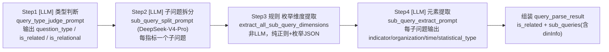
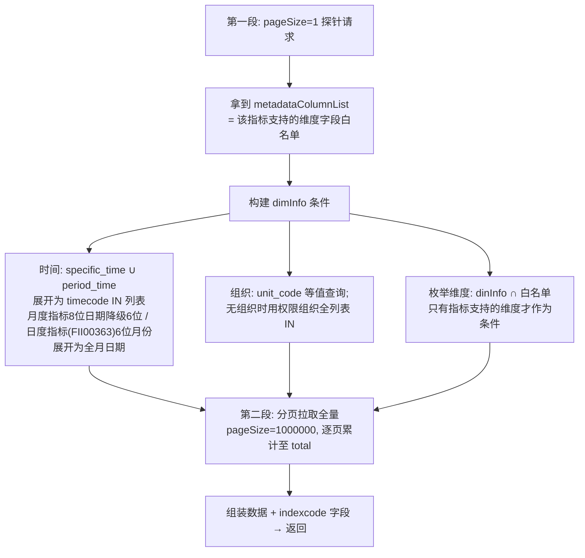
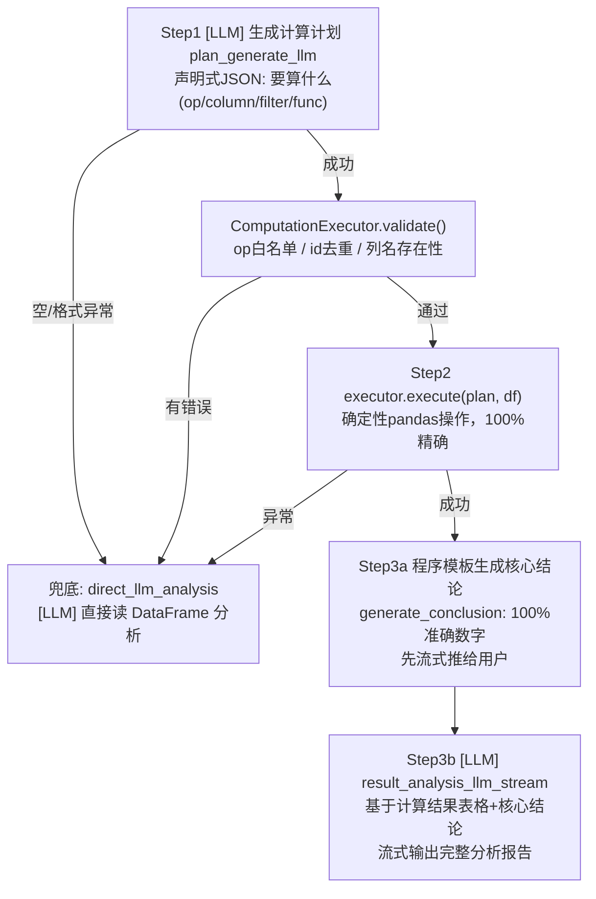

# 集团中台财务问数 — 对话接口全流程设计参考

> 回溯用方案文档。核心回答三个问题：对话接口的完整流程长什么样、每个环节（意图识别 / 检索 / 改写 / 历史上下文 / 取数 / 分析报告）具体怎么做的、为什么这么设计（对比与权衡）。
> 核对基线：分支 `feature/CD_V1.0.0_CD_SJZT_TEST_zjk`，runner.py 全文及 12 个下游模块已逐行核对。运维操作（环境地址、同步命令）见 `.trae/rules/集团中台财务.md`。

---

## 1. 系统定位与分层

**一句话**：面向集团财务中台（dam-api / dam-idx）的指标问数服务。核心设计立场是——**LLM 只负责「理解问题」和「解读结果」，实体对齐靠规则、数值计算靠可信执行器**，保证结论中的数字 100% 精确。

分层结构：

| 层 | 包 | 职责 |
|---|---|---|
| API 层 | `chatdata-app` | FastAPI 路由、SSE 封装、任务生命周期管理 |
| 业务编排层 | `chatdata-customize/chat_table` | 主流程 runner、QueryAgent、检索确认、取数、分析 |
| 算法层 | `chatdata-algorithm` | LLM 客户端、embedding、Milvus CRUD（通用能力） |
| 中台适配层 | `chatdata-adapter` | dam-api / dam-idx HTTP 封装（权限、指标数据） |

**代码地图**（主链路 12 个文件）：

| 文件 | 职责 |
|---|---|
| `chatdata-app/handle_table_chat/chat_table_server.py` | `POST /streamChat`（SSE）、`/choice`（用户选择回调）、`/announce/metadata_complete` |
| `chatdata-customize/.../analysis/runner.py` | **主流程编排**，入口 `generate_stream_with_choice()`（626 行） |
| `.../query_engine/query_complete.py` | 多轮上下文补全（LLM 指代消解） |
| `.../query_engine/get_caches_data.py` | 组织/指标/维度枚举元数据缓存 + 规则抽取（子串匹配） |
| `.../query_engine/query_agent.py` | LLM 四步解析流水线（类型判断→拆分→维度→元素） |
| `.../query_engine/{indicator,organization}_confirm.py` | 实体检索确认：子串匹配 → Milvus 混合检索兜底 |
| `.../analysis/extract_org_dimensions.py` | 枚举维度规则提取（省/市/区/行业） |
| `.../analysis/permission.py` | 中台权限拉取与校验 |
| `.../analysis/fetch_indicator_data.py` | dam-idx 两段式取数，组装数据 |
| `.../analysis/computation_executor.py` | 声明式计算计划的校验与可信执行 |
| `.../model/llm_model_utils.py` | 全部 LLM 调用封装（含 SseBuffer 流式修复） |
| `.../analysis/linkage_analyzer.py` | 联动分析（多子问题合并洞察） |
| `.../analysis/store.py` | 内存任务表：用户选择队列、metadata 就绪信号 |
| `chatdata-customize/.../dept_tree_manage/sync_orchestrate.py` | 组织数据同步（中台→金仓→Milvus） |

---

## 2. 总流程图

入口：`POST /streamChat` → `generate_stream_with_choice(request, message_id)`，全程 SSE 流式输出。`[LLM]` 为大模型调用点，其余多为规则/缓存操作。

```mermaid
flowchart TD
    Start(["POST /streamChat<br/>雪花ID生成 message_id，创建任务"]) --> Init["取 user_id / conversation_id<br/>设置日志上下文"]
    Init --> Hist{"有会话历史?"}
    Hist -->|"是"| H1["Redis 读历史 chatdata:conversation:*:history<br/>未命中 → 数据库兜底 → 回写 Redis (TTL 4h)"]
    H1 --> H2["[LLM] 上下文补全 complete_query<br/>指代消解改写，失败降级原问题"]
    Hist -->|"否"| Rel
    H2 --> Rel{"A对B 关系型查询?<br/>is_relational_query 纯规则"}
    Rel -->|"是"| Reject1["返回不支持，结束"]
    Rel -->|"否"| E1["规则抽取指标/组织<br/>extract_indexes_from_query<br/>extract_company_from_query"]
    E1 --> Perm["HTTP 拉 dam-api 用户权限<br/>组织权限 + 指标权限"]
    Perm --> P1{"抽取的实体都在权限内?"}
    P1 -->|"否"| Reject2["提示申请权限，结束"]
    P1 -->|"是"| OA{"组织精确命中?"}
    OA -->|"否"| OA1["权限组织列表 embedding<br/>余弦过滤 top50 (Redis 缓存 24h)"]
    OA -->|"是"| QA
    OA1 --> QA["[LLM] QueryAgent 四步流水线<br/>见 §4.3 详图"]

    subgraph QA_AGENT ["QueryAgent 解析（4次 LLM，逐个流式吐 thinking）"]
        QA --> Q1["Step1 [LLM] 类型判断<br/>simple/趋势/对比/排名 + is_related"]
        Q1 --> Q2["Step2 [LLM] 子问题拆分<br/>每指标一个子问题"]
        Q2 --> Q3["Step3 规则: 枚举维度提取<br/>遮蔽组织名→正则匹配省市区→扣除维度"]
        Q3 --> Q4["Step4 [LLM] 元素提取<br/>每子问题的指标/组织/时间"]
    end

    Q4 --> Loop["遍历子问题 i"]

    subgraph SUB ["每个子问题处理"]
        Loop --> S1{"指标检索"}
        S1 -->|"轮内/跨轮缓存命中"| S4
        S1 -->|"子串匹配唯一命中"| S4["得到标准指标 code+title"]
        S1 -->|"多候选/模糊"| S2["Milvus 混合检索<br/>(dense+sparse, 权限where过滤)"]
        S1 -->|"未命中"| S3["返回空候选 → 终止本子问题"]
        S2 --> S4
        S4 --> S5{"组织检索<br/>(排名类型/无组织跳过)"}
        S5 -->|"缓存命中/子串唯一"| S7
        S5 -->|"模糊"| S6["Milvus 混合检索<br/>sparse 1/4 + dense 3/4"]
        S6 --> S7
        S7{"need_choice?"}
        S7 -->|"是"| S8["SSE 推 need_choice 弹窗<br/>asyncio.Queue 等用户选择<br/>超时 360s 终止"]
        S7 -->|"否"| S9
        S8 --> S9["[LLM] 子问题改写 subquery_llm_refine<br/>融入标准指标/组织名"]
        S9 --> S10["等前端 POST /announce/metadata_complete<br/>(同一 sub_message_id)"]
        S10 --> S11["metadata_init 前端渲染骨架"]
        S11 --> S12["dam-idx 两段式取数<br/>先探维度白名单 → 交集过滤 → 分页拉取<br/>组装 DataFrame → 写 MinIO"]
        S12 --> S13["单子问题分析 stream_output_analysis<br/>见 §8 详图"]
    end

    S13 --> More{"还有子问题?"}
    More -->|"是"| Loop
    More -->|"否"| Rel2{"is_related=1?"}
    Rel2 -->|"是"| LA["联动分析 linkage_analyze_stream<br/>见 §8.3"]
    Rel2 -->|"否"| Cache
    LA --> Cache["本轮Q&A写 Redis history (TTL 4h)<br/>确认上下文写 prev_confirm (TTL 4h)"]
    Cache --> End(["回答完毕"])
    Reject1 --> End
    Reject2 --> End
```



---

## 3. 历史上下文与问题改写

**要解决的问题**：多轮对话里「那它的利润呢」这类省略/指代问题，必须先还原成自包含问题，后续的规则抽取和检索才有输入。

**实现**（`runner.py` 开头 + `query_complete.py`）：

1. **历史读取三级策略**：Redis `chatdata:conversation:{user_id}:{conversation_id}:history`（TTL 14400s）→ 未命中查数据库兜底 → 查到后回写 Redis。每级独立 try-except，任何一级失败只降级不中断。
2. **LLM 补全协议**：把 history + 新问题交给 `complete_query`，要求返回 JSON。返回带 `status` 字段：`status=0` 表示新问题本身自包含、不改写；`status=1` 才用 `new_query`。避免模型对无需补全的问题强行改写引入噪音。
3. **改写失败降级**：补全异常时直接用原始问题继续——补全是增强项，不是必需项。

**权衡**：用「补全后的 query」做后续所有抽取和检索，但**原始 query 也保留了一份**（`original_query`），用于跨轮组织复用的守门判断（§5.4）——因为补全层的组织文本不可信（§4.4）。

---

## 4. 意图识别：两层架构（本次设计的核心）

### 4.1 为什么不能把字典一次性塞给 LLM

组织字典（全称+简称）和指标字典各有数百上千条。若把全量字典放进 prompt 让 LLM 做实体对齐，一次调用的 token 就爆了，且长列表会显著降低抽取准确率。所以采用**两层架构**：

- **规则层（Python 代码）**：用 Redis 缓存的字典做子串匹配，零 token 成本完成大部分实体对齐，并把「精确命中的候选列表」作为缩小后的上下文喂给 LLM；
- **LLM 层**：只处理规则层解决不了的部分——问题类型、拆分、从自然语言里挑候选。

### 4.2 规则层：实体抽取（`get_caches_data.py`）

**组织抽取** `extract_company_from_query()`：
- 字典来自 Redis `chatdata:orgs_and_indicators:organizations`（源头是金仓 `ods_wenshu_dept`，含 unit_name 全称 + short_name 简称）；
- `_build_org_map()` 构建 `{名称: [{code, full}]}` 映射，简称字段支持逗号分隔和括号拆分（"中铝科学院（未来研究院）" → 两个 key）；
- 子串匹配后经 `_filter_substring_matches()` **剔除被更长项包含的短名**（"中铝" ⊂ "中铝集团" 时只留长名），防止重复和误命中。

**指标抽取** `extract_indexes_from_query()`：
- 第一层：全称+简称子串匹配（指标简称开关 `ENABLE_INDICATOR_ABBREVIATIONS` 当前为 False，仅全称）；
- 第二层兜底：指标名是三段式 `前缀_前缀_指标名` 格式，未命中时按 `_` 拆分取末段做模糊匹配，且**只保留「末段 → 唯一前缀」无歧义项**，歧义的直接放弃。

### 4.3 LLM 层：QueryAgent 四步流水线（`query_agent.py`）



设计要点：

- **逐小步多次调用而非一个大 prompt**：每步一个独立小 prompt，输出 JSON，失败各自兜底（Step1 失败→终止提示；Step2 失败→原问题作为单子问题兜底；Step4 失败→抛异常终止）。步间解耦，某一步的模型输出不会污染其他步。
- **规则夹在 LLM 步骤中间**（Step3）：拆分后再提取维度，是因为维度要在**子问题粒度**上提取（每个子问题可能命中不同省市）。
- **组织遮蔽防误切**：Step3 提取维度前先把已知组织名替换成占位符（`ORGPH0Z`），防止"中国铜业"里的"中国"被当成地区维度切走；提取后再还原。还有一层 `_is_org_name_fragment()` 防御：若维度值 + 后续中文构成某组织名的前缀，则跳过提取。
- **关系型拦截双保险**：runner 里的 `is_relational_query()`（纯规则：两个组织名之间恰好隔一个"对"字）在进 LLM 前拦截；QueryAgent Step1 的 `is_relational` 再拦一次。

### 4.4 为什么信规则不信补全层的组织文本

多轮补全用的是降级模型，产出的组织文本会丢字/幻觉。跨轮组织复用（§5.4）因此规定：**代词/省略轮直接复用 Redis 里"最近一次真正确认到的组织"（`last_confirmed_org` 单值），完全不依赖补全层写出的组织文本**。判断是否处于"代词轮"的守门条件是：原始问题（补全前）里没有任何规则抽取到的组织词。这是整套多轮设计里最关键的一条防串扰规则。

---

## 5. 检索与实体对齐

### 5.1 检索三级策略（指标与组织逻辑对称，`indicator_confirm.py` / `organization_confirm.py`）

| 级 | 手段 | 命中条件 | 成本 |
|---|---|---|---|
| 0 | 缓存复用 | 轮内 `previous_organization` / 跨轮 `previous_indicator`、`last_confirmed_org` | 零 |
| 1 | 子串匹配（字典） | 全称子串命中、简称精确等值；按名称长度降序只保留最长匹配组 | 零 token |
| 2 | Milvus 混合检索 | dense+sparse 向量，权限 where 过滤，top_k + 阈值 | 一次 embedding + 检索 |

**子串匹配细节**：候选先按权限过滤（`code in permission_*`），再按名称长度排序取最长组——"营业收入"和"营业收入增长率"同时是子串时，只看更长的那个。唯一命中 → 直接确认；多命中 → 转用户选择；命中但全无权限 → 返回空候选（终止）。

**Milvus 检索细节**：
- 指标：集合 `METRIC_METADATA`，`INDEX_TOPK=10`；
- 组织：集合 `DEPT_TREE`，`ORGANIZATION_TOPK=200`，混合权重 `w=[1/4, 3/4]`（sparse 1/4，dense 3/4，即语义相似为主、关键词兜底）；
- `SEARCH_THRESHOLD=0.0001`（形同虚设，实际靠 top_k 截断）；
- 两个集合都在**同步时就把权限无关数据排除在写入范围之外**，检索时再叠一层 `where unit_code/zbcode in 权限列表` 双保险。

### 5.2 检索结果的出口：三级分支

```
唯一命中 → {"confirm": False, "confirmed": {code: title}}   直接用
多候选   → {"confirm": True, "to_be_confirm": [候选...]}     弹窗让用户选
零命中   → {"confirm": True, "to_be_confirm": []}            终止本子问题
```

### 5.3 组织未精确命中的 LLM 兜底

进入 QueryAgent 前，若规则层没抽出组织，就把**权限范围内的组织列表**给 LLM 参考。列表过大时用 embedding 余弦相似度过滤到 top50（`filter_orgs_by_embedding()`）：组织名 embedding 按列表 MD5 做 key 缓存 Redis（TTL 24h，相同权限组共享），计算失败降级为直接截断前 50。

### 5.4 多轮确认上下文（三层，防串扰设计）

| 层 | 载体 | 生命周期 | 用途 |
|---|---|---|---|
| 轮内缓存 | 局部变量 `previous_organization` | 单次问答内 | 同一大问题的子问题间复用 |
| 跨轮指标/板块映射 | Redis `prev_confirm` | TTL 4h | 下轮相同指标直接复用确认结果 |
| 跨轮组织单值 | `last_confirmed_org` | TTL 4h | 代词/省略轮复用；**只在真正确认到组织时更新**（清空场景不覆盖） |

---

## 6. 元数据与数据同步：三条数据链路

### 6.1 组织主数据同步（离线脚本 `dept_tree_manage/sync_orchestrate.py`）

```
拉取数据中台组织树 (fetch_from_middleware)
  ↔ 拉取金仓 ods_wenshu_dept (fetch_from_kingbase)
→ 差集计算 (diff_middle_vs_kingbase：按 source_sync_md5 判定增/改/删)
→ 标准化 (normalize_level_path：层级路径 path_code/path_name)
→ 三段批量落库：金仓 DELETE/UPDATE/INSERT 成功后，同步执行 Milvus DEPT_TREE 的 delete/update/insert
```

要点：**金仓是权威副本，Milvus 是检索投影**，写金仓成功才写 Milvus；`source_sync_md5` 让增量同步幂等（重跑无副作用）。新加字段后靠 MD5 变化自动触发重建向量（rules 文档确认）。

### 6.2 运行时元数据缓存（`init_data_caches()`，配置驱动）

| key | 来源 | 刷新 |
|---|---|---|
| `organizations` | 金仓 ods_wenshu_dept | 手动脚本 refresh_org_cache.py 强刷 |
| `indicators` | 金仓 metric_metadata | refresh_ttl=1min |
| `dimension_enums` | 本地 JSON（省/市/区/县/自治州/行业枚举） | 随包分发 |
| `plate_enums` | 本地 JSON（板块-管理口径映射） | 随包分发 |

统一入口：Redis 优先 → 未命中走 `_LOADERS` 派发表（kingbase/json 可插拔）→ 回写 Redis。**读取端语义自行解析**（如 `_build_org_map` 拆简称），缓存层不做业务转换——缓存格式稳定，业务逻辑改动不用动缓存。

### 6.3 中台权限（在线拉取，不缓存）

每次请求 HTTP 调 dam-api 拉组织权限 + 指标权限（`obtain_user_permissions()`），去重成 code/name 四个列表。**不缓存的原因**：权限变更要求实时生效，且单次调用成本低。权限在两个位置使用：入口处拦截（§2 的 P1 节点）+ 检索时 where 过滤。

---

## 7. 取数：dam-idx 两段式（`fetch_indicator_data.py`）



设计要点：

- **先探后查**：中台不同指标支持的维度字段不同，先花一次 pageSize=1 的请求换回维度白名单，避免用不存在的维度查询报错。探针结果里的 unitcode 缺失直接判为该指标不可查。
- **时间格式适配是纯代码规则**：月度指标把 "2025年3月15日" 这类8位日期降级为6位 yyyymm（否则查不到数据）；日度指标（白名单 `DAILY_TIMECODE_INDICATORS`）反向把月份展开为全月日期列表（含闰年）。
- **分页拉取**：`fetch_data()` 循环翻页（上限 1000 页），空页提前停。

---

## 8. 分析报告生成（数值精确性的核心保障）

### 8.1 设计立场：LLM 不许算数

直接把 DataFrame 塞给 LLM 让它"读数写报告"，数字必然偶发幻觉（长数字截断、算错同比）。本项目把「算」和「说」拆开：**算**交给确定性代码，**说**才交给 LLM。

### 8.2 单子问题分析：计算计划三步路径（`stream_output_analysis()`）



**计算计划的设计**（`computation_executor.py`）：

- LLM 输出的不是代码，是**声明式 JSON**：`{id, op, column, filter(s), func, time_col, ...}`。`op` 有白名单（`VALID_OPS`：agg/group_compare/rank/yoy/mom 等确定性操作），每 op 对应一个 `_exec_{op}` 方法；
- **为什么声明式而不是生成代码**：声明式可静态校验（列名、op、id），执行是封闭的 pandas 方法集，没有代码注入面、没有执行超时问题；代价是表达力受限——复杂跨表洞察覆盖不了，所以联动大数据场景才用代码生成（§8.3）；
- **单位感知格式化**：执行器从 DataFrame 的「指标单位」列检测原始单位，"比率"类指标自动 ×100 转百分比（`_fmt_ratio_x100`），其余走亿/万/元自动格式化——结论模板的数字格式由代码保证；
- **核心结论先于 LLM 报告输出**：程序模板拼的核心结论（纯精确数字）先 yield 给用户，LLM 报告紧随其后。即使 LLM 报告部分出问题，精确数字已经到达用户。

**流式传输的一个隐蔽坑**（`SseBuffer`，`llm_model_utils.py`）：httpx 的 `aiter_text()` 不保证 SSE 事件边界对齐，跨 chunk 切割时 `\n\n` 被劈开会导致内容**静默丢弃**——曾导致报告里 "32.16" 变 "32."、"2025年" 变 "202年"。解法是 `SseBuffer` 累积拼接后按 `\n\n` 切分再输出。所有流式 LLM 调用都经 `_stream_with_buffer()` 包裹。

### 8.3 联动分析：按数据量分流（`linkage_analyzer.py`）

联动问题（is_related=1，如"A 和 B 哪个增长快"）在所有子问题取数完成后触发：

| 分支 | 条件 | 路径 |
|---|---|---|
| 小数据 | `df_merge.shape[0] < DATAFRAME_LENGTH` (1000) | 全量 DataFrame 转 CSV 直接给 LLM 流式出结论 |
| 大数据 | ≥ 1000 行 | `[LLM] 生成 pandas 聚合代码 → 子进程沙箱执行 → 压缩为统计结果 → [LLM] 基于结果出结论` |

**大数据走"生成代码"而非"计算计划"**：联动是跨指标对比洞察，声明式计划的表达力不够。生成代码在 `execute_in_subprocess()` 沙箱执行——独立子进程、内存上限 200MB、CPU 30s、墙钟 35s，df 经 pickle 传入，取回 `analysis_result` 变量。代码生成的安全/资源风险用沙箱隔离兜底。

**问题重构**：联动分析前把原问题里的口语化指标/组织名做字符串替换为标准全称（`replace_info` 在子问题循环里累积），保证 LLM 看到的问题与数据一致。

### 8.4 模型分工速查

| 环节 | 模型 | 形态 |
|---|---|---|
| 上下文补全 | 默认（qwen32b 级） | 一次性 JSON |
| 类型判断 / 元素提取 | DeepSeek-V4-Pro | 一次性 JSON |
| 子问题拆分 | DeepSeek-V4-Pro | 一次性 JSON |
| 子问题改写 | 默认 | 一次性纯文本 |
| 计算计划生成 | DeepSeek-V4-Pro | 一次性 JSON（超时 30/60/90s） |
| 分析报告 / 联动结论 | DeepSeek-V4-Pro | 流式（首帧 15s / 单模型 200s / 总 500s） |

---

## 9. 交互机制：SSE 协议与两个"挂起-唤醒"点

**SSE 事件协议**（`chat_table_server.py` 封装，runner 内 yield）：

| event | 含义 |
|---|---|
| `message` | 正文/思考过程/进度提示，直接渲染 |
| `thinking` | QueryAgent 的过程提示（"正在拆分子问题..."） |
| `sub_query` | 子问题开始（携带 sub_message_id = 父ID+索引） |
| `choice_mark` | 本子问题是否需要用户选择 |
| `need_choice` | 弹窗数据：指标/组织/板块候选 |
| `linkage_analysis` | 联动分析正文（前端分区渲染） |
| `end_point` | 结束信号；`finally` 兜底再发一次并清理任务 |
| `error` | 已知异常的用户提示 |

**挂起点 1 — 用户选择**：多候选时 runner 把任务置 `waiting`，SSE 流不关闭，`await queue.get()` 挂起；用户点选后前端 `POST /choice` 把选项 put 进 `task_store` 的队列（`choice.message_id` 去掉末位索引还原父 ID），协程唤醒继续。超时 360s（`USER_CHOICES_TIMEOUT`）终止；`CancelledError`（客户端断开）重新上抛，交给 API 层 finally 清理。

**挂起点 2 — 元数据就绪**：改写后的子问题先推给前端，前端渲染完元数据骨架后 `POST /announce/metadata_complete`（带同一 sub_message_id），runner 的 `wait_metadata_complete()` 被唤醒才 metadata_init + 取数。**保证前端展示顺序与数据流对齐**。队列 maxsize=1、消费后即回收，防止字典膨胀。

**任务存储是内存单机实现**（`TaskStore` 字典 + Queue）——多实例部署需外置，当前规模单机够用（明确的边界而非疏忽）。

---

## 10. 设计决策速查表

| 决策点 | 业界常见做法 | 本项目选择 | 为什么 |
|---|---|---|---|
| 实体对齐 | 全量 schema/dict 塞 prompt 让 LLM 对齐 | 规则子串匹配优先，LLM 只拿缩小后的候选 | 字典太长塞不下且准确率反而降；规则零成本可解释 |
| 意图/拆分 | 单个大 prompt 一次输出全部 | 4 小步流水线，规则夹中间 | 步间解耦、各自兜底、维度可在子问题粒度精确提取 |
| 数值计算 | LLM 直接读数据算 / 生成代码算 | 声明式计算计划 + 可信执行器 | 可静态校验、无注入面、数字 100% 准；表达力不足由联动代码生成补 |
| 多候选歧义 | LLM 自选 / 返回列表让用户下轮再说 | asyncio.Queue 挂起 + 弹窗同步选择 | 一次交互解决，不拖轮次；SSE 流不断 |
| 联动大数据 | 全给 LLM / 全走预置指标 | 生成 pandas 代码 + 子进程沙箱 | 表达力够，资源与安全用沙箱兜底 |
| 元数据缓存 | 每请求查库 / 定时全量刷新 | Redis 缓存 + 派发型 loader + 手动/配置刷新 | 读多写少；格式与业务解耦 |
| 组织同步 | 每次全量重建 | MD5 差集增量 + 金仓权威/Milvus 投影 | 幂等可重跑，避免高频重建向量 |
| 多轮组织复用 | 信 LLM 补全的改写结果 | 只信"最近一次真正确认的组织" | 降级模型补全会丢字/幻觉，串扰是线上事故源 |
| 任务状态 | Redis/DB 持久化 | 内存单机 | 当前单实例规模；多实例需改造（已知边界） |

---

## 11. 兜底与降级清单

| 环节 | 失败行为 |
|---|---|
| Redis 读历史 | 数据库兜底；DB 也失败则当无历史 |
| 上下文补全 | 降级用原始问题 |
| 规则抽取异常 | 返回空列表，流程继续 |
| 权限获取 | 提示中台不可用，终止 |
| QueryAgent Step1 失败 | 终止提示（不猜默认值继续） |
| Step2 拆分失败 | 原问题作为单子问题兜底 |
| 子问题改写失败 | 降级用原始子问题，不中断 |
| 检索子串匹配异常 | 降级 Milvus |
| 组织 embedding 过滤失败 | 截断前 50 个 |
| 用户选择 | 超时 360s 终止；断连上抛清理 |
| 计算计划三步任一步失败 | 回退 `direct_llm_analysis` 直接分析 |
| 取数失败 | 提示后 continue 下一个子问题 |
| 联动分析失败 | 结论写库 `⚠️msg` 并终止 |
| LLM 流式跨 chunk 截断 | SseBuffer 累积拼接修复（根治） |
